# Agency — Sequence diagrams (41 features)

Sequence diagram for each Agency partner portal feature, following the monolith architecture prompt (User → Frontend → Server → App → Routes → Middlewares → Controller → Service → DAO → Database).

- Source of truth: [`sequence/`](./sequence/) — every `.mmd` is plain Mermaid, paste it straight into draw.io (no code fence).
- This file is only a reading copy: every ```mermaid block is byte-identical to its `.mmd`, plus the fence needed to render.
- Rebuild: `python3 docs/agency/build_sequence_doc.py`.

## Conventions

- `DAO` is the real data-access layer: `<module>.repository.ts` where the module has a repository, otherwise the Prisma client called directly from the service (agencies, users, dashboards).
- `Server`/`App` map to `backend/src/server.ts` and `backend/src/app.ts`; every route lives under `/api/v1`.
- Arrow numbers are written by hand (the prompt sets `showSequenceNumbers: false`), one increasing number per arrow.
- Every file pins the same colours: `base` theme with black-on-white `themeVariables`, so the diagram is monochrome in Mermaid Live, GitHub and draw.io.
- `alt`/`else` branches cover both the success and the failure path; error codes come from the backend's real `AppError`.

## Index

| Section | Feature | File |
| --- | --- | --- |
| 3.2.1 | Select workplace | [`3.2.1-chon-noi-lam-viec.mmd`](./sequence/3.2.1-chon-noi-lam-viec.mmd) |
| 3.2.2 | Accept invitation | [`3.2.2-nhan-loi-moi.mmd`](./sequence/3.2.2-nhan-loi-moi.mmd) |
| 3.3.1 | Dashboard | [`3.3.1-bang-dieu-khien.mmd`](./sequence/3.3.1-bang-dieu-khien.mmd) |
| 3.4.1 | Tour list | [`3.4.1-danh-sach-tour.mmd`](./sequence/3.4.1-danh-sach-tour.mmd) |
| 3.4.2 | Create tour | [`3.4.2-tao-tour.mmd`](./sequence/3.4.2-tao-tour.mmd) |
| 3.4.3 | Tour detail & edit | [`3.4.3-chi-tiet-chinh-sua-tour.mmd`](./sequence/3.4.3-chi-tiet-chinh-sua-tour.mmd) |
| 3.4.4 | Archive & restore tour | [`3.4.4-luu-tru-khoi-phuc-tour.mmd`](./sequence/3.4.4-luu-tru-khoi-phuc-tour.mmd) |
| 3.4.5 | Import tours | [`3.4.5-import-tour.mmd`](./sequence/3.4.5-import-tour.mmd) |
| 3.5.1 | Departure calendar | [`3.5.1-lich-khoi-hanh.mmd`](./sequence/3.5.1-lich-khoi-hanh.mmd) |
| 3.6.1 | Booking list & detail | [`3.6.1-danh-sach-booking.mmd`](./sequence/3.6.1-danh-sach-booking.mmd) |
| 3.6.2 | Export customer list PDF | [`3.6.2-xuat-pdf-danh-sach-khach.mmd`](./sequence/3.6.2-xuat-pdf-danh-sach-khach.mmd) |
| 3.7.1 | Assigned tour content | [`3.7.1-noi-dung-tour-duoc-giao.mmd`](./sequence/3.7.1-noi-dung-tour-duoc-giao.mmd) |
| 3.7.2 | Booking tracking | [`3.7.2-theo-doi-booking.mmd`](./sequence/3.7.2-theo-doi-booking.mmd) |
| 3.7.3 | Read-only tour detail | [`3.7.3-chi-tiet-tour-readonly.mmd`](./sequence/3.7.3-chi-tiet-tour-readonly.mmd) |
| 3.8.1 | Members | [`3.8.1-thanh-vien.mmd`](./sequence/3.8.1-thanh-vien.mmd) |
| 3.8.2 | Member invitations | [`3.8.2-loi-moi-thanh-vien.mmd`](./sequence/3.8.2-loi-moi-thanh-vien.mmd) |
| 3.8.3 | Join requests | [`3.8.3-yeu-cau-tham-gia.mmd`](./sequence/3.8.3-yeu-cau-tham-gia.mmd) |
| 3.8.4 | Custom roles & permission matrix | [`3.8.4-role-va-ma-tran-quyen.mmd`](./sequence/3.8.4-role-va-ma-tran-quyen.mmd) |
| 3.9.1 | Voucher list & creation | [`3.9.1-voucher-danh-sach-tao.mmd`](./sequence/3.9.1-voucher-danh-sach-tao.mmd) |
| 3.9.2 | Single-use code batch | [`3.9.2-batch-ma-dung-mot-lan.mmd`](./sequence/3.9.2-batch-ma-dung-mot-lan.mmd) |
| 3.10.1 | Complaint list & conversation | [`3.10.1-khieu-nai-danh-sach-hoi-thoai.mmd`](./sequence/3.10.1-khieu-nai-danh-sach-hoi-thoai.mmd) |
| 3.10.2 | Complaint handling flow | [`3.10.2-quy-trinh-xu-ly-khieu-nai.mmd`](./sequence/3.10.2-quy-trinh-xu-ly-khieu-nai.mmd) |
| 3.11.1 | Review list | [`3.11.1-danh-sach-danh-gia.mmd`](./sequence/3.11.1-danh-sach-danh-gia.mmd) |
| 3.11.2 | Review dispute | [`3.11.2-phan-anh-danh-gia.mmd`](./sequence/3.11.2-phan-anh-danh-gia.mmd) |
| 3.12.1 | Custom tour request list | [`3.12.1-yeu-cau-doan-danh-sach.mmd`](./sequence/3.12.1-yeu-cau-doan-danh-sach.mmd) |
| 3.12.2 | Custom request chat & agreement | [`3.12.2-yeu-cau-doan-chat-thoa-thuan.mmd`](./sequence/3.12.2-yeu-cau-doan-chat-thoa-thuan.mmd) |
| 3.13.1 | Shared inbox | [`3.13.1-hop-thu-chung.mmd`](./sequence/3.13.1-hop-thu-chung.mmd) |
| 3.13.2 | Conversation & reply | [`3.13.2-hoi-thoai-tra-loi.mmd`](./sequence/3.13.2-hoi-thoai-tra-loi.mmd) |
| 3.13.3 | Chat permissions & isolation | [`3.13.3-phan-quyen-cach-ly-chat.mmd`](./sequence/3.13.3-phan-quyen-cach-ly-chat.mmd) |
| 3.14.1 | Commission overview | [`3.14.1-tong-quan-chiet-khau.mmd`](./sequence/3.14.1-tong-quan-chiet-khau.mmd) |
| 3.14.2 | Submit & cancel commission request | [`3.14.2-gui-huy-yeu-cau-chiet-khau.mmd`](./sequence/3.14.2-gui-huy-yeu-cau-chiet-khau.mmd) |
| 3.14.3 | Approve commission request | [`3.14.3-duyet-yeu-cau-chiet-khau.mmd`](./sequence/3.14.3-duyet-yeu-cau-chiet-khau.mmd) |
| 3.14.4 | New commission rate applied | [`3.14.4-muc-chiet-khau-moi-ap-dung.mmd`](./sequence/3.14.4-muc-chiet-khau-moi-ap-dung.mmd) |
| 3.15.1 | Premium plan management | [`3.15.1-quan-ly-goi-premium.mmd`](./sequence/3.15.1-quan-ly-goi-premium.mmd) |
| 3.15.2 | Contribution & refund | [`3.15.2-dong-gop-hoan-tien.mmd`](./sequence/3.15.2-dong-gop-hoan-tien.mmd) |
| 3.16.1 | Notifications | [`3.16.1-thong-bao.mmd`](./sequence/3.16.1-thong-bao.mmd) |
| 3.16.2 | Business profile | [`3.16.2-ho-so-doanh-nghiep.mmd`](./sequence/3.16.2-ho-so-doanh-nghiep.mmd) |
| 3.17.1 | Unverified agency | [`3.17.1-doanh-nghiep-chua-xac-minh.mmd`](./sequence/3.17.1-doanh-nghiep-chua-xac-minh.mmd) |
| 3.17.2 | Locked member | [`3.17.2-thanh-vien-bi-khoa.mmd`](./sequence/3.17.2-thanh-vien-bi-khoa.mmd) |
| 3.17.3 | Separate login portal | [`3.17.3-tach-cong-dang-nhap.mmd`](./sequence/3.17.3-tach-cong-dang-nhap.mmd) |
| 3.17.4 | Agency data isolation | [`3.17.4-cach-ly-du-lieu-giua-agency.mmd`](./sequence/3.17.4-cach-ly-du-lieu-giua-agency.mmd) |

## 3.2.1 Select workplace

File: [`sequence/3.2.1-chon-noi-lam-viec.mmd`](./sequence/3.2.1-chon-noi-lam-viec.mmd)

```mermaid
%%{init: {
  "theme": "base",
  "themeVariables": {
    "background": "#ffffff",
    "primaryColor": "#ffffff",
    "primaryTextColor": "#000000",
    "primaryBorderColor": "#000000",
    "secondaryColor": "#ffffff",
    "tertiaryColor": "#ffffff",
    "lineColor": "#000000",
    "textColor": "#000000",
    "actorBkg": "#ffffff",
    "actorBorder": "#000000",
    "actorTextColor": "#000000",
    "actorLineColor": "#000000",
    "signalColor": "#000000",
    "signalTextColor": "#000000",
    "activationBkgColor": "#ffffff",
    "activationBorderColor": "#000000",
    "noteBkgColor": "#ffffff",
    "noteBorderColor": "#000000",
    "noteTextColor": "#000000",
    "labelBoxBkgColor": "#ffffff",
    "labelBoxBorderColor": "#000000",
    "labelTextColor": "#000000",
    "loopTextColor": "#000000",
    "sequenceNumberColor": "#000000"
  },
  "sequence": {
    "mirrorActors": false,
    "showSequenceNumbers": false,
    "useMaxWidth": true,
    "curve": "linear"
  }
}}%%
sequenceDiagram
    actor User
    participant Frontend
    participant Server as server.ts
    participant App as app.ts
    participant Route as Routes
    participant Middlewares
    participant Controller
    participant Service
    participant DAO
    participant Database

    User->>Frontend: 1. Open /workplaces after sign-in
    activate Frontend
    Frontend->>Server: 2. GET /api/v1/users/me/agencies
    activate Server
    Server->>App: 3. createApp() handles the request (helmet, cors, json, authenticate)
    activate App
    App->>Route: 4. apiRouter.use('/users', agencyIdentityRouter)
    activate Route
    Route->>Middlewares: 5. authenticate -> validate(empty query)
    activate Middlewares
    alt No token / token expired
        Middlewares-->>Frontend: 6. 401 UNAUTHORIZED
        Frontend-->>User: 7. Redirect to /login
    else Valid token
        Middlewares-->>Route: 8. next() with req.actor
        deactivate Middlewares
        Route->>Controller: 9. handler(req, res) - inline controller of agencyIdentityRouter
        activate Controller
        Controller->>Service: 10. agencyService.listForUser(userId)
        activate Service
        Service->>DAO: 11. prisma.agencyMember.findMany(status ACTIVE, with role + permissions)
        activate DAO
        DAO->>Database: 12. SELECT "AgencyMember" JOIN "AgencyProfile", "AgencyRole"
        activate Database
        Database-->>DAO: 13. Membership list
        deactivate Database
        DAO-->>Service: 14. Membership rows
        deactivate DAO
        Service-->>Controller: 15. [{ agencyId, memberRole, permissions }]
        deactivate Service
        Controller-->>Frontend: 16. 200 OK + workplace list
        deactivate Controller
        Frontend-->>User: 17. Render the list to pick an agency
        deactivate Frontend
        deactivate Route
        deactivate App
        deactivate Server
    end
```

## 3.2.2 Accept invitation

File: [`sequence/3.2.2-nhan-loi-moi.mmd`](./sequence/3.2.2-nhan-loi-moi.mmd)

```mermaid
%%{init: {
  "theme": "base",
  "themeVariables": {
    "background": "#ffffff",
    "primaryColor": "#ffffff",
    "primaryTextColor": "#000000",
    "primaryBorderColor": "#000000",
    "secondaryColor": "#ffffff",
    "tertiaryColor": "#ffffff",
    "lineColor": "#000000",
    "textColor": "#000000",
    "actorBkg": "#ffffff",
    "actorBorder": "#000000",
    "actorTextColor": "#000000",
    "actorLineColor": "#000000",
    "signalColor": "#000000",
    "signalTextColor": "#000000",
    "activationBkgColor": "#ffffff",
    "activationBorderColor": "#000000",
    "noteBkgColor": "#ffffff",
    "noteBorderColor": "#000000",
    "noteTextColor": "#000000",
    "labelBoxBkgColor": "#ffffff",
    "labelBoxBorderColor": "#000000",
    "labelTextColor": "#000000",
    "loopTextColor": "#000000",
    "sequenceNumberColor": "#000000"
  },
  "sequence": {
    "mirrorActors": false,
    "showSequenceNumbers": false,
    "useMaxWidth": true,
    "curve": "linear"
  }
}}%%
sequenceDiagram
    actor User
    participant Frontend
    participant Server as server.ts
    participant App as app.ts
    participant Route as Routes
    participant Middlewares
    participant Controller
    participant Service
    participant DAO
    participant Database

    User->>Frontend: 1. Click "Join" on an invitation
    activate Frontend
    Frontend->>Server: 2. POST /api/v1/agency-invitations/{id}/accept
    activate Server
    Server->>App: 3. createApp() handles the request
    activate App
    App->>Route: 4. apiRouter.use('/agency-invitations', agencyInvitationAcceptanceRouter)
    activate Route
    Route->>Middlewares: 5. requireAuth -> rateLimit 30/15' -> validate(params)
    activate Middlewares
    alt Not signed in / malformed id
        Middlewares-->>Frontend: 6. 401 UNAUTHORIZED
    else Valid
        Middlewares-->>Route: 7. next()
        deactivate Middlewares
        Route->>Controller: 8. handler(req, res) - inline controller
        activate Controller
        Controller->>Service: 9. agencyService.acceptById(userId, invitationId)
        activate Service
        Service->>DAO: 10. acceptInvitation() inside prisma.$transaction
        activate DAO
        DAO->>Database: 11. Lock "AgencyProfile" FOR UPDATE, re-read "User", "AgencyInvitation"
        activate Database
        Database-->>DAO: 12. inviter, role, invitation status
        deactivate Database
        alt User verified + invitation still PENDING
            DAO->>Database: 13. INSERT "AgencyMember", close "AgencyJoinRequest", bump "AgencyProfile.permissionVersion", write "AuditLog"
            activate Database
            Database-->>DAO: 14. new membership
            deactivate Database
            DAO-->>Service: 15. AgencyMember
            Service-->>Controller: 16. { invitationId, agencyId, memberId }
            Controller-->>Frontend: 17. 200 OK
            Frontend-->>User: 18. Redirect to /agency of the agency just joined
        else Invitation expired / revoked / already handled, or email unverified
            DAO-->>Service: 19. AppError 409 CONFLICT
            deactivate DAO
            Service-->>Controller: 20. 409 "Invitation expired, revoked or already handled"
            deactivate Service
            Controller-->>Frontend: 21. 409 with the message
            deactivate Controller
            Frontend-->>User: 22. Show the error and reload the invitation list
            deactivate Frontend
        end
        deactivate Route
        deactivate App
        deactivate Server
    end
```

## 3.3.1 Dashboard

File: [`sequence/3.3.1-bang-dieu-khien.mmd`](./sequence/3.3.1-bang-dieu-khien.mmd)

```mermaid
%%{init: {
  "theme": "base",
  "themeVariables": {
    "background": "#ffffff",
    "primaryColor": "#ffffff",
    "primaryTextColor": "#000000",
    "primaryBorderColor": "#000000",
    "secondaryColor": "#ffffff",
    "tertiaryColor": "#ffffff",
    "lineColor": "#000000",
    "textColor": "#000000",
    "actorBkg": "#ffffff",
    "actorBorder": "#000000",
    "actorTextColor": "#000000",
    "actorLineColor": "#000000",
    "signalColor": "#000000",
    "signalTextColor": "#000000",
    "activationBkgColor": "#ffffff",
    "activationBorderColor": "#000000",
    "noteBkgColor": "#ffffff",
    "noteBorderColor": "#000000",
    "noteTextColor": "#000000",
    "labelBoxBkgColor": "#ffffff",
    "labelBoxBorderColor": "#000000",
    "labelTextColor": "#000000",
    "loopTextColor": "#000000",
    "sequenceNumberColor": "#000000"
  },
  "sequence": {
    "mirrorActors": false,
    "showSequenceNumbers": false,
    "useMaxWidth": true,
    "curve": "linear"
  }
}}%%
sequenceDiagram
    actor User
    participant Frontend
    participant Server as server.ts
    participant App as app.ts
    participant Route as Routes
    participant Middlewares
    participant Controller
    participant Service
    participant DAO
    participant Database

    User->>Frontend: 1. Open /agency (agency overview)
    activate Frontend
    Frontend->>Server: 2. GET /api/v1/agency/dashboard
    activate Server
    Server->>App: 3. createApp() handles the request
    activate App
    App->>Route: 4. apiRouter.use('/agency/dashboard', resolveAgencyContext, requireVerifiedAgency, agencyDashboardRouter)
    activate Route
    Route->>Middlewares: 5. resolveAgencyContext -> requireVerifiedAgency -> requirePermission(agency:dashboard)
    activate Middlewares
    alt Agency not VERIFIED or missing permission
        Middlewares-->>Frontend: 6. 403 FORBIDDEN
    else Valid
        Middlewares-->>Route: 7. next() with req.agencyContext
        deactivate Middlewares
        Route->>Controller: 8. dashboardsController.agency(req, res)
        activate Controller
        Controller->>Service: 9. dashboardsService.agencyDashboard(agencyId)
        activate Service
        Service->>DAO: 10. agencyCache.getOrCompute(agencyId) -> bookings.getAgencyStats, tours.countByStatus, reports.countOpenForAgency
        activate DAO
        DAO->>Database: 11. Aggregate "Booking" (revenue, top tour), "Tour" (status), "Report" (open complaints)
        activate Database
        Database-->>DAO: 12. Aggregated result per agencyId
        deactivate Database
        DAO-->>Service: 13. stats + tourCounts + openComplaints
        deactivate DAO
        Service-->>Controller: 14. AgencyDashboardDto (cache TTL)
        deactivate Service
        Controller-->>Frontend: 15. 200 OK + KPIs, chart, top tours
        deactivate Controller
        Frontend-->>User: 16. Render the dashboard, switch 7/30 day, 6 month period
        deactivate Frontend
        deactivate Route
        deactivate App
        deactivate Server
    end
```

## 3.4.1 Tour list

File: [`sequence/3.4.1-danh-sach-tour.mmd`](./sequence/3.4.1-danh-sach-tour.mmd)

```mermaid
%%{init: {
  "theme": "base",
  "themeVariables": {
    "background": "#ffffff",
    "primaryColor": "#ffffff",
    "primaryTextColor": "#000000",
    "primaryBorderColor": "#000000",
    "secondaryColor": "#ffffff",
    "tertiaryColor": "#ffffff",
    "lineColor": "#000000",
    "textColor": "#000000",
    "actorBkg": "#ffffff",
    "actorBorder": "#000000",
    "actorTextColor": "#000000",
    "actorLineColor": "#000000",
    "signalColor": "#000000",
    "signalTextColor": "#000000",
    "activationBkgColor": "#ffffff",
    "activationBorderColor": "#000000",
    "noteBkgColor": "#ffffff",
    "noteBorderColor": "#000000",
    "noteTextColor": "#000000",
    "labelBoxBkgColor": "#ffffff",
    "labelBoxBorderColor": "#000000",
    "labelTextColor": "#000000",
    "loopTextColor": "#000000",
    "sequenceNumberColor": "#000000"
  },
  "sequence": {
    "mirrorActors": false,
    "showSequenceNumbers": false,
    "useMaxWidth": true,
    "curve": "linear"
  }
}}%%
sequenceDiagram
    actor User
    participant Frontend
    participant Server as server.ts
    participant App as app.ts
    participant Route as Routes
    participant Middlewares
    participant Controller
    participant Service
    participant DAO
    participant Database

    User->>Frontend: 1. Open /agency/tours, pick a status + search
    activate Frontend
    Frontend->>Server: 2. GET /api/v1/agency/tours?page=1&limit=20&status=DRAFT&q=...
    activate Server
    Server->>App: 3. createApp() handles the request
    activate App
    App->>Route: 4. apiRouter.use('/agency/tours', resolveAgencyContext, requireVerifiedAgency, agencyToursRouter)
    activate Route
    Route->>Middlewares: 5. resolveAgencyContext -> requireVerifiedAgency -> requireAgencyPermission(agency:tour-view) -> validate(query)
    activate Middlewares
    alt Malformed query
        Middlewares-->>Frontend: 6. 400 VALIDATION_ERROR
    else Valid
        Middlewares-->>Route: 7. next()
        deactivate Middlewares
        Route->>Controller: 8. toursController.listOwn(req, res)
        activate Controller
        Controller->>Service: 9. toursService.listOwn(agencyId, { page, limit, status, q })
        activate Service
        Service->>DAO: 10. toursRepository.listByAgency(agencyId, status, page)
        activate DAO
        DAO->>Database: 11. SELECT "Tour" WHERE agencyId + status + title ILIKE q ORDER BY createdAt LIMIT/OFFSET, with COUNT
        activate Database
        Database-->>DAO: 12. items + total
        deactivate Database
        DAO-->>Service: 13. TourRecord[]
        deactivate DAO
        Service->>Service: 14. views.manageMany(): join images, itinerary, departures
        Service-->>Controller: 15. Page<TourManageDto>
        deactivate Service
        Controller-->>Frontend: 16. 200 OK + paginated list
        deactivate Controller
        Frontend-->>User: 17. Render the tour table, status badges, pagination
        deactivate Frontend
        deactivate Route
        deactivate App
        deactivate Server
    end
```

## 3.4.2 Create tour

File: [`sequence/3.4.2-tao-tour.mmd`](./sequence/3.4.2-tao-tour.mmd)

```mermaid
%%{init: {
  "theme": "base",
  "themeVariables": {
    "background": "#ffffff",
    "primaryColor": "#ffffff",
    "primaryTextColor": "#000000",
    "primaryBorderColor": "#000000",
    "secondaryColor": "#ffffff",
    "tertiaryColor": "#ffffff",
    "lineColor": "#000000",
    "textColor": "#000000",
    "actorBkg": "#ffffff",
    "actorBorder": "#000000",
    "actorTextColor": "#000000",
    "actorLineColor": "#000000",
    "signalColor": "#000000",
    "signalTextColor": "#000000",
    "activationBkgColor": "#ffffff",
    "activationBorderColor": "#000000",
    "noteBkgColor": "#ffffff",
    "noteBorderColor": "#000000",
    "noteTextColor": "#000000",
    "labelBoxBkgColor": "#ffffff",
    "labelBoxBorderColor": "#000000",
    "labelTextColor": "#000000",
    "loopTextColor": "#000000",
    "sequenceNumberColor": "#000000"
  },
  "sequence": {
    "mirrorActors": false,
    "showSequenceNumbers": false,
    "useMaxWidth": true,
    "curve": "linear"
  }
}}%%
sequenceDiagram
    actor User
    participant Frontend
    participant Server as server.ts
    participant App as app.ts
    participant Route as Routes
    participant Middlewares
    participant Controller
    participant Service
    participant DAO
    participant Database

    User->>Frontend: 1. Complete the 4-step stepper, click "Save draft"
    activate Frontend
    Frontend->>Server: 2. POST /api/v1/agency/tours (content, images, services, policies)
    activate Server
    Server->>App: 3. createApp() handles the request
    activate App
    App->>Route: 4. apiRouter.use('/agency/tours', resolveAgencyContext, requireVerifiedAgency, agencyToursRouter)
    activate Route
    Route->>Middlewares: 5. resolveAgencyContext -> requireVerifiedAgency -> requirePermission(tour:create) -> validate(body)
    activate Middlewares
    alt Missing tour:create / invalid body
        Middlewares-->>Frontend: 6. 403 FORBIDDEN or 400 VALIDATION_ERROR
    else Valid
        Middlewares-->>Route: 7. next()
        deactivate Middlewares
        Route->>Controller: 8. toursController.create(req, res)
        activate Controller
        Controller->>Service: 9. toursService.createTour(agencyId, body)
        activate Service
        Service->>DAO: 10. categories.assertActiveIds(body.categoryIds)
        activate DAO
        DAO->>Database: 11. SELECT "Category" WHERE id IN (...) AND isActive
        activate Database
        Database-->>DAO: 12. Valid categories
        deactivate Database
        alt Unknown / disabled category
            DAO-->>Service: 13. AppError 400
            Service-->>Controller: 14. 400 with the bad categories
            Controller-->>Frontend: 15. 400 VALIDATION_ERROR
            Frontend-->>User: 16. Highlight the category step in red
        else Categories valid
            DAO-->>Service: 17. OK
            deactivate DAO
            Service->>DAO: 18. toursRepository.findRecentDraft(agencyId, title, destination, 5s)
            activate DAO
            DAO->>Database: 19. SELECT "Tour" duplicate draft within 5 seconds
            activate Database
            Database-->>DAO: 20. Older draft (if any)
            deactivate Database
            alt Duplicate draft found
                DAO-->>Service: 21. Older TourRecord
                Service-->>Controller: 22. TourManageDto of the older draft (double-submit guard)
            else None yet
                DAO-->>Service: 23. null
                deactivate DAO
                Service->>DAO: 24. toursRepository.create({ ...body, agencyId, status: DRAFT })
                activate DAO
                DAO->>Database: 25. INSERT "Tour" + "TourImage" + "TourItineraryDay"
                activate Database
                Database-->>DAO: 26. TourRecord
                deactivate Database
                DAO-->>Service: 27. TourRecord
                deactivate DAO
                Service-->>Controller: 28. TourManageDto
            end
            deactivate Service
            Controller-->>Frontend: 29. 201 Created
            deactivate Controller
            Frontend-->>User: 30. Open the new tour in DRAFT status
            deactivate Frontend
        end
        deactivate Route
        deactivate App
        deactivate Server
    end
```

## 3.4.3 Tour detail & edit

File: [`sequence/3.4.3-chi-tiet-chinh-sua-tour.mmd`](./sequence/3.4.3-chi-tiet-chinh-sua-tour.mmd)

```mermaid
%%{init: {
  "theme": "base",
  "themeVariables": {
    "background": "#ffffff",
    "primaryColor": "#ffffff",
    "primaryTextColor": "#000000",
    "primaryBorderColor": "#000000",
    "secondaryColor": "#ffffff",
    "tertiaryColor": "#ffffff",
    "lineColor": "#000000",
    "textColor": "#000000",
    "actorBkg": "#ffffff",
    "actorBorder": "#000000",
    "actorTextColor": "#000000",
    "actorLineColor": "#000000",
    "signalColor": "#000000",
    "signalTextColor": "#000000",
    "activationBkgColor": "#ffffff",
    "activationBorderColor": "#000000",
    "noteBkgColor": "#ffffff",
    "noteBorderColor": "#000000",
    "noteTextColor": "#000000",
    "labelBoxBkgColor": "#ffffff",
    "labelBoxBorderColor": "#000000",
    "labelTextColor": "#000000",
    "loopTextColor": "#000000",
    "sequenceNumberColor": "#000000"
  },
  "sequence": {
    "mirrorActors": false,
    "showSequenceNumbers": false,
    "useMaxWidth": true,
    "curve": "linear"
  }
}}%%
sequenceDiagram
    actor User
    participant Frontend
    participant Server as server.ts
    participant App as app.ts
    participant Route as Routes
    participant Middlewares
    participant Controller
    participant Service
    participant DAO
    participant Database

    User->>Frontend: 1. Open /agency/tours/{id}/edit and click "Save changes"
    activate Frontend
    Frontend->>Server: 2. PATCH /api/v1/agency/tours/{id}
    activate Server
    Server->>App: 3. createApp() handles the request
    activate App
    App->>Route: 4. apiRouter.use('/agency/tours', resolveAgencyContext, requireVerifiedAgency, agencyToursRouter)
    activate Route
    Route->>Middlewares: 5. resolveAgencyContext -> requireVerifiedAgency -> requirePermission(tour:update-own) -> guardStaffTourPatch -> validate(params, body)
    activate Middlewares
    alt STAFF sends a field outside title/description/images/highlights/itinerary/inclusions/exclusions
        Middlewares-->>Frontend: 6. 403 FORBIDDEN "Staff can update tour content only"
    else Valid
        Middlewares-->>Route: 7. next()
        deactivate Middlewares
        Route->>Controller: 8. toursController.update(req, res)
        activate Controller
        Controller->>Service: 9. toursService.updateTour(agencyId, id, body, memberRole)
        activate Service
        Service->>DAO: 10. requireOwned(agencyId, id)
        activate DAO
        DAO->>Database: 11. SELECT "Tour" WHERE id AND agencyId (with itinerary, departures)
        activate Database
        Database-->>DAO: 12. tour or null
        deactivate Database
        alt Tour not found in this agency
            DAO-->>Service: 13. null
            Service-->>Controller: 14. AppError 404
            Controller-->>Frontend: 15. 404 NOT_FOUND
            Frontend-->>User: 16. Report that the tour does not exist
        else Tour belongs to the agency
            DAO-->>Service: 17. TourRecord
            deactivate DAO
            Service->>DAO: 18. toursRepository.updateIfStatus(id, [old status], patch) - optimistic updatedAt
            activate DAO
            DAO->>Database: 19. UPDATE "Tour" SET ... WHERE id AND status AND updatedAt
            activate Database
            Database-->>DAO: 20. Rows updated
            deactivate Database
            alt 0 rows (tour changed status or edited concurrently)
                DAO-->>Service: 21. null
                Service-->>Controller: 22. AppError 409 CONCURRENT_UPDATE
                Controller-->>Frontend: 23. 409 "The tour was modified, please retry"
                Frontend-->>User: 24. Reload the tour
            else Update succeeded
                DAO-->>Service: 25. New TourRecord
                deactivate DAO
                Service-->>Controller: 26. TourManageDto
                deactivate Service
                Controller-->>Frontend: 27. 200 OK
                deactivate Controller
                Frontend-->>User: 28. Show a saved toast, keep the editor
                deactivate Frontend
            end
        end
        deactivate Route
        deactivate App
        deactivate Server
    end
```

## 3.4.4 Archive & restore tour

File: [`sequence/3.4.4-luu-tru-khoi-phuc-tour.mmd`](./sequence/3.4.4-luu-tru-khoi-phuc-tour.mmd)

```mermaid
%%{init: {
  "theme": "base",
  "themeVariables": {
    "background": "#ffffff",
    "primaryColor": "#ffffff",
    "primaryTextColor": "#000000",
    "primaryBorderColor": "#000000",
    "secondaryColor": "#ffffff",
    "tertiaryColor": "#ffffff",
    "lineColor": "#000000",
    "textColor": "#000000",
    "actorBkg": "#ffffff",
    "actorBorder": "#000000",
    "actorTextColor": "#000000",
    "actorLineColor": "#000000",
    "signalColor": "#000000",
    "signalTextColor": "#000000",
    "activationBkgColor": "#ffffff",
    "activationBorderColor": "#000000",
    "noteBkgColor": "#ffffff",
    "noteBorderColor": "#000000",
    "noteTextColor": "#000000",
    "labelBoxBkgColor": "#ffffff",
    "labelBoxBorderColor": "#000000",
    "labelTextColor": "#000000",
    "loopTextColor": "#000000",
    "sequenceNumberColor": "#000000"
  },
  "sequence": {
    "mirrorActors": false,
    "showSequenceNumbers": false,
    "useMaxWidth": true,
    "curve": "linear"
  }
}}%%
sequenceDiagram
    actor User
    participant Frontend
    participant Server as server.ts
    participant App as app.ts
    participant Route as Routes
    participant Middlewares
    participant Controller
    participant Service
    participant DAO
    participant Database

    User->>Frontend: 1. Click "Archive" in the tour list
    activate Frontend
    Frontend->>Server: 2. DELETE /api/v1/agency/tours/{id}
    activate Server
    Server->>App: 3. createApp() handles the request
    activate App
    App->>Route: 4. apiRouter.use('/agency/tours', resolveAgencyContext, requireVerifiedAgency, agencyToursRouter)
    activate Route
    Route->>Middlewares: 5. resolveAgencyContext -> requireVerifiedAgency -> requirePermission(tour:delete-own) -> validate(params)
    activate Middlewares
    Middlewares-->>Route: 6. next()
    deactivate Middlewares
    Route->>Controller: 7. toursController.remove(req, res)
    activate Controller
    Controller->>Service: 8. toursService.deleteTour(agencyId, id)
    activate Service
    Service->>DAO: 9. requireOwned(agencyId, id, with departures)
    activate DAO
    DAO->>Database: 10. SELECT "Tour" + "TourDeparture" by id, agencyId
    activate Database
    Database-->>DAO: 11. tour + its departures
    deactivate Database
    DAO-->>Service: 12. TourRecord
    deactivate DAO
    alt Future departure already has bookings
        Service-->>Controller: 13. AppError 409 TOUR_HAS_BOOKINGS
        Controller-->>Frontend: 14. 409 "The tour has sold departures, close them instead of deleting"
        Frontend-->>User: 15. Show a warning, keep the tour
    else No sold seats remain
        Service->>DAO: 16. updateIfStatus(id, [current status], { status: ARCHIVED })
        activate DAO
        DAO->>Database: 17. UPDATE "Tour" SET status = ARCHIVED WHERE id AND old status
        activate Database
        Database-->>DAO: 18. Archived TourRecord
        deactivate Database
        DAO-->>Service: 19. TourRecord
        deactivate DAO
        Service-->>Controller: 20. void
        deactivate Service
        Controller-->>Frontend: 21. 204 No Content
        deactivate Controller
        Frontend-->>User: 22. Tour leaves the active list
    end
    User->>Frontend: 23. Click "Restore" on an archived tour
    Frontend->>Server: 24. POST /api/v1/agency/tours/{id}/restore
    Server->>App: 25. createApp() handles the request
    App->>Route: 26. agencyToursRouter (guardTourManagement)
    Route->>Middlewares: 27. resolveAgencyContext -> requireVerifiedAgency -> requirePermission(tour:update-own) -> guardTourManagement (blocks STAFF)
    activate Middlewares
    alt STAFF calls restore
        Middlewares-->>Frontend: 28. 403 FORBIDDEN
    else OWNER/MANAGER
        Middlewares-->>Route: 29. next()
        deactivate Middlewares
        Route->>Controller: 30. toursController.restore(req, res)
        activate Controller
        Controller->>Service: 31. toursService.restoreTour(agencyId, id)
        activate Service
        Service->>DAO: 32. updateIfStatus(id, [ARCHIVED], { status: DRAFT })
        activate DAO
        DAO->>Database: 33. UPDATE "Tour" SET status = DRAFT WHERE id AND status = ARCHIVED
        activate Database
        Database-->>DAO: 34. TourRecord
        deactivate Database
        DAO-->>Service: 35. TourRecord
        deactivate DAO
        Service-->>Controller: 36. TourManageDto (DRAFT)
        deactivate Service
        Controller-->>Frontend: 37. 200 OK
        deactivate Controller
        Frontend-->>User: 38. Tour is back in the list as DRAFT
        deactivate Frontend
        deactivate Route
        deactivate App
        deactivate Server
    end
```

## 3.4.5 Import tours

File: [`sequence/3.4.5-import-tour.mmd`](./sequence/3.4.5-import-tour.mmd)

```mermaid
%%{init: {
  "theme": "base",
  "themeVariables": {
    "background": "#ffffff",
    "primaryColor": "#ffffff",
    "primaryTextColor": "#000000",
    "primaryBorderColor": "#000000",
    "secondaryColor": "#ffffff",
    "tertiaryColor": "#ffffff",
    "lineColor": "#000000",
    "textColor": "#000000",
    "actorBkg": "#ffffff",
    "actorBorder": "#000000",
    "actorTextColor": "#000000",
    "actorLineColor": "#000000",
    "signalColor": "#000000",
    "signalTextColor": "#000000",
    "activationBkgColor": "#ffffff",
    "activationBorderColor": "#000000",
    "noteBkgColor": "#ffffff",
    "noteBorderColor": "#000000",
    "noteTextColor": "#000000",
    "labelBoxBkgColor": "#ffffff",
    "labelBoxBorderColor": "#000000",
    "labelTextColor": "#000000",
    "loopTextColor": "#000000",
    "sequenceNumberColor": "#000000"
  },
  "sequence": {
    "mirrorActors": false,
    "showSequenceNumbers": false,
    "useMaxWidth": true,
    "curve": "linear"
  }
}}%%
sequenceDiagram
    actor User
    participant Frontend
    participant Server as server.ts
    participant App as app.ts
    participant Route as Routes
    participant Middlewares
    participant Controller
    participant Service
    participant DAO
    participant Database

    User->>Frontend: 1. Open /agency/tours/import, upload a document and click "Import"
    activate Frontend
    Frontend->>Server: 2. POST /api/v1/agency/tours/import (tours array)
    activate Server
    Server->>App: 3. createApp() handles the request
    activate App
    App->>Route: 4. apiRouter.use('/agency/tours', resolveAgencyContext, requireVerifiedAgency, agencyToursRouter)
    activate Route
    Route->>Middlewares: 5. resolveAgencyContext -> requireVerifiedAgency -> requirePermission(tour:import) -> validate(body)
    activate Middlewares
    alt Not OWNER (missing tour:import)
        Middlewares-->>Frontend: 6. 403 FORBIDDEN
    else OWNER and valid body
        Middlewares-->>Route: 7. next()
        deactivate Middlewares
        Route->>Controller: 8. toursController.importTours(req, res)
        activate Controller
        Controller->>Service: 9. toursService.importTours(agencyId, body.tours)
        activate Service
        Service->>DAO: 10. categories.assertActiveIds(all categoryIds)
        activate DAO
        DAO->>Database: 11. SELECT "Category" WHERE id IN (...) AND isActive
        activate Database
        Database-->>DAO: 12. Categories valid
        deactivate Database
        alt Invalid category present
            DAO-->>Service: 13. AppError 400
            Service-->>Controller: 14. 400 (all-or-nothing, no tour created)
            Controller-->>Frontend: 15. 400 VALIDATION_ERROR
            Frontend-->>User: 16. Show the faulty categories, no import
        else All valid
            DAO-->>Service: 17. OK
            deactivate DAO
            Service->>DAO: 18. toursRepository.insertMany(inputs.map(tour => ({ ...tour, agencyId })))
            activate DAO
            DAO->>Database: 19. prisma.$transaction: INSERT "Tour" + relations for each tour (status DRAFT)
            activate Database
            Database-->>DAO: 20. TourRecord[]
            deactivate Database
            DAO-->>Service: 21. TourRecord[]
            deactivate DAO
            Service-->>Controller: 22. { created, tours: TourManageDto[] }
            deactivate Service
            Controller-->>Frontend: 23. 201 Created
            deactivate Controller
            Frontend-->>User: 24. Show the number of tours created, all in DRAFT
            deactivate Frontend
        end
        deactivate Route
        deactivate App
        deactivate Server
    end
```

## 3.5.1 Departure calendar

File: [`sequence/3.5.1-lich-khoi-hanh.mmd`](./sequence/3.5.1-lich-khoi-hanh.mmd)

```mermaid
%%{init: {
  "theme": "base",
  "themeVariables": {
    "background": "#ffffff",
    "primaryColor": "#ffffff",
    "primaryTextColor": "#000000",
    "primaryBorderColor": "#000000",
    "secondaryColor": "#ffffff",
    "tertiaryColor": "#ffffff",
    "lineColor": "#000000",
    "textColor": "#000000",
    "actorBkg": "#ffffff",
    "actorBorder": "#000000",
    "actorTextColor": "#000000",
    "actorLineColor": "#000000",
    "signalColor": "#000000",
    "signalTextColor": "#000000",
    "activationBkgColor": "#ffffff",
    "activationBorderColor": "#000000",
    "noteBkgColor": "#ffffff",
    "noteBorderColor": "#000000",
    "noteTextColor": "#000000",
    "labelBoxBkgColor": "#ffffff",
    "labelBoxBorderColor": "#000000",
    "labelTextColor": "#000000",
    "loopTextColor": "#000000",
    "sequenceNumberColor": "#000000"
  },
  "sequence": {
    "mirrorActors": false,
    "showSequenceNumbers": false,
    "useMaxWidth": true,
    "curve": "linear"
  }
}}%%
sequenceDiagram
    actor User
    participant Frontend
    participant Server as server.ts
    participant App as app.ts
    participant Route as Routes
    participant Middlewares
    participant Controller
    participant Service
    participant DAO
    participant Database

    User->>Frontend: 1. Open /agency/calendar, select month + tour
    activate Frontend
    Frontend->>Server: 2. GET /api/v1/agency/calendar?from=...&to=...&tourId=...
    activate Server
    Server->>App: 3. createApp() handles the request
    activate App
    App->>Route: 4. apiRouter.use('/agency/calendar', resolveAgencyContext, requireVerifiedAgency, agencyCalendarRouter)
    activate Route
    Route->>Middlewares: 5. resolveAgencyContext -> requireVerifiedAgency -> requirePermission(tour:update-own) -> validate(query)
    activate Middlewares
    Middlewares-->>Route: 6. next()
    deactivate Middlewares
    Route->>Controller: 7. handler(req, res) - controller inline
    activate Controller
    Controller->>Service: 8. agencyCalendarRepository.list(agencyId, query)
    activate Service
    Service->>DAO: 9. Raw SQL filters departures overlapping the date range
    activate DAO
    DAO->>Database: 10. SELECT "TourDeparture" JOIN "Tour" WHERE agencyId, status <> ARCHIVED, limited to 5000 rows
    activate Database
    Database-->>DAO: 11. Departures + tour
    deactivate Database
    alt Over 5000 departures in the selected range
        DAO-->>Service: 12. AppError 400
        Service-->>Controller: 13. 400 "Too many departures, select a tour or a shorter range"
        Controller-->>Frontend: 14. 400 BAD_REQUEST
        Frontend-->>User: 15. Ask to narrow the filters
    else Within limit
        DAO-->>Service: 16. CalendarDeparture[]
        deactivate DAO
        Service-->>Controller: 17. eventDto[] (price, capacity, seats left)
        deactivate Service
        Controller-->>Frontend: 18. 200 OK
        deactivate Controller
        Frontend-->>User: 19. Render the month calendar
    end
    User->>Frontend: 20. Add a new departure date
    Frontend->>Server: 21. POST /api/v1/agency/tours/{tourId}/departures
    Server->>App: 22. createApp() handles the request
    App->>Route: 23. apiRouter.use('/agency/tours', agencyDeparturesRouter)
    Route->>Middlewares: 24. resolveAgencyContext -> requireVerifiedAgency -> requirePermission(tour:set-availability) -> validate(params, body)
    activate Middlewares
    Middlewares-->>Route: 25. next()
    deactivate Middlewares
    Route->>Controller: 26. handler(req, res)
    activate Controller
    Controller->>Service: 27. calendar.create(agencyId, tourId, departures)
    activate Service
    Service->>DAO: 28. prisma.$transaction: lockOwned + rule checks
    activate DAO
    DAO->>Database: 29. SELECT "Tour" FOR UPDATE + existing "TourDeparture"
    activate Database
    Database-->>DAO: 30. tour + rows
    deactivate Database
    alt Date in the past or over 200 departures
        DAO-->>Service: 31. AppError 400/409
        Service-->>Controller: 32. Business rule error
        Controller-->>Frontend: 33. 400/409 with an error code
        Frontend-->>User: 34. Show the error on the date field
    else Valid
        DAO->>Database: 35. INSERT "TourDeparture" (remaining = capacity), skip duplicate dates, replay duplicate requestId
        activate Database
        Database-->>DAO: 36. New departure
        deactivate Database
        DAO-->>Service: 37. { events, created, skipped, replayed }
        deactivate DAO
        Service-->>Controller: 38. Result
        deactivate Service
        Controller-->>Frontend: 39. 201 Created
        deactivate Controller
        Frontend-->>User: 40. New departure appears on the calendar
        deactivate Frontend
        deactivate Route
        deactivate App
        deactivate Server
    end
```

## 3.6.1 Booking list & detail

File: [`sequence/3.6.1-danh-sach-booking.mmd`](./sequence/3.6.1-danh-sach-booking.mmd)

```mermaid
%%{init: {
  "theme": "base",
  "themeVariables": {
    "background": "#ffffff",
    "primaryColor": "#ffffff",
    "primaryTextColor": "#000000",
    "primaryBorderColor": "#000000",
    "secondaryColor": "#ffffff",
    "tertiaryColor": "#ffffff",
    "lineColor": "#000000",
    "textColor": "#000000",
    "actorBkg": "#ffffff",
    "actorBorder": "#000000",
    "actorTextColor": "#000000",
    "actorLineColor": "#000000",
    "signalColor": "#000000",
    "signalTextColor": "#000000",
    "activationBkgColor": "#ffffff",
    "activationBorderColor": "#000000",
    "noteBkgColor": "#ffffff",
    "noteBorderColor": "#000000",
    "noteTextColor": "#000000",
    "labelBoxBkgColor": "#ffffff",
    "labelBoxBorderColor": "#000000",
    "labelTextColor": "#000000",
    "loopTextColor": "#000000",
    "sequenceNumberColor": "#000000"
  },
  "sequence": {
    "mirrorActors": false,
    "showSequenceNumbers": false,
    "useMaxWidth": true,
    "curve": "linear"
  }
}}%%
sequenceDiagram
    actor User
    participant Frontend
    participant Server as server.ts
    participant App as app.ts
    participant Route as Routes
    participant Middlewares
    participant Controller
    participant Service
    participant DAO
    participant Database

    User->>Frontend: 1. Open /agency/bookings, filter by status/tour/date range
    activate Frontend
    Frontend->>Server: 2. GET /api/v1/agency/bookings?page=1&status=CONFIRMED&tourId=...
    activate Server
    Server->>App: 3. createApp() handles the request
    activate App
    App->>Route: 4. apiRouter.use('/agency/bookings', resolveAgencyContext, requireVerifiedAgency, agencyBookingsRouter)
    activate Route
    Route->>Middlewares: 5. requirePermission(agency:bookings-view) -> validate(query)
    activate Middlewares
    alt Missing agency:bookings-view (STAFF/not a member)
        Middlewares-->>Frontend: 6. 403 FORBIDDEN
    else Valid
        Middlewares-->>Route: 7. next()
        deactivate Middlewares
        Route->>Controller: 8. bookingsController.listForAgency(req, res)
        activate Controller
        Controller->>Service: 9. bookingsService.listForAgency(agencyId, query)
        activate Service
        Service->>DAO: 10. bookingsRepository.listByAgency(agencyId, query)
        activate DAO
        DAO->>Database: 11. SELECT "Booking" WHERE agencyId + filters ORDER BY createdAt DESC, COUNT
        activate Database
        Database-->>DAO: 12. items + total
        deactivate Database
        DAO-->>Service: 13. BookingRecord[]
        deactivate DAO
        Service-->>Controller: 14. Page<AgencyBookingDto> (customer, payment, commission)
        deactivate Service
        Controller-->>Frontend: 15. 200 OK
        deactivate Controller
        Frontend-->>User: 16. Render the booking table + pagination
    end
    User->>Frontend: 17. Open a booking detail
    Frontend->>Server: 18. GET /api/v1/agency/bookings/{id}
    Server->>App: 19. createApp() handles the request
    App->>Route: 20. agencyBookingsRouter
    Route->>Middlewares: 21. requirePermission(agency:bookings-view) -> validate(params)
    activate Middlewares
    Middlewares-->>Route: 22. next()
    deactivate Middlewares
    Route->>Controller: 23. bookingsController.getForAgency(req, res)
    activate Controller
    Controller->>Service: 24. bookingsService.getForAgency(agencyId, id)
    activate Service
    Service->>DAO: 25. bookingsRepository.findById(id)
    activate DAO
    DAO->>Database: 26. SELECT "Booking" + "Passenger" + "Payment"
    activate Database
    Database-->>DAO: 27. Full booking
    deactivate Database
    DAO-->>Service: 28. BookingRecord or null
    deactivate DAO
    alt Booking missing or in another agency
        Service-->>Controller: 29. AppError 404
        Controller-->>Frontend: 30. 404 NOT_FOUND
        Frontend-->>User: 31. Show booking not found
    else Owned by the agency
        Service-->>Controller: 32. AgencyBookingDto
        deactivate Service
        Controller-->>Frontend: 33. 200 OK
        deactivate Controller
        Frontend-->>User: 34. Render passengers, refund status
        deactivate Frontend
    end
    deactivate Route
    deactivate App
    deactivate Server
```

## 3.6.2 Export customer list PDF

File: [`sequence/3.6.2-xuat-pdf-danh-sach-khach.mmd`](./sequence/3.6.2-xuat-pdf-danh-sach-khach.mmd)

```mermaid
%%{init: {
  "theme": "base",
  "themeVariables": {
    "background": "#ffffff",
    "primaryColor": "#ffffff",
    "primaryTextColor": "#000000",
    "primaryBorderColor": "#000000",
    "secondaryColor": "#ffffff",
    "tertiaryColor": "#ffffff",
    "lineColor": "#000000",
    "textColor": "#000000",
    "actorBkg": "#ffffff",
    "actorBorder": "#000000",
    "actorTextColor": "#000000",
    "actorLineColor": "#000000",
    "signalColor": "#000000",
    "signalTextColor": "#000000",
    "activationBkgColor": "#ffffff",
    "activationBorderColor": "#000000",
    "noteBkgColor": "#ffffff",
    "noteBorderColor": "#000000",
    "noteTextColor": "#000000",
    "labelBoxBkgColor": "#ffffff",
    "labelBoxBorderColor": "#000000",
    "labelTextColor": "#000000",
    "loopTextColor": "#000000",
    "sequenceNumberColor": "#000000"
  },
  "sequence": {
    "mirrorActors": false,
    "showSequenceNumbers": false,
    "useMaxWidth": true,
    "curve": "linear"
  }
}}%%
sequenceDiagram
    actor User
    participant Frontend
    participant Server as server.ts
    participant App as app.ts
    participant Route as Routes
    participant Middlewares
    participant Controller
    participant Service
    participant DAO
    participant Database

    User->>Frontend: 1. Click "Export customers PDF" on a departure
    activate Frontend
    Frontend->>Server: 2. GET /api/v1/agency/tours/{tourId}/departures/{departureId}/customers.pdf
    activate Server
    Server->>App: 3. createApp() handles the request
    activate App
    App->>Route: 4. apiRouter.use('/agency/tours', resolveAgencyContext, requireVerifiedAgency, agencyCustomersExportRouter)
    activate Route
    Route->>Middlewares: 5. resolveAgencyContext -> requireVerifiedAgency -> requirePermission(agency:export-customers) -> validate(params)
    activate Middlewares
    alt Missing agency:export-customers
        Middlewares-->>Frontend: 6. 403 FORBIDDEN
    else Valid
        Middlewares-->>Route: 7. next()
        deactivate Middlewares
        Route->>Controller: 8. bookingsController.exportDepartureCustomers(req, res)
        activate Controller
        Controller->>Service: 9. bookingsService.listDepartureCustomers(agencyId, tourId, departureId)
        activate Service
        Service->>DAO: 10. bookingsRepository.listPaidForTour(agencyId, tourId, departureId)
        activate DAO
        DAO->>Database: 11. SELECT paid "Booking" + "Passenger" for the agency's departure
        activate Database
        Database-->>DAO: 12. bookings + passengers
        deactivate Database
        DAO-->>Service: 13. rows
        deactivate DAO
        alt No bookings
            Service-->>Controller: 14. AppError 404 "No customers"
            Controller-->>Frontend: 15. 404 NOT_FOUND
            Frontend-->>User: 16. Show the departure has no customers
        else Data present
            Service-->>Controller: 17. { tourTitle, rows, truncated }
            deactivate Service
            Controller->>Service: 18. renderCustomersPdf(): PDFKit + DejaVu font (Vietnamese)
            activate Service
            Service-->>Controller: 19. PDF stream
            deactivate Service
            Controller-->>Frontend: 20. 200 OK, Content-Type application/pdf
            deactivate Controller
            Frontend-->>User: 21. Download {tour}-{date}-customers.pdf
            deactivate Frontend
        end
        deactivate Route
        deactivate App
        deactivate Server
    end
```

## 3.7.1 Assigned tour content

File: [`sequence/3.7.1-noi-dung-tour-duoc-giao.mmd`](./sequence/3.7.1-noi-dung-tour-duoc-giao.mmd)

```mermaid
%%{init: {
  "theme": "base",
  "themeVariables": {
    "background": "#ffffff",
    "primaryColor": "#ffffff",
    "primaryTextColor": "#000000",
    "primaryBorderColor": "#000000",
    "secondaryColor": "#ffffff",
    "tertiaryColor": "#ffffff",
    "lineColor": "#000000",
    "textColor": "#000000",
    "actorBkg": "#ffffff",
    "actorBorder": "#000000",
    "actorTextColor": "#000000",
    "actorLineColor": "#000000",
    "signalColor": "#000000",
    "signalTextColor": "#000000",
    "activationBkgColor": "#ffffff",
    "activationBorderColor": "#000000",
    "noteBkgColor": "#ffffff",
    "noteBorderColor": "#000000",
    "noteTextColor": "#000000",
    "labelBoxBkgColor": "#ffffff",
    "labelBoxBorderColor": "#000000",
    "labelTextColor": "#000000",
    "loopTextColor": "#000000",
    "sequenceNumberColor": "#000000"
  },
  "sequence": {
    "mirrorActors": false,
    "showSequenceNumbers": false,
    "useMaxWidth": true,
    "curve": "linear"
  }
}}%%
sequenceDiagram
    actor User
    participant Frontend
    participant Server as server.ts
    participant App as app.ts
    participant Route as Routes
    participant Middlewares
    participant Controller
    participant Service
    participant DAO
    participant Database

    User->>Frontend: 1. STAFF opens /agency/work/tours
    activate Frontend
    Frontend->>Server: 2. GET /api/v1/agency/work/tours
    activate Server
    Server->>App: 3. createApp() handles the request
    activate App
    App->>Route: 4. apiRouter.use('/agency', resolveAgencyContext, requireVerifiedAgency, agencyFoundationRouter)
    activate Route
    Route->>Middlewares: 5. resolveAgencyContext -> requireVerifiedAgency -> requireAgencyPermission(agency:tour-view)
    activate Middlewares
    Middlewares-->>Route: 6. next()
    deactivate Middlewares
    Route->>Controller: 7. handler(req, res) - controller inline
    activate Controller
    Controller->>Service: 8. prisma.tour.findMany(agencyId, status <> ARCHIVED, memberScopes of the member)
    activate Service
    Service->>DAO: 9. Query tours + assigned scopes
    activate DAO
    DAO->>Database: 10. SELECT "Tour" + "AgencyMemberTourScope" WHERE memberId
    activate Database
    Database-->>DAO: 11. tours + allowedFields
    deactivate Database
    DAO-->>Service: 12. rows
    deactivate DAO
    Service-->>Controller: 13. Tour list + allowedFields
    deactivate Service
    Controller-->>Frontend: 14. 200 OK
    deactivate Controller
    Frontend-->>User: 15. Show only assigned tours, lock fields outside scope
    User->>Frontend: 16. Edit content within the allowed scope, click "Save"
    Frontend->>Server: 17. PATCH /api/v1/agency/work/tours/{id}/content
    Server->>App: 18. createApp() handles the request
    App->>Route: 19. agencyFoundationRouter
    Route->>Middlewares: 20. resolveAgencyContext -> requireVerifiedAgency -> requireAgencyPermission(agency:tour-content-update) -> validate(body)
    activate Middlewares
    Middlewares-->>Route: 21. next()
    deactivate Middlewares
    Route->>Controller: 22. handler(req, res)
    activate Controller
    Controller->>Service: 23. agencyWorkService.updateScopedContent(ctx, tourId, patch)
    activate Service
    Service->>DAO: 24. prisma.$transaction: lockAgencyAccess + scope + tour
    activate DAO
    DAO->>Database: 25. SELECT "AgencyMemberTourScope", "Tour" inside the transaction
    activate Database
    Database-->>DAO: 26. scope + tour
    deactivate Database
    alt Field outside scope / tour locked (PENDING_REVIEW, ARCHIVED)
        DAO-->>Service: 27. AppError 403/409 TOUR_LOCKED
        Service-->>Controller: 28. Business rule error
        Controller-->>Frontend: 29. 403/409 with an error code
        Frontend-->>User: 30. Show a notification, no save
    else Within scope
        DAO->>Database: 31. UPDATE "Tour" WHERE id AND status AND updatedAt (optimistic)
        activate Database
        Database-->>DAO: 32. Row count
        deactivate Database
        DAO-->>Service: 33. TourRecord or null
        deactivate DAO
        Service-->>Controller: 34. TourManageDto
        deactivate Service
        Controller-->>Frontend: 35. 200 OK
        deactivate Controller
        Frontend-->>User: 36. Saved toast shown
        deactivate Frontend
        deactivate Route
        deactivate App
        deactivate Server
    end
```

## 3.7.2 Booking tracking

File: [`sequence/3.7.2-theo-doi-booking.mmd`](./sequence/3.7.2-theo-doi-booking.mmd)

```mermaid
%%{init: {
  "theme": "base",
  "themeVariables": {
    "background": "#ffffff",
    "primaryColor": "#ffffff",
    "primaryTextColor": "#000000",
    "primaryBorderColor": "#000000",
    "secondaryColor": "#ffffff",
    "tertiaryColor": "#ffffff",
    "lineColor": "#000000",
    "textColor": "#000000",
    "actorBkg": "#ffffff",
    "actorBorder": "#000000",
    "actorTextColor": "#000000",
    "actorLineColor": "#000000",
    "signalColor": "#000000",
    "signalTextColor": "#000000",
    "activationBkgColor": "#ffffff",
    "activationBorderColor": "#000000",
    "noteBkgColor": "#ffffff",
    "noteBorderColor": "#000000",
    "noteTextColor": "#000000",
    "labelBoxBkgColor": "#ffffff",
    "labelBoxBorderColor": "#000000",
    "labelTextColor": "#000000",
    "loopTextColor": "#000000",
    "sequenceNumberColor": "#000000"
  },
  "sequence": {
    "mirrorActors": false,
    "showSequenceNumbers": false,
    "useMaxWidth": true,
    "curve": "linear"
  }
}}%%
sequenceDiagram
    actor User
    participant Frontend
    participant Server as server.ts
    participant App as app.ts
    participant Route as Routes
    participant Middlewares
    participant Controller
    participant Service
    participant DAO
    participant Database

    User->>Frontend: 1. STAFF opens /agency/work/bookings
    activate Frontend
    Frontend->>Server: 2. GET /api/v1/agency/work/bookings?page=1
    activate Server
    Server->>App: 3. createApp() handles the request
    activate App
    App->>Route: 4. apiRouter.use('/agency', resolveAgencyContext, requireVerifiedAgency, agencyFoundationRouter)
    activate Route
    Route->>Middlewares: 5. resolveAgencyContext -> requireVerifiedAgency -> requireAgencyPermission(agency:booking-monitor) -> validate(query)
    activate Middlewares
    alt Missing agency:booking-monitor (ACCOUNTANT, outsider)
        Middlewares-->>Frontend: 6. 403 FORBIDDEN
    else Valid
        Middlewares-->>Route: 7. next()
        deactivate Middlewares
        Route->>Controller: 8. handler(req, res) - controller inline
        activate Controller
        Controller->>Service: 9. prisma.booking.findMany(agencyId, page, take 50)
        activate Service
        Service->>DAO: 10. Query condensed bookings
        activate DAO
        DAO->>Database: 11. SELECT code, tour, date, status, customer count, contact (no finance)
        activate Database
        Database-->>DAO: 12. At most 50 rows
        deactivate Database
        DAO-->>Service: 13. rows
        deactivate DAO
        Service-->>Controller: 14. Tracking list
        deactivate Service
        Controller-->>Frontend: 15. 200 OK
        deactivate Controller
        Frontend-->>User: 16. Render the table, no revenue column and no export customers button
        deactivate Frontend
        deactivate Route
        deactivate App
        deactivate Server
    end
```

## 3.7.3 Read-only tour detail

File: [`sequence/3.7.3-chi-tiet-tour-readonly.mmd`](./sequence/3.7.3-chi-tiet-tour-readonly.mmd)

```mermaid
%%{init: {
  "theme": "base",
  "themeVariables": {
    "background": "#ffffff",
    "primaryColor": "#ffffff",
    "primaryTextColor": "#000000",
    "primaryBorderColor": "#000000",
    "secondaryColor": "#ffffff",
    "tertiaryColor": "#ffffff",
    "lineColor": "#000000",
    "textColor": "#000000",
    "actorBkg": "#ffffff",
    "actorBorder": "#000000",
    "actorTextColor": "#000000",
    "actorLineColor": "#000000",
    "signalColor": "#000000",
    "signalTextColor": "#000000",
    "activationBkgColor": "#ffffff",
    "activationBorderColor": "#000000",
    "noteBkgColor": "#ffffff",
    "noteBorderColor": "#000000",
    "noteTextColor": "#000000",
    "labelBoxBkgColor": "#ffffff",
    "labelBoxBorderColor": "#000000",
    "labelTextColor": "#000000",
    "loopTextColor": "#000000",
    "sequenceNumberColor": "#000000"
  },
  "sequence": {
    "mirrorActors": false,
    "showSequenceNumbers": false,
    "useMaxWidth": true,
    "curve": "linear"
  }
}}%%
sequenceDiagram
    actor User
    participant Frontend
    participant Server as server.ts
    participant App as app.ts
    participant Route as Routes
    participant Middlewares
    participant Controller
    participant Service
    participant DAO
    participant Database

    User->>Frontend: 1. STAFF opens /agency/tours/{id}
    activate Frontend
    Frontend->>Server: 2. GET /api/v1/agency/tours/{id}
    activate Server
    Server->>App: 3. createApp() handles the request
    activate App
    App->>Route: 4. apiRouter.use('/agency/tours', resolveAgencyContext, requireVerifiedAgency, agencyToursRouter)
    activate Route
    Route->>Middlewares: 5. resolveAgencyContext -> requireVerifiedAgency -> requireAgencyPermission(agency:tour-view) -> validate(params)
    activate Middlewares
    Middlewares-->>Route: 6. next()
    deactivate Middlewares
    Route->>Controller: 7. toursController.getOwn(req, res)
    activate Controller
    Controller->>Service: 8. toursService.getOwn(agencyId, id)
    activate Service
    Service->>DAO: 9. requireOwned(agencyId, id, true)
    activate DAO
    DAO->>Database: 10. SELECT "Tour" + images + itinerary + departures WHERE id AND agencyId
    activate Database
    Database-->>DAO: 11. TourRecord or null
    deactivate Database
    alt Tour not in the selected agency
        DAO-->>Service: 12. null
        Service-->>Controller: 13. AppError 404
        Controller-->>Frontend: 14. 404 NOT_FOUND
        Frontend-->>User: 15. Show tour not found
    else Owned by the agency
        DAO-->>Service: 16. TourRecord
        deactivate DAO
        Service-->>Controller: 17. TourManageDto
        deactivate Service
        Controller-->>Frontend: 18. 200 OK
        deactivate Controller
        Frontend-->>User: 19. Render the tour workspace in read-only mode
        User->>Frontend: 20. Try to edit (via a manual request)
        Frontend->>Server: 21. PATCH /api/v1/agency/tours/{id}
        Server->>App: 22. createApp() handles the request
        App->>Route: 23. agencyToursRouter
        Route->>Middlewares: 24. requirePermission(tour:update-own)
        activate Middlewares
        Middlewares-->>Frontend: 25. 403 FORBIDDEN
        deactivate Middlewares
        deactivate Route
        deactivate App
        deactivate Server
        deactivate Frontend
    end
```

## 3.8.1 Members

File: [`sequence/3.8.1-thanh-vien.mmd`](./sequence/3.8.1-thanh-vien.mmd)

```mermaid
%%{init: {
  "theme": "base",
  "themeVariables": {
    "background": "#ffffff",
    "primaryColor": "#ffffff",
    "primaryTextColor": "#000000",
    "primaryBorderColor": "#000000",
    "secondaryColor": "#ffffff",
    "tertiaryColor": "#ffffff",
    "lineColor": "#000000",
    "textColor": "#000000",
    "actorBkg": "#ffffff",
    "actorBorder": "#000000",
    "actorTextColor": "#000000",
    "actorLineColor": "#000000",
    "signalColor": "#000000",
    "signalTextColor": "#000000",
    "activationBkgColor": "#ffffff",
    "activationBorderColor": "#000000",
    "noteBkgColor": "#ffffff",
    "noteBorderColor": "#000000",
    "noteTextColor": "#000000",
    "labelBoxBkgColor": "#ffffff",
    "labelBoxBorderColor": "#000000",
    "labelTextColor": "#000000",
    "loopTextColor": "#000000",
    "sequenceNumberColor": "#000000"
  },
  "sequence": {
    "mirrorActors": false,
    "showSequenceNumbers": false,
    "useMaxWidth": true,
    "curve": "linear"
  }
}}%%
sequenceDiagram
    actor User
    participant Frontend
    participant Server as server.ts
    participant App as app.ts
    participant Route as Routes
    participant Middlewares
    participant Controller
    participant Service
    participant DAO
    participant Database

    User->>Frontend: 1. OWNER opens /agency/team
    activate Frontend
    Frontend->>Server: 2. GET /api/v1/agency/members
    activate Server
    Server->>App: 3. createApp() handles the request
    activate App
    App->>Route: 4. apiRouter.use('/agency', resolveAgencyContext, requireVerifiedAgency, agencyFoundationRouter)
    activate Route
    Route->>Middlewares: 5. resolveAgencyContext -> requireVerifiedAgency -> requireAgencyPermission(agency:team-view)
    activate Middlewares
    alt Missing agency:team-view
        Middlewares-->>Frontend: 6. 403 FORBIDDEN
    else Valid
        Middlewares-->>Route: 7. next()
        deactivate Middlewares
        Route->>Controller: 8. handler(req, res)
        activate Controller
        Controller->>Service: 9. prisma.agencyMember.findMany(agencyId, with role + overrides + tourScopes)
        activate Service
        Service->>DAO: 10. Query members
        activate DAO
        DAO->>Database: 11. SELECT "AgencyMember" JOIN "User", "AgencyRole", "AgencyMemberPermissionOverride"
        activate Database
        Database-->>DAO: 12. members
        deactivate Database
        DAO-->>Service: 13. rows
        deactivate DAO
        Service->>Service: 14. effectiveAgencyPermissions(member) per row
        Service-->>Controller: 15. Member list + current permissions
        deactivate Service
        Controller-->>Frontend: 16. 200 OK
        deactivate Controller
        Frontend-->>User: 17. Render member table, roles, statuses
        User->>Frontend: 18. Change role or status of a member
        Frontend->>Server: 19. PATCH /api/v1/agency/members/{id} (role/status)
        Server->>App: 20. createApp() handles the request
        App->>Route: 21. agencyFoundationRouter
        Route->>Middlewares: 22. resolveAgencyContext -> requireVerifiedAgency -> requireAgencyPermission(agency:team-manage) -> validate(body)
        activate Middlewares
        Middlewares-->>Route: 23. next()
        deactivate Middlewares
        Route->>Controller: 24. handler(req, res)
        activate Controller
        Controller->>Service: 25. agencyService.changeMember(ctx, memberId, patch)
        activate Service
        Service->>DAO: 26. prisma.$transaction: check owner + update
        activate DAO
        DAO->>Database: 27. SELECT "AgencyMember" + "AgencyProfile", UPDATE role/status, bump "permissionVersion"
        activate Database
        Database-->>DAO: 28. member after update
        deactivate Database
        alt Cannot change last OWNER / unknown memberId
            DAO-->>Service: 29. AppError 400/404
            Service-->>Controller: 30. Business error
            Controller-->>Frontend: 31. 400/404
            Frontend-->>User: 32. Show error, revert select
        else Valid
            DAO-->>Service: 33. member
            deactivate DAO
            Service-->>Controller: 34. member DTO
            deactivate Service
            Controller-->>Frontend: 35. 200 OK
            deactivate Controller
            Frontend-->>User: 36. Update table + audit
            deactivate Frontend
            deactivate Route
            deactivate App
            deactivate Server
        end
    end
```

## 3.8.2 Member invitations

File: [`sequence/3.8.2-loi-moi-thanh-vien.mmd`](./sequence/3.8.2-loi-moi-thanh-vien.mmd)

```mermaid
%%{init: {
  "theme": "base",
  "themeVariables": {
    "background": "#ffffff",
    "primaryColor": "#ffffff",
    "primaryTextColor": "#000000",
    "primaryBorderColor": "#000000",
    "secondaryColor": "#ffffff",
    "tertiaryColor": "#ffffff",
    "lineColor": "#000000",
    "textColor": "#000000",
    "actorBkg": "#ffffff",
    "actorBorder": "#000000",
    "actorTextColor": "#000000",
    "actorLineColor": "#000000",
    "signalColor": "#000000",
    "signalTextColor": "#000000",
    "activationBkgColor": "#ffffff",
    "activationBorderColor": "#000000",
    "noteBkgColor": "#ffffff",
    "noteBorderColor": "#000000",
    "noteTextColor": "#000000",
    "labelBoxBkgColor": "#ffffff",
    "labelBoxBorderColor": "#000000",
    "labelTextColor": "#000000",
    "loopTextColor": "#000000",
    "sequenceNumberColor": "#000000"
  },
  "sequence": {
    "mirrorActors": false,
    "showSequenceNumbers": false,
    "useMaxWidth": true,
    "curve": "linear"
  }
}}%%
sequenceDiagram
    actor User
    participant Frontend
    participant Server as server.ts
    participant App as app.ts
    participant Route as Routes
    participant Middlewares
    participant Controller
    participant Service
    participant DAO
    participant Database

    User->>Frontend: 1. OWNER enters email + role, clicks "Invite"
    activate Frontend
    Frontend->>Server: 2. POST /api/v1/agency/invitations { email, role, roleId? }
    activate Server
    Server->>App: 3. createApp() handles the request
    activate App
    App->>Route: 4. apiRouter.use('/agency', resolveAgencyContext, requireVerifiedAgency, agencyFoundationRouter)
    activate Route
    Route->>Middlewares: 5. resolveAgencyContext -> requireVerifiedAgency -> requireAgencyPermission(agency:team-invite) -> validate(body)
    activate Middlewares
    alt Missing agency:team-invite or invalid email
        Middlewares-->>Frontend: 6. 403/400
    else Valid
        Middlewares-->>Route: 7. next()
        deactivate Middlewares
        Route->>Controller: 8. handler(req, res)
        activate Controller
        Controller->>Service: 9. agencyService.invite(ctx, { email, role, roleId })
        activate Service
        Service->>DAO: 10. Check role is valid + inviter still has permission
        activate DAO
        DAO->>Database: 11. SELECT "AgencyRole", "AgencyMember" of inviter, duplicate invitation
        activate Database
        Database-->>DAO: 12. role + inviter
        deactivate Database
        alt Invalid role / not delegable / invitation already exists
            DAO-->>Service: 13. AppError 400/403/409
            Service-->>Controller: 14. Business error
            Controller-->>Frontend: 15. 4xx with message
            Frontend-->>User: 16. Show error on the form
        else Valid
            DAO->>Database: 16. INSERT "AgencyInvitation" (tokenHash, 7-day expiry, PENDING)
            activate Database
            Database-->>DAO: 17. invitation
            deactivate Database
            DAO-->>Service: 18. invitation
            deactivate DAO
            Service->>Service: 19. Queue invitation email in mail outbox (token never returned by API)
            Service-->>Controller: 20. { id, email, role, expiresAt, status }
            deactivate Service
            Controller-->>Frontend: 21. 201 Created
            deactivate Controller
            Frontend-->>User: 22. Invitation appears in the list, "Revoke" button
        end
    end
    User->>Frontend: 23. OWNER clicks "Revoke" on a pending invitation
    Frontend->>Server: 24. POST /api/v1/agency/invitations/{id}/revoke
    Server->>App: 25. createApp() handles the request
    App->>Route: 26. agencyFoundationRouter
    Route->>Middlewares: 27. requireAgencyPermission(agency:team-manage) -> validate(params)
    activate Middlewares
    Middlewares-->>Route: 28. next()
    deactivate Middlewares
    Route->>Controller: 29. handler(req, res)
    activate Controller
    Controller->>Service: 30. agencyService.revoke(ctx, id)
    activate Service
    Service->>DAO: 31. UPDATE "AgencyInvitation" SET status = REVOKED WHERE agencyId + PENDING
    activate DAO
    DAO->>Database: 32. UPDATE + audit
    activate Database
    Database-->>DAO: 33. invitation
    deactivate Database
    DAO-->>Service: 34. invitation
    deactivate DAO
    Service-->>Controller: 35. OK
    deactivate Service
    Controller-->>Frontend: 36. 200 OK
    deactivate Controller
    Frontend-->>User: 37. Invitation disappears, old token stops working
    deactivate Frontend
    deactivate Route
    deactivate App
    deactivate Server
```

## 3.8.3 Join requests

File: [`sequence/3.8.3-yeu-cau-tham-gia.mmd`](./sequence/3.8.3-yeu-cau-tham-gia.mmd)

```mermaid
%%{init: {
  "theme": "base",
  "themeVariables": {
    "background": "#ffffff",
    "primaryColor": "#ffffff",
    "primaryTextColor": "#000000",
    "primaryBorderColor": "#000000",
    "secondaryColor": "#ffffff",
    "tertiaryColor": "#ffffff",
    "lineColor": "#000000",
    "textColor": "#000000",
    "actorBkg": "#ffffff",
    "actorBorder": "#000000",
    "actorTextColor": "#000000",
    "actorLineColor": "#000000",
    "signalColor": "#000000",
    "signalTextColor": "#000000",
    "activationBkgColor": "#ffffff",
    "activationBorderColor": "#000000",
    "noteBkgColor": "#ffffff",
    "noteBorderColor": "#000000",
    "noteTextColor": "#000000",
    "labelBoxBkgColor": "#ffffff",
    "labelBoxBorderColor": "#000000",
    "labelTextColor": "#000000",
    "loopTextColor": "#000000",
    "sequenceNumberColor": "#000000"
  },
  "sequence": {
    "mirrorActors": false,
    "showSequenceNumbers": false,
    "useMaxWidth": true,
    "curve": "linear"
  }
}}%%
sequenceDiagram
    actor User
    participant Frontend
    participant Server as server.ts
    participant App as app.ts
    participant Route as Routes
    participant Middlewares
    participant Controller
    participant Service
    participant DAO
    participant Database

    User->>Frontend: 1. OWNER opens /agency/team/requests
    activate Frontend
    Frontend->>Server: 2. GET /api/v1/agency/join-requests?page=1
    activate Server
    Server->>App: 3. createApp() handles the request
    activate App
    App->>Route: 4. apiRouter.use('/agency', resolveAgencyContext, requireVerifiedAgency, workplaceTeamRouter)
    activate Route
    Route->>Middlewares: 5. router: resolveAgencyContext + agency:context-view -> agency:team-view -> validate(query)
    activate Middlewares
    Middlewares-->>Route: 6. next()
    deactivate Middlewares
    Route->>Controller: 7. handler(req, res) - inline controller
    activate Controller
    Controller->>Service: 8. workplacesService.queue(ctx, page)
    activate Service
    Service->>DAO: 9. prisma.agencyJoinRequest.findMany(agencyId, PENDING)
    activate DAO
    DAO->>Database: 10. SELECT "AgencyJoinRequest" JOIN "User" by agencyId
    activate Database
    Database-->>DAO: 11. rows + total
    deactivate Database
    DAO-->>Service: 12. pending requests
    deactivate DAO
    Service-->>Controller: 13. Page<JoinRequest>
    deactivate Service
    Controller-->>Frontend: 14. 200 OK
    deactivate Controller
    Frontend-->>User: 15. Render list + role select + Approve/Reject buttons
    User->>Frontend: 16. Pick a role, click "Approve"
    Frontend->>Server: 17. POST /api/v1/agency/join-requests/{id}/approve { roleId }
    Server->>App: 18. createApp() handles the request
    App->>Route: 19. workplaceTeamRouter
    Route->>Middlewares: 20. agency:permissions-manage -> validate(params, body)
    activate Middlewares
    alt Not OWNER
        Middlewares-->>Frontend: 21. 403 FORBIDDEN
    else OWNER
        Middlewares-->>Route: 22. next()
        deactivate Middlewares
        Route->>Controller: 23. handler(req, res)
        activate Controller
        Controller->>Service: 24. workplacesService.review(ctx, id, roleId)
        activate Service
        Service->>DAO: 25. prisma.$transaction: lockWorkplaceOwner + check role
        activate DAO
        DAO->>Database: 26. SELECT request, "AgencyRole", INSERT/UPDATE "AgencyMember", bump "permissionVersion", write notification + audit
        activate Database
        Database-->>DAO: 27. new state
        deactivate Database
        DAO-->>Service: 28. { status: APPROVED }
        deactivate DAO
        Service-->>Controller: 29. { status }
        deactivate Service
        Controller-->>Frontend: 30. 200 OK
        deactivate Controller
        Frontend-->>User: 31. Request leaves the queue, user is notified
        deactivate Frontend
        deactivate Route
        deactivate App
        deactivate Server
    end
```

## 3.8.4 Custom roles & permission matrix

File: [`sequence/3.8.4-role-va-ma-tran-quyen.mmd`](./sequence/3.8.4-role-va-ma-tran-quyen.mmd)

```mermaid
%%{init: {
  "theme": "base",
  "themeVariables": {
    "background": "#ffffff",
    "primaryColor": "#ffffff",
    "primaryTextColor": "#000000",
    "primaryBorderColor": "#000000",
    "secondaryColor": "#ffffff",
    "tertiaryColor": "#ffffff",
    "lineColor": "#000000",
    "textColor": "#000000",
    "actorBkg": "#ffffff",
    "actorBorder": "#000000",
    "actorTextColor": "#000000",
    "actorLineColor": "#000000",
    "signalColor": "#000000",
    "signalTextColor": "#000000",
    "activationBkgColor": "#ffffff",
    "activationBorderColor": "#000000",
    "noteBkgColor": "#ffffff",
    "noteBorderColor": "#000000",
    "noteTextColor": "#000000",
    "labelBoxBkgColor": "#ffffff",
    "labelBoxBorderColor": "#000000",
    "labelTextColor": "#000000",
    "loopTextColor": "#000000",
    "sequenceNumberColor": "#000000"
  },
  "sequence": {
    "mirrorActors": false,
    "showSequenceNumbers": false,
    "useMaxWidth": true,
    "curve": "linear"
  }
}}%%
sequenceDiagram
    actor User
    participant Frontend
    participant Server as server.ts
    participant App as app.ts
    participant Route as Routes
    participant Middlewares
    participant Controller
    participant Service
    participant DAO
    participant Database

    User->>Frontend: 1. OWNER creates a role in the "Role & permissions" tab
    activate Frontend
    Frontend->>Server: 2. POST /api/v1/agency/roles { name, permissions }
    activate Server
    Server->>App: 3. createApp() handles the request
    activate App
    App->>Route: 4. apiRouter.use('/agency', resolveAgencyContext, requireVerifiedAgency, agencyFoundationRouter)
    activate Route
    Route->>Middlewares: 5. resolveAgencyContext -> requireVerifiedAgency -> requireAgencyPermission(agency:permissions-manage) -> validate(body)
    activate Middlewares
    alt Not OWNER or invalid permission
        Middlewares-->>Frontend: 6. 403/400
    else Valid
        Middlewares-->>Route: 7. next()
        deactivate Middlewares
        Route->>Controller: 8. handler(req, res)
        activate Controller
        Controller->>Service: 9. agencyAccessService.saveRole(ctx, body)
        activate Service
        Service->>DAO: 10. prisma.$transaction: create/update "AgencyRole"
        activate DAO
        DAO->>Database: 11. INSERT/UPDATE "AgencyRole" + "AgencyRolePermission" WHERE agencyId
        activate Database
        Database-->>DAO: 12. role + permissions
        deactivate Database
        DAO-->>Service: 13. role
        deactivate DAO
        Service->>Service: 14. bumpAgencyPermissions(agencyId) -> bump permissionVersion
        Service-->>Controller: 15. role DTO
        deactivate Service
        Controller-->>Frontend: 16. 201/200 OK
        deactivate Controller
        Frontend-->>User: 17. New role appears in the permission matrix
        User->>Frontend: 18. Assign role + ALLOW/DENY override to a member
        Frontend->>Server: 19. PUT /api/v1/agency/members/{id}/access { roleId, overrides }
        Server->>App: 20. createApp() handles the request
        App->>Route: 21. agencyFoundationRouter
        Route->>Middlewares: 22. agency:permissions-manage -> validate(params, body)
        activate Middlewares
        Middlewares-->>Route: 23. next()
        deactivate Middlewares
        Route->>Controller: 24. handler(req, res)
        activate Controller
        Controller->>Service: 25. agencyAccessService.setMemberAccess(ctx, memberId, input)
        activate Service
        Service->>DAO: 26. prisma.$transaction: update member + replace "AgencyMemberPermissionOverride"
        activate DAO
        DAO->>Database: 27. UPDATE "AgencyMember".roleId, DELETE/INSERT override, bump "permissionVersion", audit
        activate Database
        Database-->>DAO: 28. member
        deactivate Database
        alt Cannot grant more than the OWNER has
            DAO-->>Service: 29. AppError 403
            Service-->>Controller: 30. Error
            Controller-->>Frontend: 31. 403
            Frontend-->>User: 32. Show error, keep old permissions
        else Valid
            DAO-->>Service: 33. member
            deactivate DAO
            Service-->>Controller: 34. member DTO
            deactivate Service
            Controller-->>Frontend: 35. 200 OK
            deactivate Controller
            Frontend-->>User: 36. Effective permissions update at once, no re-login
            deactivate Frontend
            deactivate Route
            deactivate App
            deactivate Server
        end
    end
```

## 3.9.1 Voucher list & creation

File: [`sequence/3.9.1-voucher-danh-sach-tao.mmd`](./sequence/3.9.1-voucher-danh-sach-tao.mmd)

```mermaid
%%{init: {
  "theme": "base",
  "themeVariables": {
    "background": "#ffffff",
    "primaryColor": "#ffffff",
    "primaryTextColor": "#000000",
    "primaryBorderColor": "#000000",
    "secondaryColor": "#ffffff",
    "tertiaryColor": "#ffffff",
    "lineColor": "#000000",
    "textColor": "#000000",
    "actorBkg": "#ffffff",
    "actorBorder": "#000000",
    "actorTextColor": "#000000",
    "actorLineColor": "#000000",
    "signalColor": "#000000",
    "signalTextColor": "#000000",
    "activationBkgColor": "#ffffff",
    "activationBorderColor": "#000000",
    "noteBkgColor": "#ffffff",
    "noteBorderColor": "#000000",
    "noteTextColor": "#000000",
    "labelBoxBkgColor": "#ffffff",
    "labelBoxBorderColor": "#000000",
    "labelTextColor": "#000000",
    "loopTextColor": "#000000",
    "sequenceNumberColor": "#000000"
  },
  "sequence": {
    "mirrorActors": false,
    "showSequenceNumbers": false,
    "useMaxWidth": true,
    "curve": "linear"
  }
}}%%
sequenceDiagram
    actor User
    participant Frontend
    participant Server as server.ts
    participant App as app.ts
    participant Route as Routes
    participant Middlewares
    participant Controller
    participant Service
    participant DAO
    participant Database

    User->>Frontend: 1. OWNER/MANAGER saves the voucher form
    activate Frontend
    Frontend->>Server: 2. POST /api/v1/agency/promotions
    activate Server
    Server->>App: 3. createApp() handles the request
    activate App
    App->>Route: 4. apiRouter.use('/agency/promotions', resolveAgencyContext, requireVerifiedAgency, agencyPromotionsRouter)
    activate Route
    Route->>Middlewares: 5. router: requirePermission(promotion:agency-manage) -> validate(body)
    activate Middlewares
    alt STAFF/ACCOUNTANT or invalid body
        Middlewares-->>Frontend: 6. 403/400
    else Valid
        Middlewares-->>Route: 7. next()
        deactivate Middlewares
        Route->>Controller: 8. promotionsController.createAgency(req, res)
        activate Controller
        Controller->>Service: 9. promotionsService.createForAgency(actor, body)
        activate Service
        Service->>DAO: 10. promotionsRepository.create({ scope: AGENCY, ownerId: agencyId, ... })
        activate DAO
        DAO->>Database: 11. INSERT "Promotion" (type, discount, period, status)
        activate Database
        Database-->>DAO: 12. PromotionRecord
        deactivate Database
        alt CODE duplicated in the agency
            DAO-->>Service: 13. Unique violation
            Service-->>Controller: 14. AppError 409
            Controller-->>Frontend: 15. 409 CONFLICT
            Frontend-->>User: 16. Report the code already exists
        else Created
            DAO-->>Service: 17. PromotionRecord
            deactivate DAO
            Service-->>Controller: 18. PromotionDto
            deactivate Service
            Controller-->>Frontend: 19. 201 Created
            deactivate Controller
            Frontend-->>User: 20. Voucher appears in the list, can enable/disable/archive
            deactivate Frontend
        end
        deactivate Route
        deactivate App
        deactivate Server
    end
```

## 3.9.2 Single-use code batch

File: [`sequence/3.9.2-batch-ma-dung-mot-lan.mmd`](./sequence/3.9.2-batch-ma-dung-mot-lan.mmd)

```mermaid
%%{init: {
  "theme": "base",
  "themeVariables": {
    "background": "#ffffff",
    "primaryColor": "#ffffff",
    "primaryTextColor": "#000000",
    "primaryBorderColor": "#000000",
    "secondaryColor": "#ffffff",
    "tertiaryColor": "#ffffff",
    "lineColor": "#000000",
    "textColor": "#000000",
    "actorBkg": "#ffffff",
    "actorBorder": "#000000",
    "actorTextColor": "#000000",
    "actorLineColor": "#000000",
    "signalColor": "#000000",
    "signalTextColor": "#000000",
    "activationBkgColor": "#ffffff",
    "activationBorderColor": "#000000",
    "noteBkgColor": "#ffffff",
    "noteBorderColor": "#000000",
    "noteTextColor": "#000000",
    "labelBoxBkgColor": "#ffffff",
    "labelBoxBorderColor": "#000000",
    "labelTextColor": "#000000",
    "loopTextColor": "#000000",
    "sequenceNumberColor": "#000000"
  },
  "sequence": {
    "mirrorActors": false,
    "showSequenceNumbers": false,
    "useMaxWidth": true,
    "curve": "linear"
  }
}}%%
sequenceDiagram
    actor User
    participant Frontend
    participant Server as server.ts
    participant App as app.ts
    participant Route as Routes
    participant Middlewares
    participant Controller
    participant Service
    participant DAO
    participant Database

    User->>Frontend: 1. Voucher UNIQUE_BATCH -> enter count, prefix -> "Generate codes"
    activate Frontend
    Frontend->>Server: 2. POST /api/v1/agency/promotions/{id}/generate-batch { count, prefix }
    activate Server
    Server->>App: 3. createApp() handles the request
    activate App
    App->>Route: 4. apiRouter.use('/agency/promotions', resolveAgencyContext, requireVerifiedAgency, agencyPromotionsRouter)
    activate Route
    Route->>Middlewares: 5. requirePermission(promotion:agency-manage) -> validate(params, body)
    activate Middlewares
    alt Missing permission or invalid count
        Middlewares-->>Frontend: 6. 403/400
    else Valid
        Middlewares-->>Route: 7. next()
        deactivate Middlewares
        Route->>Controller: 8. promotionsController.generateBatchAgency(req, res)
        activate Controller
        Controller->>Service: 9. promotionsService.generateCodeBatch(actor, id, count, prefix)
        activate Service
        Service->>DAO: 10. promotionsRepository.findById(id)
        activate DAO
        DAO->>Database: 11. SELECT "Promotion" WHERE id
        activate Database
        Database-->>DAO: 12. promotion
        deactivate Database
        alt Voucher belongs to another agency or does not exist
            DAO-->>Service: 13. null / other ownerId
            Service-->>Controller: 14. AppError 403/404
            Controller-->>Frontend: 15. 403/404
            Frontend-->>User: 16. Report no permission
        else Voucher of the agency
            DAO-->>Service: 17. promotion
            deactivate DAO
            Service->>Service: 18. Build a set of unique codes in memory (prefix + 6 chars)
            Service->>DAO: 19. promotionsRepository.createCodeInstances(id, codes)
            activate DAO
            DAO->>Database: 20. INSERT "PromotionCodeInstance" (single-use code each)
            activate Database
            Database-->>DAO: 21. instances
            deactivate Database
            DAO-->>Service: 22. OK
            deactivate DAO
            Service-->>Controller: 23. string[] of new codes
            deactivate Service
            Controller-->>Frontend: 24. 200 OK
            deactivate Controller
            Frontend-->>User: 25. Show code list + export button to send guests
            deactivate Frontend
        end
        deactivate Route
        deactivate App
        deactivate Server
    end
```

## 3.10.1 Complaint list & conversation

File: [`sequence/3.10.1-khieu-nai-danh-sach-hoi-thoai.mmd`](./sequence/3.10.1-khieu-nai-danh-sach-hoi-thoai.mmd)

```mermaid
%%{init: {
  "theme": "base",
  "themeVariables": {
    "background": "#ffffff",
    "primaryColor": "#ffffff",
    "primaryTextColor": "#000000",
    "primaryBorderColor": "#000000",
    "secondaryColor": "#ffffff",
    "tertiaryColor": "#ffffff",
    "lineColor": "#000000",
    "textColor": "#000000",
    "actorBkg": "#ffffff",
    "actorBorder": "#000000",
    "actorTextColor": "#000000",
    "actorLineColor": "#000000",
    "signalColor": "#000000",
    "signalTextColor": "#000000",
    "activationBkgColor": "#ffffff",
    "activationBorderColor": "#000000",
    "noteBkgColor": "#ffffff",
    "noteBorderColor": "#000000",
    "noteTextColor": "#000000",
    "labelBoxBkgColor": "#ffffff",
    "labelBoxBorderColor": "#000000",
    "labelTextColor": "#000000",
    "loopTextColor": "#000000",
    "sequenceNumberColor": "#000000"
  },
  "sequence": {
    "mirrorActors": false,
    "showSequenceNumbers": false,
    "useMaxWidth": true,
    "curve": "linear"
  }
}}%%
sequenceDiagram
    actor User
    participant Frontend
    participant Server as server.ts
    participant App as app.ts
    participant Route as Routes
    participant Middlewares
    participant Controller
    participant Service
    participant DAO
    participant Database

    User->>Frontend: 1. Open /agency/complaints
    activate Frontend
    Frontend->>Server: 2. GET /api/v1/agency/complaint-tickets?page=1&status=OPEN
    activate Server
    Server->>App: 3. createApp() handles the request
    activate App
    App->>Route: 4. apiRouter.use('/agency/complaint-tickets', resolveAgencyContext, requireVerifiedAgency, agencyComplaintTicketsRouter)
    activate Route
    Route->>Middlewares: 5. requirePermission(complaint:respond) -> validate(query)
    activate Middlewares
    alt Missing complaint:respond
        Middlewares-->>Frontend: 6. 403 FORBIDDEN
    else Valid
        Middlewares-->>Route: 7. next()
        deactivate Middlewares
        Route->>Controller: 8. complaintsController.listAgencyTickets(req, res)
        activate Controller
        Controller->>Service: 9. complaintsService.listAgencyTickets(agencyId, query)
        activate Service
        Service->>DAO: 10. complaintsRepository.listByAgency(agencyId, query)
        activate DAO
        DAO->>Database: 11. SELECT "ComplaintTicket" WHERE agencyId + filters, COUNT
        activate Database
        Database-->>DAO: 12. items + total
        deactivate Database
        DAO-->>Service: 13. tickets
        deactivate DAO
        Service-->>Controller: 14. Page<ComplaintTicketSummaryDto> + stats
        deactivate Service
        Controller-->>Frontend: 15. 200 OK
        deactivate Controller
        Frontend-->>User: 16. Render stats + list + conversation
        User->>Frontend: 17. Pick a ticket
        Frontend->>Server: 18. GET /api/v1/agency/complaint-tickets/{id}
        Server->>App: 19. createApp() handles the request
        App->>Route: 20. agencyComplaintTicketsRouter
        Route->>Middlewares: 21. requirePermission(complaint:respond) -> validate(params)
        activate Middlewares
        Middlewares-->>Route: 22. next()
        deactivate Middlewares
        Route->>Controller: 23. complaintsController.getTicketDetail(req, res)
        activate Controller
        Controller->>Service: 24. complaintsService.getTicketDetail(id, { userId, role, agencyId })
        activate Service
        Service->>DAO: 25. complaintsRepository.findById(id)
        activate DAO
        DAO->>Database: 26. SELECT "ComplaintTicket" + messages + images
        activate Database
        Database-->>DAO: 27. ticket
        deactivate Database
        DAO-->>Service: 28. ticket or null
        deactivate DAO
        alt Ticket of another agency / does not exist
            Service-->>Controller: 29. AppError 404
            Controller-->>Frontend: 30. 404
            Frontend-->>User: 31. Report not found
        else Belongs to the agency
            Service-->>Controller: 32. ComplaintTicketDetailDto
            deactivate Service
            Controller-->>Frontend: 33. 200 OK
            deactivate Controller
            Frontend-->>User: 34. Render the full conversation, reply box
            deactivate Frontend
        end
        deactivate Route
        deactivate App
        deactivate Server
    end
```

## 3.10.2 Complaint handling flow

File: [`sequence/3.10.2-quy-trinh-xu-ly-khieu-nai.mmd`](./sequence/3.10.2-quy-trinh-xu-ly-khieu-nai.mmd)

```mermaid
%%{init: {
  "theme": "base",
  "themeVariables": {
    "background": "#ffffff",
    "primaryColor": "#ffffff",
    "primaryTextColor": "#000000",
    "primaryBorderColor": "#000000",
    "secondaryColor": "#ffffff",
    "tertiaryColor": "#ffffff",
    "lineColor": "#000000",
    "textColor": "#000000",
    "actorBkg": "#ffffff",
    "actorBorder": "#000000",
    "actorTextColor": "#000000",
    "actorLineColor": "#000000",
    "signalColor": "#000000",
    "signalTextColor": "#000000",
    "activationBkgColor": "#ffffff",
    "activationBorderColor": "#000000",
    "noteBkgColor": "#ffffff",
    "noteBorderColor": "#000000",
    "noteTextColor": "#000000",
    "labelBoxBkgColor": "#ffffff",
    "labelBoxBorderColor": "#000000",
    "labelTextColor": "#000000",
    "loopTextColor": "#000000",
    "sequenceNumberColor": "#000000"
  },
  "sequence": {
    "mirrorActors": false,
    "showSequenceNumbers": false,
    "useMaxWidth": true,
    "curve": "linear"
  }
}}%%
sequenceDiagram
    actor User
    participant Frontend
    participant Server as server.ts
    participant App as app.ts
    participant Route as Routes
    participant Middlewares
    participant Controller
    participant Service
    participant DAO
    participant Database

    User->>Frontend: 1. Enter a reply on the complaint ticket, click "Send"
    activate Frontend
    Frontend->>Server: 2. POST /api/v1/agency/complaint-tickets/{id}/messages { text, image? }
    activate Server
    Server->>App: 3. createApp() handles request
    activate App
    App->>Route: 4. apiRouter.use('/agency/complaint-tickets', resolveAgencyContext, requireVerifiedAgency, agencyComplaintTicketsRouter)
    activate Route
    Route->>Middlewares: 5. requirePermission(complaint:respond), rateLimit messages, validate(params, body)
    activate Middlewares
    Middlewares-->>Route: 6. next()
    deactivate Middlewares
    Route->>Controller: 7. complaintsController.sendMessage(req, res)
    activate Controller
    Controller->>Service: 8. complaintsService.sendMessage(id, { userId, role, agencyId }, body)
    activate Service
    Service->>DAO: 9. complaintsRepository.findById(id)
    activate DAO
    DAO->>Database: 10. SELECT "ComplaintTicket" + messages
    activate Database
    Database-->>DAO: 11. ticket
    deactivate Database
    alt Ticket closed / message limit reached / not owned by agency
        DAO-->>Service: 12. invalid state
        Service-->>Controller: 13. AppError 400/409/404
        Controller-->>Frontend: 14. Error with code TICKET_CLOSED/TICKET_FULL
        Frontend-->>User: 15. Show error, keep typed content
    else Open
        DAO-->>Service: 16. ticket
        deactivate DAO
        Service->>DAO: 17. appendMessage() + updateStatus(OPEN to IN_PROGRESS, firstResponseAt)
        activate DAO
        DAO->>Database: 18. INSERT "ComplaintTicketMessage", UPDATE "ComplaintTicket"
        activate Database
        Database-->>DAO: 19. message + ticket
        deactivate Database
        DAO-->>Service: 20. message
        deactivate DAO
        Service->>Service: 21. notificationsService.notify(traveler, COMPLAINT_UPDATED)
        Service-->>Controller: 22. ComplaintTicketMessageDto
        deactivate Service
        Controller-->>Frontend: 23. 201 Created
        deactivate Controller
        Frontend-->>User: 24. Message shown in conversation, status IN_PROGRESS
    end
    User->>Frontend: 25. Enter solution + refund (if any), click "Close ticket"
    Frontend->>Server: 26. POST /api/v1/agency/complaint-tickets/{id}/resolve { solutionSummary, refundAmount? }
    Server->>App: 27. createApp() handles request
    App->>Route: 28. agencyComplaintTicketsRouter
    Route->>Middlewares: 29. requirePermission(complaint:respond), validate(body)
    activate Middlewares
    Middlewares-->>Route: 30. next()
    deactivate Middlewares
    Route->>Controller: 31. complaintsController.resolveTicket(req, res)
    activate Controller
    Controller->>Service: 32. complaintsService.resolveTicket(id, agencyId, body, userId)
    activate Service
    Service->>DAO: 33. updateStatus([OPEN, IN_PROGRESS] to RESOLVED) + refunds.create if refunded
    activate DAO
    DAO->>Database: 34. UPDATE "ComplaintTicket", INSERT "Refund", UPDATE "Booking"
    activate Database
    Database-->>DAO: 35. new ticket
    deactivate Database
    alt Ticket state already changed (handled by someone else)
        DAO-->>Service: 36. 0 rows updated
        Service-->>Controller: 37. AppError 409 CONCURRENT_UPDATE
        Controller-->>Frontend: 38. 409
        Frontend-->>User: 39. Reload the ticket
    else Success
        DAO-->>Service: 40. ticket
        deactivate DAO
        Service-->>Controller: 41. ComplaintTicketDetailDto
        deactivate Service
        Controller-->>Frontend: 42. 200 OK
        deactivate Controller
        Frontend-->>User: 43. Ticket moves to RESOLVED, awaits traveler confirmation/CSAT
        deactivate Frontend
        deactivate Route
        deactivate App
        deactivate Server
    end
```

## 3.11.1 Review list

File: [`sequence/3.11.1-danh-sach-danh-gia.mmd`](./sequence/3.11.1-danh-sach-danh-gia.mmd)

```mermaid
%%{init: {
  "theme": "base",
  "themeVariables": {
    "background": "#ffffff",
    "primaryColor": "#ffffff",
    "primaryTextColor": "#000000",
    "primaryBorderColor": "#000000",
    "secondaryColor": "#ffffff",
    "tertiaryColor": "#ffffff",
    "lineColor": "#000000",
    "textColor": "#000000",
    "actorBkg": "#ffffff",
    "actorBorder": "#000000",
    "actorTextColor": "#000000",
    "actorLineColor": "#000000",
    "signalColor": "#000000",
    "signalTextColor": "#000000",
    "activationBkgColor": "#ffffff",
    "activationBorderColor": "#000000",
    "noteBkgColor": "#ffffff",
    "noteBorderColor": "#000000",
    "noteTextColor": "#000000",
    "labelBoxBkgColor": "#ffffff",
    "labelBoxBorderColor": "#000000",
    "labelTextColor": "#000000",
    "loopTextColor": "#000000",
    "sequenceNumberColor": "#000000"
  },
  "sequence": {
    "mirrorActors": false,
    "showSequenceNumbers": false,
    "useMaxWidth": true,
    "curve": "linear"
  }
}}%%
sequenceDiagram
    actor User
    participant Frontend
    participant Server as server.ts
    participant App as app.ts
    participant Route as Routes
    participant Middlewares
    participant Controller
    participant Service
    participant DAO
    participant Database

    User->>Frontend: 1. Open /agency/reviews
    activate Frontend
    Frontend->>Server: 2. GET /api/v1/reviews?agencyId={activeAgencyId}&page=1
    activate Server
    Server->>App: 3. createApp() handles request
    activate App
    App->>Route: 4. apiRouter.use('/reviews', reviewsRouter)
    activate Route
    Route->>Middlewares: 5. validate(query: exactly one of tourId/agencyId/guideId)
    activate Middlewares
    alt Invalid filter (0 or more than 1 parameter)
        Middlewares-->>Frontend: 6. 400 VALIDATION_ERROR
    else Valid
        Middlewares-->>Route: 7. next()
        deactivate Middlewares
        Route->>Controller: 8. reviewsController.listPublic(req, res)
        activate Controller
        Controller->>Service: 9. reviewsService.listPublic(query)
        activate Service
        Service->>DAO: 10. reviewsRepository.listPublic({ agencyId, page })
        activate DAO
        DAO->>Database: 11. SELECT "Review" WHERE status = VISIBLE AND tour.agencyId = ... ORDER BY createdAt DESC
        activate Database
        Database-->>DAO: 12. items + total
        deactivate Database
        DAO-->>Service: 13. ReviewRecord[]
        deactivate DAO
        Service->>Service: 14. Mask author name, attach tour info
        Service-->>Controller: 15. Page<ReviewDto>
        deactivate Service
        Controller-->>Frontend: 16. 200 OK
        deactivate Controller
        Frontend-->>User: 17. Render stars, content, time, "Review dispute" button
        deactivate Frontend
        deactivate Route
        deactivate App
        deactivate Server
    end
```

## 3.11.2 Review dispute

File: [`sequence/3.11.2-phan-anh-danh-gia.mmd`](./sequence/3.11.2-phan-anh-danh-gia.mmd)

```mermaid
%%{init: {
  "theme": "base",
  "themeVariables": {
    "background": "#ffffff",
    "primaryColor": "#ffffff",
    "primaryTextColor": "#000000",
    "primaryBorderColor": "#000000",
    "secondaryColor": "#ffffff",
    "tertiaryColor": "#ffffff",
    "lineColor": "#000000",
    "textColor": "#000000",
    "actorBkg": "#ffffff",
    "actorBorder": "#000000",
    "actorTextColor": "#000000",
    "actorLineColor": "#000000",
    "signalColor": "#000000",
    "signalTextColor": "#000000",
    "activationBkgColor": "#ffffff",
    "activationBorderColor": "#000000",
    "noteBkgColor": "#ffffff",
    "noteBorderColor": "#000000",
    "noteTextColor": "#000000",
    "labelBoxBkgColor": "#ffffff",
    "labelBoxBorderColor": "#000000",
    "labelTextColor": "#000000",
    "loopTextColor": "#000000",
    "sequenceNumberColor": "#000000"
  },
  "sequence": {
    "mirrorActors": false,
    "showSequenceNumbers": false,
    "useMaxWidth": true,
    "curve": "linear"
  }
}}%%
sequenceDiagram
    actor User
    participant Frontend
    participant Server as server.ts
    participant App as app.ts
    participant Route as Routes
    participant Middlewares
    participant Controller
    participant Service
    participant DAO
    participant Database

    User->>Frontend: 1. Pick issue category + description, click "Send dispute"
    activate Frontend
    Frontend->>Server: 2. POST /api/v1/agency/review-disputes/{reviewId}
    activate Server
    Server->>App: 3. createApp() handles request
    activate App
    App->>Route: 4. apiRouter.use('/agency/review-disputes', resolveAgencyContext, requireVerifiedAgency, agencyReviewDisputesRouter)
    activate Route
    Route->>Middlewares: 5. router: requirePermission(review:dispute), rateLimit, validate(params, body)
    activate Middlewares
    alt Missing review:dispute or description too short
        Middlewares-->>Frontend: 6. 403/400
    else Valid
        Middlewares-->>Route: 7. next()
        deactivate Middlewares
        Route->>Controller: 8. reportsController.disputeReview(req, res)
        activate Controller
        Controller->>Service: 9. reportsService.disputeReview(agencyId, reviewId, body)
        activate Service
        Service->>DAO: 10. reviewsService.getFacts(reviewId)
        activate DAO
        DAO->>Database: 11. SELECT "Review" JOIN "Tour" to get agencyId
        activate Database
        Database-->>DAO: 12. review facts
        deactivate Database
        DAO-->>Service: 13. review or null
        deactivate DAO
        alt Review of another agency / not found
            Service-->>Controller: 14. AppError 404
            Controller-->>Frontend: 15. 404 NOT_FOUND
            Frontend-->>User: 16. Show review not found
        else Owned by agency
            Service->>DAO: 16. reportsRepository.findOpenDuplicate(agencyId, REVIEW, reviewId)
            activate DAO
            DAO->>Database: 17. SELECT open "Report" for the same review
            activate Database
            Database-->>DAO: 18. duplicate report or null
            deactivate Database
            alt Open dispute already exists
                DAO-->>Service: 19. existing report
                Service-->>Controller: 20. AppError 409
                Controller-->>Frontend: 21. 409 "One open dispute per review"
                Frontend-->>User: 22. Show error, switch to "Sent disputes" tab
            else None yet
                DAO-->>Service: 23. null
                deactivate DAO
                Service->>DAO: 24. reportsRepository.create({ targetType: REVIEW, targetId, category, description })
                activate DAO
                DAO->>Database: 25. INSERT "Report" (status OPEN, reporter = agency)
                activate Database
                Database-->>DAO: 26. ReportRecord
                deactivate Database
                DAO-->>Service: 27. report
                deactivate DAO
                Service-->>Controller: 28. MyReportDto
                deactivate Service
                Controller-->>Frontend: 29. 201 Created
                deactivate Controller
                Frontend-->>User: 30. "Sent disputes" tab shows open state
                deactivate Frontend
            end
            deactivate Route
            deactivate App
            deactivate Server
        end
    end
```

## 3.12.1 Custom tour request list

File: [`sequence/3.12.1-yeu-cau-doan-danh-sach.mmd`](./sequence/3.12.1-yeu-cau-doan-danh-sach.mmd)

```mermaid
%%{init: {
  "theme": "base",
  "themeVariables": {
    "background": "#ffffff",
    "primaryColor": "#ffffff",
    "primaryTextColor": "#000000",
    "primaryBorderColor": "#000000",
    "secondaryColor": "#ffffff",
    "tertiaryColor": "#ffffff",
    "lineColor": "#000000",
    "textColor": "#000000",
    "actorBkg": "#ffffff",
    "actorBorder": "#000000",
    "actorTextColor": "#000000",
    "actorLineColor": "#000000",
    "signalColor": "#000000",
    "signalTextColor": "#000000",
    "activationBkgColor": "#ffffff",
    "activationBorderColor": "#000000",
    "noteBkgColor": "#ffffff",
    "noteBorderColor": "#000000",
    "noteTextColor": "#000000",
    "labelBoxBkgColor": "#ffffff",
    "labelBoxBorderColor": "#000000",
    "labelTextColor": "#000000",
    "loopTextColor": "#000000",
    "sequenceNumberColor": "#000000"
  },
  "sequence": {
    "mirrorActors": false,
    "showSequenceNumbers": false,
    "useMaxWidth": true,
    "curve": "linear"
  }
}}%%
sequenceDiagram
    actor User
    participant Frontend
    participant Server as server.ts
    participant App as app.ts
    participant Route as Routes
    participant Middlewares
    participant Controller
    participant Service
    participant DAO
    participant Database

    User->>Frontend: 1. Open /agency/custom-tours
    activate Frontend
    Frontend->>Server: 2. GET /api/v1/custom-tours?page=1&status=...
    activate Server
    Server->>App: 3. createApp() handles request
    activate App
    App->>Route: 4. apiRouter.use('/custom-tours', customToursRouter)
    activate Route
    Route->>Middlewares: 5. resolveAgencyContextIfMember, requirePermission(custom-tour:view), validate(query)
    activate Middlewares
    alt ACCOUNTANT (no custom-tour:view) or no agency selected
        Middlewares-->>Frontend: 6. 403 FORBIDDEN
    else Valid
        Middlewares-->>Route: 7. next() (req.agencyContext if member)
        deactivate Middlewares
        Route->>Controller: 8. customToursController.list(req, res)
        activate Controller
        Controller->>Service: 9. customToursService.list(actor, query)
        activate Service
        Service->>DAO: 10. customToursRepository.listForAgency(agencyId, query) or listForTraveler
        activate DAO
        DAO->>Database: 11. SELECT "CustomTourRequest" WHERE agencyId/sender + filters
        activate Database
        Database-->>DAO: 12. items + total
        deactivate Database
        DAO-->>Service: 13. requests
        deactivate DAO
        Service-->>Controller: 14. Page<CustomTourRequestDto>
        deactivate Service
        Controller-->>Frontend: 15. 200 OK
        deactivate Controller
        Frontend-->>User: 16. Render list + detail (destination, dates, budget, status)
        deactivate Frontend
        deactivate Route
        deactivate App
        deactivate Server
    end
```

## 3.12.2 Custom request chat & agreement

File: [`sequence/3.12.2-yeu-cau-doan-chat-thoa-thuan.mmd`](./sequence/3.12.2-yeu-cau-doan-chat-thoa-thuan.mmd)

```mermaid
%%{init: {
  "theme": "base",
  "themeVariables": {
    "background": "#ffffff",
    "primaryColor": "#ffffff",
    "primaryTextColor": "#000000",
    "primaryBorderColor": "#000000",
    "secondaryColor": "#ffffff",
    "tertiaryColor": "#ffffff",
    "lineColor": "#000000",
    "textColor": "#000000",
    "actorBkg": "#ffffff",
    "actorBorder": "#000000",
    "actorTextColor": "#000000",
    "actorLineColor": "#000000",
    "signalColor": "#000000",
    "signalTextColor": "#000000",
    "activationBkgColor": "#ffffff",
    "activationBorderColor": "#000000",
    "noteBkgColor": "#ffffff",
    "noteBorderColor": "#000000",
    "noteTextColor": "#000000",
    "labelBoxBkgColor": "#ffffff",
    "labelBoxBorderColor": "#000000",
    "labelTextColor": "#000000",
    "loopTextColor": "#000000",
    "sequenceNumberColor": "#000000"
  },
  "sequence": {
    "mirrorActors": false,
    "showSequenceNumbers": false,
    "useMaxWidth": true,
    "curve": "linear"
  }
}}%%
sequenceDiagram
    actor User
    participant Frontend
    participant Server as server.ts
    participant App as app.ts
    participant Route as Routes
    participant Middlewares
    participant Controller
    participant Service
    participant DAO
    participant Database

    User->>Frontend: 1. Draft an agreement for the custom tour request, click "Save draft"
    activate Frontend
    Frontend->>Server: 2. PATCH /api/v1/custom-tours/{id}/draft (itinerary, price, inclusions/exclusions, cancellation)
    activate Server
    Server->>App: 3. createApp() handles request
    activate App
    App->>Route: 4. apiRouter.use('/custom-tours', customToursRouter)
    activate Route
    Route->>Middlewares: 5. resolveAgencyContextIfMember, requirePermission(custom-tour:respond), validate(params, body)
    activate Middlewares
    Middlewares-->>Route: 6. next()
    deactivate Middlewares
    Route->>Controller: 7. customToursController.saveDraft(req, res)
    activate Controller
    Controller->>Service: 8. customToursService.saveDraft(actor, id, body)
    activate Service
    Service->>DAO: 9. customToursRepository.findByIdForAgency(id, agencyId)
    activate DAO
    DAO->>Database: 10. SELECT "CustomTourRequest" + offer draft
    activate Database
    Database-->>DAO: 11. request
    deactivate Database
    alt Request of another agency / wrong status
        DAO-->>Service: 12. null / status not editable
        Service-->>Controller: 13. AppError 404/409
        Controller-->>Frontend: 14. 404/409
        Frontend-->>User: 15. Show error, keep the draft
    else Valid
        DAO-->>Service: 16. request
        deactivate DAO
        Service->>DAO: 17. UPDATE agreement draft (not sent to traveler)
        activate DAO
        DAO->>Database: 18. UPDATE "CustomTourRequest" SET draft = ...
        activate Database
        Database-->>DAO: 19. request
        deactivate Database
        DAO-->>Service: 20. request
        deactivate DAO
        Service-->>Controller: 21. CustomTourRequestDto
        deactivate Service
        Controller-->>Frontend: 22. 200 OK
        deactivate Controller
        Frontend-->>User: 23. Draft saved
    end
    User->>Frontend: 24. Click "Send offer to traveler"
    Frontend->>Server: 25. POST /api/v1/custom-tours/{id}/offers { revision }
    Server->>App: 26. createApp() handles request
    App->>Route: 27. customToursRouter
    Route->>Middlewares: 28. requirePermission(custom-tour:respond), validate(params, body)
    activate Middlewares
    Middlewares-->>Route: 29. next()
    deactivate Middlewares
    Route->>Controller: 30. customToursController.sendOffer(req, res)
    activate Controller
    Controller->>Service: 31. customToursService.sendOffer(actor, id, revision)
    activate Service
    Service->>DAO: 32. Check revision + NEGOTIATING status
    activate DAO
    DAO->>Database: 33. UPDATE "CustomTourRequest": status WAITING_TRAVELER, new offer version
    activate Database
    Database-->>DAO: 34. request
    deactivate Database
    alt Revision mismatch (someone else just edited)
        DAO-->>Service: 35. AppError 409
        Service-->>Controller: 36. 409
        Controller-->>Frontend: 37. 409 CONFLICT
        Frontend-->>User: 38. Reload the request
    else Success
        DAO-->>Service: 39. request
        deactivate DAO
        Service->>Service: 40. notification to traveler + emit realtime chat event
        Service-->>Controller: 41. CustomTourRequestDto
        deactivate Service
        Controller-->>Frontend: 42. 200 OK
        deactivate Controller
        Frontend-->>User: 43. Status "Waiting for traveler", traveler gets notification
        deactivate Frontend
        deactivate Route
        deactivate App
        deactivate Server
    end
```

## 3.13.1 Shared inbox

File: [`sequence/3.13.1-hop-thu-chung.mmd`](./sequence/3.13.1-hop-thu-chung.mmd)

```mermaid
%%{init: {
  "theme": "base",
  "themeVariables": {
    "background": "#ffffff",
    "primaryColor": "#ffffff",
    "primaryTextColor": "#000000",
    "primaryBorderColor": "#000000",
    "secondaryColor": "#ffffff",
    "tertiaryColor": "#ffffff",
    "lineColor": "#000000",
    "textColor": "#000000",
    "actorBkg": "#ffffff",
    "actorBorder": "#000000",
    "actorTextColor": "#000000",
    "actorLineColor": "#000000",
    "signalColor": "#000000",
    "signalTextColor": "#000000",
    "activationBkgColor": "#ffffff",
    "activationBorderColor": "#000000",
    "noteBkgColor": "#ffffff",
    "noteBorderColor": "#000000",
    "noteTextColor": "#000000",
    "labelBoxBkgColor": "#ffffff",
    "labelBoxBorderColor": "#000000",
    "labelTextColor": "#000000",
    "loopTextColor": "#000000",
    "sequenceNumberColor": "#000000"
  },
  "sequence": {
    "mirrorActors": false,
    "showSequenceNumbers": false,
    "useMaxWidth": true,
    "curve": "linear"
  }
}}%%
sequenceDiagram
    actor User
    participant Frontend
    participant Server as server.ts
    participant App as app.ts
    participant Route as Routes
    participant Middlewares
    participant Controller
    participant Service
    participant DAO
    participant Database

    User->>Frontend: 1. Member opens /agency/conversations
    activate Frontend
    Frontend->>Server: 2. GET /api/v1/agency/chat/conversations?page=1
    activate Server
    Server->>App: 3. createApp() handles request
    activate App
    App->>Route: 4. apiRouter.use('/agency/chat', resolveAgencyContext, requireVerifiedAgency, agencyChatRouter)
    activate Route
    Route->>Middlewares: 5. requireAgencyPermission(chat:use), validate(query)
    activate Middlewares
    alt ACCOUNTANT / member without chat:use
        Middlewares-->>Frontend: 6. 403 FORBIDDEN
    else Valid
        Middlewares-->>Route: 7. next()
        deactivate Middlewares
        Route->>Controller: 8. chatController.list(req, res)
        activate Controller
        Controller->>Service: 9. chatService.listConversations(actor, query)
        activate Service
        Service->>DAO: 10. chatRepository.listConversations({ agencyId, participants })
        activate DAO
        DAO->>Database: 11. SELECT "Conversation" WHERE agencyId ORDER BY lastMessageAt DESC, COUNT
        activate Database
        Database-->>DAO: 12. conversations + shared unreadCount
        deactivate Database
        DAO-->>Service: 13. rows
        deactivate DAO
        Service->>Service: 14. Attach last message preview + agency unread badge
        Service-->>Controller: 15. Page<ConversationDto>
        deactivate Service
        Controller-->>Frontend: 16. 200 OK
        deactivate Controller
        Frontend-->>User: 17. Render thread list (not split per staff member)
        deactivate Frontend
        deactivate Route
        deactivate App
        deactivate Server
    end
```

## 3.13.2 Conversation & reply

File: [`sequence/3.13.2-hoi-thoai-tra-loi.mmd`](./sequence/3.13.2-hoi-thoai-tra-loi.mmd)

```mermaid
%%{init: {
  "theme": "base",
  "themeVariables": {
    "background": "#ffffff",
    "primaryColor": "#ffffff",
    "primaryTextColor": "#000000",
    "primaryBorderColor": "#000000",
    "secondaryColor": "#ffffff",
    "tertiaryColor": "#ffffff",
    "lineColor": "#000000",
    "textColor": "#000000",
    "actorBkg": "#ffffff",
    "actorBorder": "#000000",
    "actorTextColor": "#000000",
    "actorLineColor": "#000000",
    "signalColor": "#000000",
    "signalTextColor": "#000000",
    "activationBkgColor": "#ffffff",
    "activationBorderColor": "#000000",
    "noteBkgColor": "#ffffff",
    "noteBorderColor": "#000000",
    "noteTextColor": "#000000",
    "labelBoxBkgColor": "#ffffff",
    "labelBoxBorderColor": "#000000",
    "labelTextColor": "#000000",
    "loopTextColor": "#000000",
    "sequenceNumberColor": "#000000"
  },
  "sequence": {
    "mirrorActors": false,
    "showSequenceNumbers": false,
    "useMaxWidth": true,
    "curve": "linear"
  }
}}%%
sequenceDiagram
    actor User
    participant Frontend
    participant Server as server.ts
    participant App as app.ts
    participant Route as Routes
    participant Middlewares
    participant Controller
    participant Service
    participant DAO
    participant Database

    User->>Frontend: 1. Open a conversation in the shared inbox
    activate Frontend
    Frontend->>Server: 2. GET /api/v1/agency/chat/conversations/{id}/messages
    activate Server
    Server->>App: 3. createApp() handles request
    activate App
    App->>Route: 4. apiRouter.use('/agency/chat', resolveAgencyContext, requireVerifiedAgency, agencyChatRouter)
    activate Route
    Route->>Middlewares: 5. requireAgencyPermission(chat:use), validate(params, query)
    activate Middlewares
    Middlewares-->>Route: 6. next()
    deactivate Middlewares
    Route->>Controller: 7. chatController.messages(req, res)
    activate Controller
    Controller->>Service: 8. chatService.listMessages(userId, id, query, agencyId)
    activate Service
    Service->>DAO: 9. Check participant + agencyId then listMessages()
    activate DAO
    DAO->>Database: 10. SELECT "Conversation" + "Message" (paging forward/backward)
    activate Database
    Database-->>DAO: 11. items + hasMore
    deactivate Database
    alt Not a member of the thread agency
        DAO-->>Service: 12. conversation null / different agencyId
        Service-->>Controller: 13. AppError 403/404
        Controller-->>Frontend: 14. 403/404
        Frontend-->>User: 15. Show permission error
    else Valid
        DAO-->>Service: 16. messages
        deactivate DAO
        Service->>DAO: 17. markMessagesRead(conversationId, readerId) + reset agency badge
        activate DAO
        DAO->>Database: 18. UPDATE "Conversation" read watermark
        activate Database
        Database-->>DAO: 19. OK
        deactivate Database
        DAO-->>Service: 20. OK
        deactivate DAO
        Service-->>Controller: 21. MessagesPageDto
        deactivate Service
        Controller-->>Frontend: 22. 200 OK
        deactivate Controller
        Frontend-->>User: 23. Render message history
    end
    User->>Frontend: 24. Enter message and click "Send"
    Frontend->>Server: 25. POST /api/v1/agency/chat/conversations/{id}/messages { text }
    Server->>App: 26. createApp() handles request
    App->>Route: 27. agencyChatRouter
    Route->>Middlewares: 28. requireAgencyPermission(chat:use), rateLimit 60/min, validate(body)
    activate Middlewares
    Middlewares-->>Route: 29. next()
    deactivate Middlewares
    Route->>Controller: 30. chatController.send(req, res)
    activate Controller
    Controller->>Service: 31. chatService.sendMessage(userId, id, text, agencyId)
    activate Service
    Service->>DAO: 32. appendMessageAndBumpUnread() + recordMessage()
    activate DAO
    DAO->>Database: 33. INSERT "Message", UPDATE "Conversation" lastMessage + traveler side unread
    activate Database
    Database-->>DAO: 34. message
    deactivate Database
    DAO-->>Service: 35. message
    deactivate DAO
    Service->>Service: 36. notifications + chat.gateway emits "message:new" to thread room
    Service-->>Controller: 37. MessageDto
    deactivate Service
    Controller-->>Frontend: 38. 201 Created
    deactivate Controller
    Frontend-->>User: 39. Message shown immediately, traveler gets realtime/notification
    deactivate Frontend
    deactivate Route
    deactivate App
    deactivate Server
```

## 3.13.3 Chat permissions & isolation

File: [`sequence/3.13.3-phan-quyen-cach-ly-chat.mmd`](./sequence/3.13.3-phan-quyen-cach-ly-chat.mmd)

```mermaid
%%{init: {
  "theme": "base",
  "themeVariables": {
    "background": "#ffffff",
    "primaryColor": "#ffffff",
    "primaryTextColor": "#000000",
    "primaryBorderColor": "#000000",
    "secondaryColor": "#ffffff",
    "tertiaryColor": "#ffffff",
    "lineColor": "#000000",
    "textColor": "#000000",
    "actorBkg": "#ffffff",
    "actorBorder": "#000000",
    "actorTextColor": "#000000",
    "actorLineColor": "#000000",
    "signalColor": "#000000",
    "signalTextColor": "#000000",
    "activationBkgColor": "#ffffff",
    "activationBorderColor": "#000000",
    "noteBkgColor": "#ffffff",
    "noteBorderColor": "#000000",
    "noteTextColor": "#000000",
    "labelBoxBkgColor": "#ffffff",
    "labelBoxBorderColor": "#000000",
    "labelTextColor": "#000000",
    "loopTextColor": "#000000",
    "sequenceNumberColor": "#000000"
  },
  "sequence": {
    "mirrorActors": false,
    "showSequenceNumbers": false,
    "useMaxWidth": true,
    "curve": "linear"
  }
}}%%
sequenceDiagram
    actor User
    participant Frontend
    participant Server as server.ts
    participant App as app.ts
    participant Route as Routes
    participant Middlewares
    participant Controller
    participant Service
    participant DAO
    participant Database

    User->>Frontend: 1. Call /agency/chat/conversations with an agency that is not theirs
    activate Frontend
    Frontend->>Server: 2. GET /api/v1/agency/chat/conversations (X-Agency-Id: another agency)
    activate Server
    Server->>App: 3. createApp() handles the request
    activate App
    App->>Route: 4. apiRouter.use('/agency/chat', resolveAgencyContext, requireVerifiedAgency, agencyChatRouter)
    activate Route
    Route->>Middlewares: 5. resolveAgencyContext: read the ACTIVE "AgencyMember" by userId + header
    activate Middlewares
    Middlewares->>DAO: 6. agencyService.resolveOptional(userId, X-Agency-Id)
    activate DAO
    DAO->>Database: 7. SELECT "AgencyMember" WHERE userId AND agencyId AND status ACTIVE
    activate Database
    Database-->>DAO: 8. no membership
    deactivate Database
    DAO-->>Middlewares: 9. null
    deactivate DAO
    alt No ACTIVE membership for that agency
        Middlewares-->>Frontend: 10. 403 FORBIDDEN "Agency membership is not active"
    else Has membership
        Middlewares-->>Route: 11. next()
        deactivate Middlewares
        Route->>Controller: 12. chatController.list(req, res)
        activate Controller
        Controller->>Service: 13. chatService.listConversations(actor, query)
        activate Service
        Service->>DAO: 14. chatRepository.listConversations({ agencyId })
        activate DAO
        DAO->>Database: 15. SELECT "Conversation" WHERE agencyId = ctx.agencyId
        activate Database
        Database-->>DAO: 16. only this agency's threads
        deactivate Database
        DAO-->>Service: 17. rows
        deactivate DAO
        Service-->>Controller: 18. Page<ConversationDto>
        deactivate Service
        Controller-->>Frontend: 19. 200 OK (no other agency's threads leaked)
        deactivate Controller
        Frontend-->>User: 20. Empty inbox or only its own threads
    end
    User->>Frontend: 21. Open another agency's thread by id
    Frontend->>Server: 22. GET /api/v1/agency/chat/conversations/{id}
    Server->>App: 23. createApp() handles the request
    App->>Route: 24. agencyChatRouter
    Route->>Middlewares: 25. resolveAgencyContext -> requireAgencyPermission(chat:use)
    activate Middlewares
    Middlewares-->>Route: 26. next()
    deactivate Middlewares
    Route->>Controller: 27. chatController.detail(req, res)
    activate Controller
    Controller->>Service: 28. chatService.getConversation(userId, id, agencyId)
    activate Service
    Service->>DAO: 29. chatRepository.findConversation(id)
    activate DAO
    DAO->>Database: 30. SELECT "Conversation" WHERE id
    activate Database
    Database-->>DAO: 31. conversation
    deactivate Database
    DAO-->>Service: 32. conversation
    deactivate DAO
    Service-->>Controller: 33. AppError 404 (agencyId mismatch)
    deactivate Service
    Controller-->>Frontend: 34. 404 NOT_FOUND
    deactivate Controller
    Frontend-->>User: 35. No cross-tenant read
    deactivate Frontend
    deactivate Route
    deactivate App
    deactivate Server
```

## 3.14.1 Commission overview

File: [`sequence/3.14.1-tong-quan-chiet-khau.mmd`](./sequence/3.14.1-tong-quan-chiet-khau.mmd)

```mermaid
%%{init: {
  "theme": "base",
  "themeVariables": {
    "background": "#ffffff",
    "primaryColor": "#ffffff",
    "primaryTextColor": "#000000",
    "primaryBorderColor": "#000000",
    "secondaryColor": "#ffffff",
    "tertiaryColor": "#ffffff",
    "lineColor": "#000000",
    "textColor": "#000000",
    "actorBkg": "#ffffff",
    "actorBorder": "#000000",
    "actorTextColor": "#000000",
    "actorLineColor": "#000000",
    "signalColor": "#000000",
    "signalTextColor": "#000000",
    "activationBkgColor": "#ffffff",
    "activationBorderColor": "#000000",
    "noteBkgColor": "#ffffff",
    "noteBorderColor": "#000000",
    "noteTextColor": "#000000",
    "labelBoxBkgColor": "#ffffff",
    "labelBoxBorderColor": "#000000",
    "labelTextColor": "#000000",
    "loopTextColor": "#000000",
    "sequenceNumberColor": "#000000"
  },
  "sequence": {
    "mirrorActors": false,
    "showSequenceNumbers": false,
    "useMaxWidth": true,
    "curve": "linear"
  }
}}%%
sequenceDiagram
    actor User
    participant Frontend
    participant Server as server.ts
    participant App as app.ts
    participant Route as Routes
    participant Middlewares
    participant Controller
    participant Service
    participant DAO
    participant Database

    User->>Frontend: 1. Open /agency/settings/commission
    activate Frontend
    Frontend->>Server: 2. GET /api/v1/agency/commission
    activate Server
    Server->>App: 3. createApp() handles the request
    activate App
    App->>Route: 4. apiRouter.use('/agency/commission', resolveAgencyContext, requireVerifiedAgency, agencyCommissionRouter)
    activate Route
    Route->>Middlewares: 5. requireAgencyPermission(agency:context-view)
    activate Middlewares
    alt Missing agency:context-view
        Middlewares-->>Frontend: 6. 403 FORBIDDEN
    else Valid
        Middlewares-->>Route: 7. next()
        deactivate Middlewares
        Route->>Controller: 8. agencyCommissionController.overview(req, res)
        activate Controller
        Controller->>Service: 9. agencyCommissionService.overview(agencyId)
        activate Service
        Service->>DAO: 10. repo.profile + settings.getCommissionBps(agencyId) + repo.findPending + repo.recent
        activate DAO
        DAO->>Database: 11. SELECT "AgencyProfile".commissionRateBps/commissionVersion, "SystemSetting", "AgencyCommissionRequest"
        activate Database
        Database-->>DAO: 12. profile + platform rate + requests
        deactivate Database
        alt Agency not found
            DAO-->>Service: 13. null
            Service-->>Controller: 14. AppError 404
            Controller-->>Frontend: 15. 404
            Frontend-->>User: 16. Show error
        else Profile exists
            DAO-->>Service: 17. data
            deactivate DAO
            Service->>Service: 18. Compute share = 10000 - commissionBps, plus override if any
            Service-->>Controller: 19. AgencyCommissionOverviewDto
            deactivate Service
            Controller-->>Frontend: 20. 200 OK
            deactivate Controller
            Frontend-->>User: 21. Render current rate, 2/5/10/20 million simulation, history
            deactivate Frontend
        end
        deactivate Route
        deactivate App
        deactivate Server
    end
```

## 3.14.2 Submit & cancel commission request

File: [`sequence/3.14.2-gui-huy-yeu-cau-chiet-khau.mmd`](./sequence/3.14.2-gui-huy-yeu-cau-chiet-khau.mmd)

```mermaid
%%{init: {
  "theme": "base",
  "themeVariables": {
    "background": "#ffffff",
    "primaryColor": "#ffffff",
    "primaryTextColor": "#000000",
    "primaryBorderColor": "#000000",
    "secondaryColor": "#ffffff",
    "tertiaryColor": "#ffffff",
    "lineColor": "#000000",
    "textColor": "#000000",
    "actorBkg": "#ffffff",
    "actorBorder": "#000000",
    "actorTextColor": "#000000",
    "actorLineColor": "#000000",
    "signalColor": "#000000",
    "signalTextColor": "#000000",
    "activationBkgColor": "#ffffff",
    "activationBorderColor": "#000000",
    "noteBkgColor": "#ffffff",
    "noteBorderColor": "#000000",
    "noteTextColor": "#000000",
    "labelBoxBkgColor": "#ffffff",
    "labelBoxBorderColor": "#000000",
    "labelTextColor": "#000000",
    "loopTextColor": "#000000",
    "sequenceNumberColor": "#000000"
  },
  "sequence": {
    "mirrorActors": false,
    "showSequenceNumbers": false,
    "useMaxWidth": true,
    "curve": "linear"
  }
}}%%
sequenceDiagram
    actor User
    participant Frontend
    participant Server as server.ts
    participant App as app.ts
    participant Route as Routes
    participant Middlewares
    participant Controller
    participant Service
    participant DAO
    participant Database

    User->>Frontend: 1. OWNER enters the desired rate + reason, clicks "Submit request"
    activate Frontend
    Frontend->>Server: 2. POST /api/v1/agency/commission/requests { requestedSharePercent, reason }
    activate Server
    Server->>App: 3. createApp() handles the request
    activate App
    App->>Route: 4. apiRouter.use('/agency/commission', resolveAgencyContext, requireVerifiedAgency, agencyCommissionRouter)
    activate Route
    Route->>Middlewares: 5. requireAgencyPermission(agency:finance-manage) -> validate(body 0-50%)
    activate Middlewares
    alt MANAGER/ACCOUNTANT submits or rate outside 0-50
        Middlewares-->>Frontend: 6. 403/400
    else OWNER + valid
        Middlewares-->>Route: 7. next()
        deactivate Middlewares
        Route->>Controller: 8. agencyCommissionController.create(req, res)
        activate Controller
        Controller->>Service: 9. agencyCommissionService.create({ agencyId, actorUserId }, body)
        activate Service
        Service->>DAO: 10. repo.profile + settings.getCommissionBps(agencyId)
        activate DAO
        DAO->>Database: 11. SELECT "AgencyProfile" (commissionVersion) + platform rate
        activate Database
        Database-->>DAO: 12. profile + bps
        deactivate Database
        alt Agency does not exist
            DAO-->>Service: 13. null
            Service-->>Controller: 14. AppError 404
            Controller-->>Frontend: 15. 404
            Frontend-->>User: 16. Show error
        else Profile exists
            DAO-->>Service: 17. profile
            deactivate DAO
            Service->>DAO: 18. repo.create({ currentShareBps, requestedShareBps, baseVersion, reason })
            activate DAO
            DAO->>Database: 19. INSERT "AgencyCommissionRequest" (PENDING, unique while pending)
            activate Database
            Database-->>DAO: 20. request
            deactivate Database
            alt PENDING request already exists (unique violation)
                DAO-->>Service: 21. unique error
                Service-->>Controller: 22. AppError 409
                Controller-->>Frontend: 23. 409 "A commission request is already pending"
                Frontend-->>User: 24. Disable submit button
            else Created
                DAO-->>Service: 25. request
                deactivate DAO
                Service->>Service: 26. notificationsService.notifyAdmins(AGENCY_COMMISSION_REQUEST)
                Service-->>Controller: 27. AgencyCommissionRequestDto
                deactivate Service
                Controller-->>Frontend: 28. 201 Created
                deactivate Controller
                Frontend-->>User: 29. "Pending approval" banner, Cancel button appears
                User->>Frontend: 30. Click "Cancel request"
                Frontend->>Server: 31. POST /api/v1/agency/commission/requests/{id}/cancel
                Server->>App: 32. createApp() handles the request
                App->>Route: 33. agencyCommissionRouter
                Route->>Middlewares: 34. requireAgencyPermission(agency:finance-manage) -> validate(params)
                activate Middlewares
                Middlewares-->>Route: 35. next()
                deactivate Middlewares
                Route->>Controller: 36. agencyCommissionController.cancel(req, res)
                activate Controller
                Controller->>Service: 37. agencyCommissionService.cancel(agencyId, actorUserId, id)
                activate Service
                Service->>DAO: 38. repo.cancel(): UPDATE status = CANCELLED WHERE id AND agencyId AND PENDING
                activate DAO
                DAO->>Database: 39. UPDATE "AgencyCommissionRequest"
                activate Database
                Database-->>DAO: 40. request
                deactivate Database
                alt No longer PENDING (approved/rejected)
                    DAO-->>Service: 41. AppError 409/404
                    Service-->>Controller: 42. Error
                    Controller-->>Frontend: 43. 409/404
                    Frontend-->>User: 44. Reload the screen
                else Cancelled
                    DAO-->>Service: 45. request
                    deactivate DAO
                    Service-->>Controller: 46. DTO with status CANCELLED
                    deactivate Service
                    Controller-->>Frontend: 47. 200 OK
                    deactivate Controller
                    Frontend-->>User: 48. Pending banner disappears
                    deactivate Frontend
                end
            end
            deactivate Route
            deactivate App
            deactivate Server
        end
    end
```

## 3.14.3 Approve commission request

File: [`sequence/3.14.3-duyet-yeu-cau-chiet-khau.mmd`](./sequence/3.14.3-duyet-yeu-cau-chiet-khau.mmd)

```mermaid
%%{init: {
  "theme": "base",
  "themeVariables": {
    "background": "#ffffff",
    "primaryColor": "#ffffff",
    "primaryTextColor": "#000000",
    "primaryBorderColor": "#000000",
    "secondaryColor": "#ffffff",
    "tertiaryColor": "#ffffff",
    "lineColor": "#000000",
    "textColor": "#000000",
    "actorBkg": "#ffffff",
    "actorBorder": "#000000",
    "actorTextColor": "#000000",
    "actorLineColor": "#000000",
    "signalColor": "#000000",
    "signalTextColor": "#000000",
    "activationBkgColor": "#ffffff",
    "activationBorderColor": "#000000",
    "noteBkgColor": "#ffffff",
    "noteBorderColor": "#000000",
    "noteTextColor": "#000000",
    "labelBoxBkgColor": "#ffffff",
    "labelBoxBorderColor": "#000000",
    "labelTextColor": "#000000",
    "loopTextColor": "#000000",
    "sequenceNumberColor": "#000000"
  },
  "sequence": {
    "mirrorActors": false,
    "showSequenceNumbers": false,
    "useMaxWidth": true,
    "curve": "linear"
  }
}}%%
sequenceDiagram
    actor User
    participant Frontend
    participant Server as server.ts
    participant App as app.ts
    participant Route as Routes
    participant Middlewares
    participant Controller
    participant Service
    participant DAO
    participant Database

    User->>Frontend: 1. Super Admin opens /super-admin/settings/commission, clicks "Approve"
    activate Frontend
    Frontend->>Server: 2. POST /api/v1/admin/settings/agency-commission-requests/{id}/approve { note? }
    activate Server
    Server->>App: 3. createApp() handles the request
    activate App
    App->>Route: 4. apiRouter.use('/admin/settings/agency-commission-requests', adminAgencyCommissionRequestsRouter)
    activate Route
    Route->>Middlewares: 5. requireSuperAdmin -> requirePermission(commission:configure) -> validate(params, body)
    activate Middlewares
    alt Not Super Admin
        Middlewares-->>Frontend: 6. 403 FORBIDDEN
    else Valid
        Middlewares-->>Route: 7. next()
        deactivate Middlewares
        Route->>Controller: 8. agencyCommissionController.approve(req, res)
        activate Controller
        Controller->>Service: 9. agencyCommissionService.approve(actor, id, note)
        activate Service
        Service->>DAO: 10. repo.approve(): prisma.$transaction
        activate DAO
        DAO->>Database: 11. Lock "AgencyProfile" FOR UPDATE, read "AgencyCommissionRequest" + profile
        activate Database
        Database-->>DAO: 12. request + commissionVersion
        deactivate Database
        alt Request no longer PENDING
            DAO-->>Service: 13. AppError 409 NOT_PENDING
            Service-->>Controller: 14. 409
            Controller-->>Frontend: 15. 409 CONFLICT
            Frontend-->>User: 16. Reload the queue
        else commissionVersion differs from baseVersion
            DAO-->>Service: 17. AppError 409 SETTINGS_CONFLICT
            Service-->>Controller: 18. 409 "Commission rate has changed..."
            Controller-->>Frontend: 19. 409 with error code
            Frontend-->>User: 20. Reject and ask to submit again
        else Valid
            DAO->>Database: 21. UPDATE "AgencyProfile" commissionRateBps = 10000 - requestedShareBps, commissionVersion + 1
            activate Database
            Database-->>DAO: 22. new version
            deactivate Database
            DAO->>Database: 23. UPDATE "AgencyCommissionRequest" status APPROVED, appliedVersion, decidedBy/At, INSERT "AuditLog"
            activate Database
            Database-->>DAO: 24. approved request
            deactivate Database
            DAO-->>Service: 25. CommissionRequestRow
            deactivate DAO
            Service->>Service: 26. notificationsService.notifyAgency(AGENCY_COMMISSION_DECIDED)
            Service-->>Controller: 27. AgencyCommissionRequestDto
            deactivate Service
            Controller-->>Frontend: 28. 200 OK
            deactivate Controller
            Frontend-->>User: 29. Queue refreshed, agency gets a notification
            deactivate Frontend
        end
        deactivate Route
        deactivate App
        deactivate Server
    end
```

## 3.14.4 New commission rate applied

File: [`sequence/3.14.4-muc-chiet-khau-moi-ap-dung.mmd`](./sequence/3.14.4-muc-chiet-khau-moi-ap-dung.mmd)

```mermaid
%%{init: {
  "theme": "base",
  "themeVariables": {
    "background": "#ffffff",
    "primaryColor": "#ffffff",
    "primaryTextColor": "#000000",
    "primaryBorderColor": "#000000",
    "secondaryColor": "#ffffff",
    "tertiaryColor": "#ffffff",
    "lineColor": "#000000",
    "textColor": "#000000",
    "actorBkg": "#ffffff",
    "actorBorder": "#000000",
    "actorTextColor": "#000000",
    "actorLineColor": "#000000",
    "signalColor": "#000000",
    "signalTextColor": "#000000",
    "activationBkgColor": "#ffffff",
    "activationBorderColor": "#000000",
    "noteBkgColor": "#ffffff",
    "noteBorderColor": "#000000",
    "noteTextColor": "#000000",
    "labelBoxBkgColor": "#ffffff",
    "labelBoxBorderColor": "#000000",
    "labelTextColor": "#000000",
    "loopTextColor": "#000000",
    "sequenceNumberColor": "#000000"
  },
  "sequence": {
    "mirrorActors": false,
    "showSequenceNumbers": false,
    "useMaxWidth": true,
    "curve": "linear"
  }
}}%%
sequenceDiagram
    actor User
    participant Frontend
    participant Server as server.ts
    participant App as app.ts
    participant Route as Routes
    participant Middlewares
    participant Controller
    participant Service
    participant DAO
    participant Database

    User->>Frontend: 1. Agency reopens /agency/settings/commission after approval
    activate Frontend
    Frontend->>Server: 2. GET /api/v1/agency/commission
    activate Server
    Server->>App: 3. createApp() handles the request
    activate App
    App->>Route: 4. apiRouter.use('/agency/commission', resolveAgencyContext, requireVerifiedAgency, agencyCommissionRouter)
    activate Route
    Route->>Middlewares: 5. requireAgencyPermission(agency:context-view)
    activate Middlewares
    Middlewares-->>Route: 6. next()
    deactivate Middlewares
    Route->>Controller: 7. agencyCommissionController.overview(req, res)
    activate Controller
    Controller->>Service: 8. agencyCommissionService.overview(agencyId)
    activate Service
    Service->>DAO: 9. repo.profile + settings.getCommissionBps(agencyId) + repo.findPending + repo.recent
    activate DAO
    DAO->>Database: 10. SELECT "AgencyProfile" (new override commissionRateBps), approved "AgencyCommissionRequest"
    activate Database
    Database-->>DAO: 11. profile + history
    deactivate Database
    DAO-->>Service: 12. data
    deactivate DAO
    Service->>Service: 13. effectiveSharePercent = (10000 - commissionRateBps)/100, overrideSharePercent
    Service-->>Controller: 14. Overview with the new rate + APPROVED status history
    deactivate Service
    Controller-->>Frontend: 15. 200 OK
    deactivate Controller
    Frontend-->>User: 16. Rate card updated, "pending" banner disappears
    User->>Frontend: 17. Traveler books a new tour of the agency
    Frontend->>Server: 18. POST /api/v1/bookings
    Server->>App: 19. createApp() handles the request
    App->>Route: 20. apiRouter.use('/bookings', bookingsRouter)
    Route->>Middlewares: 21. requirePermission(booking:create) -> validate(body)
    activate Middlewares
    Middlewares-->>Route: 22. next()
    deactivate Middlewares
    Route->>Controller: 23. bookingsController.create(req, res)
    activate Controller
    Controller->>Service: 24. bookingsService.createBooking(travelerId, body)
    activate Service
    Service->>DAO: 25. settings.getCommissionBps(agencyId) + toursRepository.getBookableDeparture
    activate DAO
    DAO->>Database: 26. SELECT "AgencyProfile".commissionRateBps (new override) / "SystemSetting"
    activate Database
    Database-->>DAO: 27. new commissionBps
    deactivate Database
    DAO-->>Service: 28. bps
    deactivate DAO
    alt No override
        Service->>Service: 29. Use the default platform rate
    else Override exists
        Service->>Service: 29. Use the newly approved rate
    end
    Service->>DAO: 30. bookingsRepository.create({ commissionAmount = ratioVnd(total, bps), agencyAmount, commissionBps })
    activate DAO
    DAO->>Database: 31. INSERT "Booking" with the commission snapshot
    activate Database
    Database-->>DAO: 32. booking
    deactivate Database
    DAO-->>Service: 33. booking
    deactivate DAO
    Service-->>Controller: 34. BookingDto
    deactivate Service
    Controller-->>Frontend: 35. 201 Created
    deactivate Controller
    Frontend-->>User: 36. Booking keeps the commission rate from creation time
    deactivate Frontend
    deactivate Route
    deactivate App
    deactivate Server
```

## 3.15.1 Premium plan management

File: [`sequence/3.15.1-quan-ly-goi-premium.mmd`](./sequence/3.15.1-quan-ly-goi-premium.mmd)

```mermaid
%%{init: {
  "theme": "base",
  "themeVariables": {
    "background": "#ffffff",
    "primaryColor": "#ffffff",
    "primaryTextColor": "#000000",
    "primaryBorderColor": "#000000",
    "secondaryColor": "#ffffff",
    "tertiaryColor": "#ffffff",
    "lineColor": "#000000",
    "textColor": "#000000",
    "actorBkg": "#ffffff",
    "actorBorder": "#000000",
    "actorTextColor": "#000000",
    "actorLineColor": "#000000",
    "signalColor": "#000000",
    "signalTextColor": "#000000",
    "activationBkgColor": "#ffffff",
    "activationBorderColor": "#000000",
    "noteBkgColor": "#ffffff",
    "noteBorderColor": "#000000",
    "noteTextColor": "#000000",
    "labelBoxBkgColor": "#ffffff",
    "labelBoxBorderColor": "#000000",
    "labelTextColor": "#000000",
    "loopTextColor": "#000000",
    "sequenceNumberColor": "#000000"
  },
  "sequence": {
    "mirrorActors": false,
    "showSequenceNumbers": false,
    "useMaxWidth": true,
    "curve": "linear"
  }
}}%%
sequenceDiagram
    actor User
    participant Frontend
    participant Server as server.ts
    participant App as app.ts
    participant Route as Routes
    participant Middlewares
    participant Controller
    participant Service
    participant DAO
    participant Database

    User->>Frontend: 1. OWNER opens /agency/premium, configures the plan and clicks "Create contribution"
    activate Frontend
    Frontend->>Server: 2. POST /api/v1/agency/premium/contributions { title, gift, tourIds, capacity }
    activate Server
    Server->>App: 3. createApp() handles the request
    activate App
    App->>Route: 4. apiRouter.use('/agency/premium', resolveAgencyContext, requireVerifiedAgency, agencyPremiumRouter)
    activate Route
    Route->>Middlewares: 5. requireAuth -> role('AGENCY') -> requirePermission(premium:contribute) -> validate(body)
    activate Middlewares
    alt Not OWNER (MANAGER/STAFF/ACCOUNTANT lack premium:contribute)
        Middlewares-->>Frontend: 6. 403 FORBIDDEN
    else Valid
        Middlewares-->>Route: 7. next()
        deactivate Middlewares
        Route->>Controller: 8. handler(req, res) - controller inline
        activate Controller
        Controller->>Service: 9. premiumRepository.contribute(agencyId, input)
        activate Service
        Service->>DAO: 10. prisma.tour.count({ id IN tourIds, agencyId })
        activate DAO
        DAO->>Database: 11. SELECT COUNT(*) FROM "Tour" WHERE id IN (...) AND agencyId = ...
        activate Database
        Database-->>DAO: 12. count of valid tours
        deactivate Database
        alt Tour not owned by the agency
            DAO-->>Service: 13. count < number of tourIds
            Service-->>Controller: 14. AppError 404 "Tour does not belong to the Agency"
            Controller-->>Frontend: 15. 404 NOT_FOUND
            Frontend-->>User: 16. Highlight the invalid tour
        else All tours valid
            DAO-->>Service: 17. valid count
            deactivate DAO
            Service->>DAO: 18. prisma.premiumContribution.create({ ...terms, agencyId })
            activate DAO
            DAO->>Database: 19. INSERT "PremiumContribution" (PENDING, acceptingNew = true)
            activate Database
            Database-->>DAO: 20. contribution
            deactivate Database
            DAO-->>Service: 21. contribution
            deactivate DAO
            Service-->>Controller: 22. contribution DTO
            deactivate Service
            Controller-->>Frontend: 23. 201 Created
            deactivate Controller
            Frontend-->>User: 24. Contribution appears with PENDING status
        end
    end
    User->>Frontend: 25. Open the plan's "Usage" tab
    Frontend->>Server: 26. GET /api/v1/agency/premium/usage
    Server->>App: 27. createApp() handles the request
    App->>Route: 28. agencyPremiumRouter
    Route->>Middlewares: 29. requireAuth -> role('AGENCY') -> requirePermission(premium:contribute)
    activate Middlewares
    Middlewares-->>Route: 30. next()
    deactivate Middlewares
    Route->>Controller: 31. handler(req, res)
    activate Controller
    Controller->>Service: 32. repo.contributions(agencyId) + prisma.premiumVoucher.groupBy(contributionId)
    activate Service
    Service->>DAO: 33. Query capacity and vouchers used
    activate DAO
    DAO->>Database: 34. SELECT "PremiumContribution", GROUP BY "PremiumVoucher".contributionId
    activate Database
    Database-->>DAO: 35. rows + usage
    deactivate Database
    DAO-->>Service: 36. data
    deactivate DAO
    Service-->>Controller: 37. [{ capacity, committed, used }]
    deactivate Service
    Controller-->>Frontend: 38. 200 OK
    deactivate Controller
    Frontend-->>User: 39. Render usage progress and plan version
    deactivate Frontend
    deactivate Route
    deactivate App
    deactivate Server
```

## 3.15.2 Contribution & refund

File: [`sequence/3.15.2-dong-gop-hoan-tien.mmd`](./sequence/3.15.2-dong-gop-hoan-tien.mmd)

```mermaid
%%{init: {
  "theme": "base",
  "themeVariables": {
    "background": "#ffffff",
    "primaryColor": "#ffffff",
    "primaryTextColor": "#000000",
    "primaryBorderColor": "#000000",
    "secondaryColor": "#ffffff",
    "tertiaryColor": "#ffffff",
    "lineColor": "#000000",
    "textColor": "#000000",
    "actorBkg": "#ffffff",
    "actorBorder": "#000000",
    "actorTextColor": "#000000",
    "actorLineColor": "#000000",
    "signalColor": "#000000",
    "signalTextColor": "#000000",
    "activationBkgColor": "#ffffff",
    "activationBorderColor": "#000000",
    "noteBkgColor": "#ffffff",
    "noteBorderColor": "#000000",
    "noteTextColor": "#000000",
    "labelBoxBkgColor": "#ffffff",
    "labelBoxBorderColor": "#000000",
    "labelTextColor": "#000000",
    "loopTextColor": "#000000",
    "sequenceNumberColor": "#000000"
  },
  "sequence": {
    "mirrorActors": false,
    "showSequenceNumbers": false,
    "useMaxWidth": true,
    "curve": "linear"
  }
}}%%
sequenceDiagram
    actor User
    participant Frontend
    participant Server as server.ts
    participant App as app.ts
    participant Route as Routes
    participant Middlewares
    participant Controller
    participant Service
    participant DAO
    participant Database

    User->>Frontend: 1. OWNER clicks "Stop new vouchers" on a contribution
    activate Frontend
    Frontend->>Server: 2. POST /api/v1/agency/premium/contributions/{id}/stop
    activate Server
    Server->>App: 3. createApp() handles the request
    activate App
    App->>Route: 4. apiRouter.use('/agency/premium', resolveAgencyContext, requireVerifiedAgency, agencyPremiumRouter)
    activate Route
    Route->>Middlewares: 5. requireAuth -> role('AGENCY') -> requirePermission(premium:contribute) -> validate(params)
    activate Middlewares
    alt Not OWNER
        Middlewares-->>Frontend: 6. 403 FORBIDDEN
    else Valid
        Middlewares-->>Route: 7. next()
        deactivate Middlewares
        Route->>Controller: 8. handler(req, res)
        activate Controller
        Controller->>Service: 9. premiumRepository.stopContribution(id, agencyId)
        activate Service
        Service->>DAO: 10. prisma.premiumContribution.updateMany({ id, agencyId })
        activate DAO
        DAO->>Database: 11. UPDATE "PremiumContribution" SET acceptingNew = false
        activate Database
        Database-->>DAO: 12. updated row count
        deactivate Database
        alt Contribution of the agency not found
            DAO-->>Service: 13. count = 0
            Service-->>Controller: 14. AppError 404
            Controller-->>Frontend: 15. 404 NOT_FOUND
            Frontend-->>User: 16. Reload the list
        else Found
            DAO-->>Service: 17. OK
            deactivate DAO
            Service-->>Controller: 18. { stopped: true }
            deactivate Service
            Controller-->>Frontend: 19. 200 OK
            deactivate Controller
            Frontend-->>User: 20. Contribution stops accepting vouchers, issued vouchers still valid
        end
    end
    User->>Frontend: 21. Super Admin approves the contribution in /admin/premium
    Frontend->>Server: 22. PATCH /api/v1/admin/premium/contributions/{id} { status: APPROVED }
    Server->>App: 23. createApp() handles the request
    App->>Route: 24. apiRouter.use('/admin/premium', adminPremiumRouter)
    Route->>Middlewares: 25. requireSuperAdmin -> requirePermission(premium:manage) -> validate(params, body)
    activate Middlewares
    Middlewares-->>Route: 26. next()
    deactivate Middlewares
    Route->>Controller: 27. handler(req, res)
    activate Controller
    Controller->>Service: 28. premiumRepository.decideContribution(id, status)
        activate Service
        Service->>DAO: 29. prisma.premiumContribution.update({ id, status: PENDING })
        activate DAO
        DAO->>Database: 30. UPDATE "PremiumContribution", INSERT "AuditLog"
        activate Database
        Database-->>DAO: 31. contribution
        deactivate Database
        alt Contribution no longer PENDING
            DAO-->>Service: 32. Prisma error P2025
            Service-->>Controller: 33. 404/409
            Controller-->>Frontend: 34. 4xx
            Frontend-->>User: 35. Reload the queue
        else Success
            DAO-->>Service: 36. contribution
            deactivate DAO
            Service-->>Controller: 37. contribution DTO
            deactivate Service
            Controller-->>Frontend: 38. 200 OK
            deactivate Controller
            Frontend-->>User: 39. Contribution moves to APPROVED/REJECTED
            deactivate Frontend
        end
        deactivate Route
        deactivate App
        deactivate Server
```

## 3.16.1 Notifications

File: [`sequence/3.16.1-thong-bao.mmd`](./sequence/3.16.1-thong-bao.mmd)

```mermaid
%%{init: {
  "theme": "base",
  "themeVariables": {
    "background": "#ffffff",
    "primaryColor": "#ffffff",
    "primaryTextColor": "#000000",
    "primaryBorderColor": "#000000",
    "secondaryColor": "#ffffff",
    "tertiaryColor": "#ffffff",
    "lineColor": "#000000",
    "textColor": "#000000",
    "actorBkg": "#ffffff",
    "actorBorder": "#000000",
    "actorTextColor": "#000000",
    "actorLineColor": "#000000",
    "signalColor": "#000000",
    "signalTextColor": "#000000",
    "activationBkgColor": "#ffffff",
    "activationBorderColor": "#000000",
    "noteBkgColor": "#ffffff",
    "noteBorderColor": "#000000",
    "noteTextColor": "#000000",
    "labelBoxBkgColor": "#ffffff",
    "labelBoxBorderColor": "#000000",
    "labelTextColor": "#000000",
    "loopTextColor": "#000000",
    "sequenceNumberColor": "#000000"
  },
  "sequence": {
    "mirrorActors": false,
    "showSequenceNumbers": false,
    "useMaxWidth": true,
    "curve": "linear"
  }
}}%%
sequenceDiagram
    actor User
    participant Frontend
    participant Server as server.ts
    participant App as app.ts
    participant Route as Routes
    participant Middlewares
    participant Controller
    participant Service
    participant DAO
    participant Database

    User->>Frontend: 1. Open notification bell (or /agency/notifications)
    activate Frontend
    Frontend->>Server: 2. GET /api/v1/agency/notifications?page=1
    activate Server
    Server->>App: 3. createApp() handles request
    activate App
    App->>Route: 4. apiRouter.use('/agency', resolveAgencyContext, requireVerifiedAgency, agencyFoundationRouter) -> '/notifications'
    activate Route
    Route->>Middlewares: 5. resolveAgencyContext -> requireAgencyPermission(agency:context-view) -> validate(query)
    activate Middlewares
    alt Missing agency:context-view / no agency selected
        Middlewares-->>Frontend: 6. 403 FORBIDDEN
    else Valid
        Middlewares-->>Route: 7. next()
        deactivate Middlewares
        Route->>Controller: 8. notificationsController.list(req, res)
        activate Controller
        Controller->>Service: 9. notificationsService.list(userId, query, agencyId)
        activate Service
        Service->>DAO: 10. notificationsRepository.list(userId, unreadOnly, page, agencyId)
        activate DAO
        DAO->>Database: 11. SELECT "Notification" WHERE userId AND agencyId, ORDER BY createdAt DESC
        activate Database
        Database-->>DAO: 12. items + total
        deactivate Database
        DAO-->>Service: 13. notifications
        deactivate DAO
        Service-->>Controller: 14. Page<NotificationDto> + unreadCount
        deactivate Service
        Controller-->>Frontend: 15. 200 OK
        deactivate Controller
        Frontend-->>User: 16. Render popover/inbox, unread badge per agency
    end
    User->>Frontend: 17. Click "Mark as read" on a notification
    Frontend->>Server: 18. PATCH /api/v1/agency/notifications/{id}/read
    Server->>App: 19. createApp() handles request
    App->>Route: 20. agencyFoundationRouter -> notificationsRouter
    Route->>Middlewares: 21. requireAgencyPermission(agency:context-view) -> validate(params)
    activate Middlewares
    Middlewares-->>Route: 22. next()
    deactivate Middlewares
    Route->>Controller: 23. notificationsController.markRead(req, res)
    activate Controller
    Controller->>Service: 24. notificationsService.markRead(userId, id, agencyId)
    activate Service
    Service->>DAO: 25. notificationsRepository.markRead(id, userId, agencyId)
    activate DAO
    DAO->>Database: 26. UPDATE "Notification" SET readAt WHERE id AND userId AND agencyId
    activate Database
    Database-->>DAO: 27. notification or null
    deactivate Database
    alt Notification of another user / another agency
        DAO-->>Service: 28. null
        Service-->>Controller: 29. AppError 404
        Controller-->>Frontend: 30. 404
        Frontend-->>User: 31. Ignore, reload the list
    else Own user in this agency
        DAO-->>Service: 32. notification
        deactivate DAO
        Service-->>Controller: 33. NotificationDto
        deactivate Service
        Controller-->>Frontend: 34. 200 OK
        deactivate Controller
        Frontend-->>User: 35. Badge drops, notification becomes read
        deactivate Frontend
    end
    deactivate Route
    deactivate App
    deactivate Server
```

## 3.16.2 Business profile

File: [`sequence/3.16.2-ho-so-doanh-nghiep.mmd`](./sequence/3.16.2-ho-so-doanh-nghiep.mmd)

```mermaid
%%{init: {
  "theme": "base",
  "themeVariables": {
    "background": "#ffffff",
    "primaryColor": "#ffffff",
    "primaryTextColor": "#000000",
    "primaryBorderColor": "#000000",
    "secondaryColor": "#ffffff",
    "tertiaryColor": "#ffffff",
    "lineColor": "#000000",
    "textColor": "#000000",
    "actorBkg": "#ffffff",
    "actorBorder": "#000000",
    "actorTextColor": "#000000",
    "actorLineColor": "#000000",
    "signalColor": "#000000",
    "signalTextColor": "#000000",
    "activationBkgColor": "#ffffff",
    "activationBorderColor": "#000000",
    "noteBkgColor": "#ffffff",
    "noteBorderColor": "#000000",
    "noteTextColor": "#000000",
    "labelBoxBkgColor": "#ffffff",
    "labelBoxBorderColor": "#000000",
    "labelTextColor": "#000000",
    "loopTextColor": "#000000",
    "sequenceNumberColor": "#000000"
  },
  "sequence": {
    "mirrorActors": false,
    "showSequenceNumbers": false,
    "useMaxWidth": true,
    "curve": "linear"
  }
}}%%
sequenceDiagram
    actor User
    participant Frontend
    participant Server as server.ts
    participant App as app.ts
    participant Route as Routes
    participant Middlewares
    participant Controller
    participant Service
    participant DAO
    participant Database

    User->>Frontend: 1. OWNER edits the business profile at /agency/settings/profile
    activate Frontend
    Frontend->>Server: 2. PATCH /api/v1/users/me { agencyProfile: { companyName, taxId, address, ... } }
    activate Server
    Server->>App: 3. createApp() handles request
    activate App
    App->>Route: 4. apiRouter.use('/users', usersRouter)
    activate Route
    Route->>Middlewares: 5. requirePermission(profile:update-own) -> validate(body)
    activate Middlewares
    alt Missing profile:update-own
        Middlewares-->>Frontend: 6. 403 FORBIDDEN
    else Valid
        Middlewares-->>Route: 7. next()
        deactivate Middlewares
        Route->>Controller: 8. usersController.updateMe(req, res)
        activate Controller
        Controller->>Service: 9. usersService.updateMe(userId, body)
        activate Service
        Service->>DAO: 10. requireUser + assertLegacyAgencyOwner(userId)
        activate DAO
        DAO->>Database: 11. SELECT "User" + "AgencyMember" WHERE agency.userId = userId AND role OWNER AND ACTIVE
        activate Database
        Database-->>DAO: 12. user + membership
        deactivate Database
        alt Not a legacy business owner
            DAO-->>Service: 13. null
            Service-->>Controller: 14. AppError 403 "Active agency OWNER membership required"
            Controller-->>Frontend: 15. 403 FORBIDDEN
            Frontend-->>User: 16. Switch form to read-only + permission notice
        else Is the business owner
            DAO-->>Service: 17. user + membership
            deactivate DAO
            alt Legal details changed while VERIFIED
                Service-->>Controller: 18. AppError 409 AGENCY_REVERIFICATION_REQUIRED
                Controller-->>Frontend: 19. 409 reverification required
                Frontend-->>User: 20. Show warning, do not save
            else Valid
                Service->>DAO: 21. usersRepository.update(userId, patch) + agencyProfile update
                activate DAO
                DAO->>Database: 22. UPDATE "User", UPDATE "AgencyProfile" (description, address, license)
                activate Database
                Database-->>DAO: 23. user + agencyProfile
                deactivate Database
                DAO-->>Service: 24. new data
                deactivate DAO
                Service-->>Controller: 25. PrivateUserDto
                deactivate Service
                Controller-->>Frontend: 26. 200 OK
                deactivate Controller
                Frontend-->>User: 27. Saved toast, verification status unchanged
                deactivate Frontend
            end
        end
        deactivate Route
        deactivate App
        deactivate Server
    end
```

## 3.17.1 Unverified agency

File: [`sequence/3.17.1-doanh-nghiep-chua-xac-minh.mmd`](./sequence/3.17.1-doanh-nghiep-chua-xac-minh.mmd)

```mermaid
%%{init: {
  "theme": "base",
  "themeVariables": {
    "background": "#ffffff",
    "primaryColor": "#ffffff",
    "primaryTextColor": "#000000",
    "primaryBorderColor": "#000000",
    "secondaryColor": "#ffffff",
    "tertiaryColor": "#ffffff",
    "lineColor": "#000000",
    "textColor": "#000000",
    "actorBkg": "#ffffff",
    "actorBorder": "#000000",
    "actorTextColor": "#000000",
    "actorLineColor": "#000000",
    "signalColor": "#000000",
    "signalTextColor": "#000000",
    "activationBkgColor": "#ffffff",
    "activationBorderColor": "#000000",
    "noteBkgColor": "#ffffff",
    "noteBorderColor": "#000000",
    "noteTextColor": "#000000",
    "labelBoxBkgColor": "#ffffff",
    "labelBoxBorderColor": "#000000",
    "labelTextColor": "#000000",
    "loopTextColor": "#000000",
    "sequenceNumberColor": "#000000"
  },
  "sequence": {
    "mirrorActors": false,
    "showSequenceNumbers": false,
    "useMaxWidth": true,
    "curve": "linear"
  }
}}%%
sequenceDiagram
    actor User
    participant Frontend
    participant Server as server.ts
    participant App as app.ts
    participant Route as Routes
    participant Middlewares
    participant Controller
    participant Service
    participant DAO
    participant Database

    User->>Frontend: 1. Agency member UNVERIFIED/PENDING opens /agency/tours
    activate Frontend
    Frontend->>Server: 2. GET /api/v1/agency/tours?page=1 (X-Agency-Id)
    activate Server
    Server->>App: 3. createApp() handles request
    activate App
    App->>Route: 4. apiRouter.use('/agency/tours', resolveAgencyContext, requireVerifiedAgency, agencyToursRouter)
    activate Route
    Route->>Middlewares: 5. resolveAgencyContext -> requireVerifiedAgency
    activate Middlewares
    Middlewares->>DAO: 6. prisma.agencyProfile.findUnique(agencyId)
    activate DAO
    DAO->>Database: 7. SELECT "AgencyProfile".verificationStatus
    activate Database
    Database-->>DAO: 8. UNVERIFIED / PENDING
    deactivate Database
    DAO-->>Middlewares: 9. profile
    deactivate DAO
    alt verificationStatus is not VERIFIED
        Middlewares-->>Frontend: 10. 403 FORBIDDEN "Agency must be verified"
        Frontend-->>User: 11. Render "Business is unverified" notice
    else Already VERIFIED
        Middlewares-->>Route: 12. next()
        deactivate Middlewares
        Route->>Controller: 13. toursController.listOwn(req, res)
        activate Controller
        Controller->>Service: 14. toursService.listOwn(agencyId, query)
        activate Service
        Service->>DAO: 15. toursRepository.listByAgency(agencyId, query)
        activate DAO
        DAO->>Database: 16. SELECT "Tour" of the agency
        activate Database
        Database-->>DAO: 17. items + total
        deactivate Database
        DAO-->>Service: 18. TourRecord[]
        deactivate DAO
        Service-->>Controller: 19. Page<TourManageDto>
        deactivate Service
        Controller-->>Frontend: 20. 200 OK
        deactivate Controller
        Frontend-->>User: 21. Open full features by role
        deactivate Frontend
        deactivate Route
        deactivate App
        deactivate Server
    end
```

## 3.17.2 Locked member

File: [`sequence/3.17.2-thanh-vien-bi-khoa.mmd`](./sequence/3.17.2-thanh-vien-bi-khoa.mmd)

```mermaid
%%{init: {
  "theme": "base",
  "themeVariables": {
    "background": "#ffffff",
    "primaryColor": "#ffffff",
    "primaryTextColor": "#000000",
    "primaryBorderColor": "#000000",
    "secondaryColor": "#ffffff",
    "tertiaryColor": "#ffffff",
    "lineColor": "#000000",
    "textColor": "#000000",
    "actorBkg": "#ffffff",
    "actorBorder": "#000000",
    "actorTextColor": "#000000",
    "actorLineColor": "#000000",
    "signalColor": "#000000",
    "signalTextColor": "#000000",
    "activationBkgColor": "#ffffff",
    "activationBorderColor": "#000000",
    "noteBkgColor": "#ffffff",
    "noteBorderColor": "#000000",
    "noteTextColor": "#000000",
    "labelBoxBkgColor": "#ffffff",
    "labelBoxBorderColor": "#000000",
    "labelTextColor": "#000000",
    "loopTextColor": "#000000",
    "sequenceNumberColor": "#000000"
  },
  "sequence": {
    "mirrorActors": false,
    "showSequenceNumbers": false,
    "useMaxWidth": true,
    "curve": "linear"
  }
}}%%
sequenceDiagram
    actor User
    participant Frontend
    participant Server as server.ts
    participant App as app.ts
    participant Route as Routes
    participant Middlewares
    participant Controller
    participant Service
    participant DAO
    participant Database

    User->>Frontend: 1. SUSPENDED/REMOVED member opens /agency
    activate Frontend
    Frontend->>Server: 2. GET /api/v1/agency/dashboard (old X-Agency-Id)
    activate Server
    Server->>App: 3. createApp() handles request
    activate App
    App->>Route: 4. apiRouter.use('/agency/dashboard', resolveAgencyContext, requireVerifiedAgency, agencyDashboardRouter)
    activate Route
    Route->>Middlewares: 5. resolveAgencyContext
    activate Middlewares
    Middlewares->>DAO: 6. agencyService.resolve(userId, X-Agency-Id)
    activate DAO
    DAO->>Database: 7. SELECT "AgencyMember" WHERE userId AND status = ACTIVE
    activate Database
    Database-->>DAO: 8. no rows (SUSPENDED/REMOVED excluded)
    deactivate Database
    DAO-->>Middlewares: 9. null
    deactivate DAO
    alt No ACTIVE membership left
        Middlewares-->>Frontend: 10. 403 FORBIDDEN "Agency membership is not active"
        Frontend-->>User: 11. Clear activeAgency, redirect to /workplaces
    else ACTIVE membership exists
        Middlewares-->>Route: 12. next() with agencyContext
        deactivate Middlewares
        Route->>Controller: 13. dashboardsController.agency(req, res)
        activate Controller
        Controller->>Service: 14. dashboardsService.agencyDashboard(agencyId)
        activate Service
        Service->>DAO: 15. Aggregate booking/tour/report by agencyId
        activate DAO
        DAO->>Database: 16. Aggregate "Booking", "Tour", "Report"
        activate Database
        Database-->>DAO: 17. KPI
        deactivate Database
        DAO-->>Service: 18. stats
        deactivate DAO
        Service-->>Controller: 19. AgencyDashboardDto
        deactivate Service
        Controller-->>Frontend: 20. 200 OK
        deactivate Controller
        Frontend-->>User: 21. Render dashboard
        deactivate Frontend
        deactivate Route
        deactivate App
        deactivate Server
    end
```

## 3.17.3 Separate login portal

File: [`sequence/3.17.3-tach-cong-dang-nhap.mmd`](./sequence/3.17.3-tach-cong-dang-nhap.mmd)

```mermaid
%%{init: {
  "theme": "base",
  "themeVariables": {
    "background": "#ffffff",
    "primaryColor": "#ffffff",
    "primaryTextColor": "#000000",
    "primaryBorderColor": "#000000",
    "secondaryColor": "#ffffff",
    "tertiaryColor": "#ffffff",
    "lineColor": "#000000",
    "textColor": "#000000",
    "actorBkg": "#ffffff",
    "actorBorder": "#000000",
    "actorTextColor": "#000000",
    "actorLineColor": "#000000",
    "signalColor": "#000000",
    "signalTextColor": "#000000",
    "activationBkgColor": "#ffffff",
    "activationBorderColor": "#000000",
    "noteBkgColor": "#ffffff",
    "noteBorderColor": "#000000",
    "noteTextColor": "#000000",
    "labelBoxBkgColor": "#ffffff",
    "labelBoxBorderColor": "#000000",
    "labelTextColor": "#000000",
    "loopTextColor": "#000000",
    "sequenceNumberColor": "#000000"
  },
  "sequence": {
    "mirrorActors": false,
    "showSequenceNumbers": false,
    "useMaxWidth": true,
    "curve": "linear"
  }
}}%%
sequenceDiagram
    actor User
    participant Frontend
    participant Server as server.ts
    participant App as app.ts
    participant Route as Routes
    participant Middlewares
    participant Controller
    participant Service
    participant DAO
    participant Database

    User->>Frontend: 1. Enter an AGENCY account in the traveller login form /login
    activate Frontend
    Frontend->>Server: 2. POST /api/v1/auth/login { email, password }
    activate Server
    Server->>App: 3. createApp() handles request
    activate App
    App->>Route: 4. apiRouter.use('/auth', authRouter)
    activate Route
    Route->>Middlewares: 5. authRateLimiter (20/15 min) -> validate(body)
    activate Middlewares
    Middlewares-->>Route: 6. next()
    deactivate Middlewares
    Route->>Controller: 7. authController.login(req, res)
    activate Controller
    Controller->>Service: 8. authService.login(input, context)
    activate Service
    Service->>DAO: 9. validateCredentials(email, password)
    activate DAO
    DAO->>Database: 10. SELECT "User" by email + check password hash
    activate Database
    Database-->>DAO: 11. user (role = AGENCY)
    deactivate Database
    DAO-->>Service: 12. user
    deactivate DAO
    alt Role = AGENCY
        Service-->>Controller: 13. AppError 403 AGENCY_PORTAL_REQUIRED
        Controller-->>Frontend: 14. 403 "Please use the Agency login portal"
        Frontend-->>User: 15. Show "This is a partner account" + /login/agency link
    else Traveller role
        Service-->>Controller: 16. LoginResult + JWT
        deactivate Service
        Controller-->>Frontend: 17. 200 OK + token
        deactivate Controller
        Frontend-->>User: 18. Enter the traveller portal
    end
    User->>Frontend: 19. Log in again at the partner portal /login/agency
    Frontend->>Server: 20. POST /api/v1/auth/agency/login
    Server->>App: 21. createApp() handles request
    App->>Route: 22. authRouter
    Route->>Middlewares: 23. authRateLimiter -> validate(body)
    activate Middlewares
    Middlewares-->>Route: 24. next()
    deactivate Middlewares
    Route->>Controller: 25. authController.loginAgency(req, res)
    activate Controller
    Controller->>Service: 26. authService.loginAgency(input, context)
    activate Service
    Service->>DAO: 27. validateCredentials + check agency profile
    activate DAO
    DAO->>Database: 28. SELECT "User" + "AgencyProfile".verificationStatus
    activate Database
    Database-->>DAO: 29. user + profile
    deactivate Database
    alt AGENCY but PENDING_VERIFICATION and profile incomplete
        DAO-->>Service: 30. profile missing
        Service-->>Controller: 31. AppError 403
        Controller-->>Frontend: 32. 403
        Frontend-->>User: 33. Redirect to complete the profile
    else Valid
        DAO-->>Service: 34. user
        deactivate DAO
        Service-->>Controller: 35. LoginResult + JWT
        deactivate Service
        Controller-->>Frontend: 36. 200 OK
        deactivate Controller
        Frontend-->>User: 37. Enter /agency (or /workplaces if several workplaces)
        deactivate Frontend
    end
    deactivate Route
    deactivate App
    deactivate Server
```

## 3.17.4 Agency data isolation

File: [`sequence/3.17.4-cach-ly-du-lieu-giua-agency.mmd`](./sequence/3.17.4-cach-ly-du-lieu-giua-agency.mmd)

```mermaid
%%{init: {
  "theme": "base",
  "themeVariables": {
    "background": "#ffffff",
    "primaryColor": "#ffffff",
    "primaryTextColor": "#000000",
    "primaryBorderColor": "#000000",
    "secondaryColor": "#ffffff",
    "tertiaryColor": "#ffffff",
    "lineColor": "#000000",
    "textColor": "#000000",
    "actorBkg": "#ffffff",
    "actorBorder": "#000000",
    "actorTextColor": "#000000",
    "actorLineColor": "#000000",
    "signalColor": "#000000",
    "signalTextColor": "#000000",
    "activationBkgColor": "#ffffff",
    "activationBorderColor": "#000000",
    "noteBkgColor": "#ffffff",
    "noteBorderColor": "#000000",
    "noteTextColor": "#000000",
    "labelBoxBkgColor": "#ffffff",
    "labelBoxBorderColor": "#000000",
    "labelTextColor": "#000000",
    "loopTextColor": "#000000",
    "sequenceNumberColor": "#000000"
  },
  "sequence": {
    "mirrorActors": false,
    "showSequenceNumbers": false,
    "useMaxWidth": true,
    "curve": "linear"
  }
}}%%
sequenceDiagram
    actor User
    participant Frontend
    participant Server as server.ts
    participant App as app.ts
    participant Route as Routes
    participant Middlewares
    participant Controller
    participant Service
    participant DAO
    participant Database

    User->>Frontend: 1. Agency A member opens an agency B booking by id
    activate Frontend
    Frontend->>Server: 2. GET /api/v1/agency/bookings/{id} (X-Agency-Id: agency A)
    activate Server
    Server->>App: 3. createApp() handles request
    activate App
    App->>Route: 4. apiRouter.use('/agency/bookings', resolveAgencyContext, requireVerifiedAgency, agencyBookingsRouter)
    activate Route
    Route->>Middlewares: 5. resolveAgencyContext -> requireVerifiedAgency -> requirePermission(agency:bookings-view)
    activate Middlewares
    Middlewares-->>Route: 6. next() (agencyContext.agencyId = A)
    deactivate Middlewares
    Route->>Controller: 7. bookingsController.getForAgency(req, res)
    activate Controller
    Controller->>Service: 8. bookingsService.getForAgency(ctx.agencyId, id)
    activate Service
    Service->>DAO: 9. bookingsRepository.findById(id)
    activate DAO
    DAO->>Database: 10. SELECT "Booking" WHERE id (no agency filter in SQL)
    activate Database
    Database-->>DAO: 11. agency B booking
    deactivate Database
    DAO-->>Service: 12. BookingRecord
    deactivate DAO
    alt booking.agencyId differs from ctx.agencyId
        Service-->>Controller: 13. AppError 404 "Booking not found"
        Controller-->>Frontend: 14. 404 NOT_FOUND
        Frontend-->>User: 15. No other agency data visible
    else Same agency
        Service-->>Controller: 16. AgencyBookingDto
        deactivate Service
        Controller-->>Frontend: 17. 200 OK
        deactivate Controller
        Frontend-->>User: 18. Render booking detail
    end
    User->>Frontend: 19. Try deleting an agency B tour
    Frontend->>Server: 20. DELETE /api/v1/agency/tours/{tourId}
    Server->>App: 21. createApp() handles request
    App->>Route: 22. agencyToursRouter
    Route->>Middlewares: 23. requirePermission(tour:delete-own) -> validate(params)
    activate Middlewares
    Middlewares-->>Route: 24. next()
    deactivate Middlewares
    Route->>Controller: 25. toursController.remove(req, res)
    activate Controller
    Controller->>Service: 26. toursService.deleteTour(ctx.agencyId, tourId)
    activate Service
    Service->>DAO: 27. requireOwned(agencyId, id)
    activate DAO
    DAO->>Database: 28. SELECT "Tour" WHERE id AND agencyId = ctx.agencyId
    activate Database
    Database-->>DAO: 29. no rows
    deactivate Database
    DAO-->>Service: 30. null
    deactivate DAO
    Service-->>Controller: 31. AppError 404
    deactivate Service
    Controller-->>Frontend: 32. 404 NOT_FOUND
    deactivate Controller
    Frontend-->>User: 33. Operation rejected, no data lost
    deactivate Frontend
    deactivate Route
    deactivate App
    deactivate Server
```
