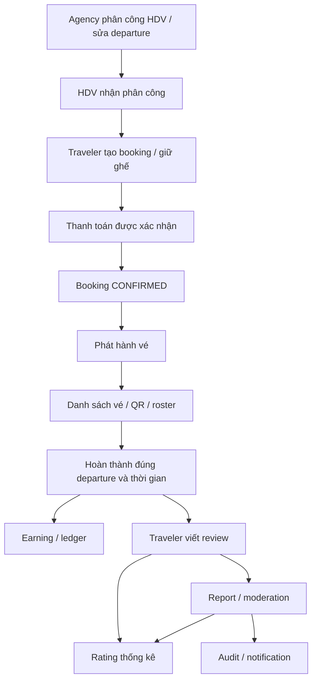

# Plan xử lý 23 task KHIEM — đối chiếu code hiện tại

Ngày rà soát: 04/11/2026. Phạm vi: backend Express/Prisma, Next.js, Flutter và shared constants/types liên quan đến 23 task.

Tiến độ 05/11/2026: batch 1 đã triển khai backend cho 04, 08, 09, 10, 02; xem `docs/khiem-implementation-report.md` về thay đổi, migration, kết quả test và giới hạn. Các mô tả “hiện trạng” dưới đây là snapshot trước triển khai, không phải trạng thái source sau batch 1.

Tiến độ 07/11/2026: đã bổ sung source cho 18 task còn lại. Backend/web đã qua các suite liên quan; nghiệm thu mobile đang chờ SDK đáp ứng Dart ^3.13.3 / Flutter >=3.47.0. Bảng chi tiết từng task, migrations và giới hạn nằm trong phần cập nhật 07/11/2026 của implementation report. Không đồng nhất “đã code” với “đã nghiệm thu mobile/deploy”.

## 1. Cách đọc kết quả

Đây là rà soát tĩnh source code, chưa phải kết quả chạy lại lỗi trên server/device. Đã lập inventory source và lần theo route → controller → service → repository/schema → client ở các luồng trong danh sách; không khẳng định đã đọc từng dòng của toàn bộ 1.156 file source/config trong repo. Không đọc giá trị `.env`, không gọi payment/Cloudinary/AI thật, không sửa implementation.

Working tree đang có nhiều thay đổi chưa commit, bao gồm `prisma/schema.prisma`, users, bookings, e-tickets, reviews, moderation, audit, notifications và maintenance. Kết luận dưới đây dựa trên working tree, không chỉ HEAD. Đặc biệt KHIEM-14 đã có phần fix trong working tree; cần phối hợp với phần việc đang sửa của người khác trước khi commit các file dùng chung.

Trạng thái:
- **Lỗi từ code**: có đường đi hoặc điều kiện sai cụ thể; vẫn cần regression test để xác nhận lúc chạy.
- **Thiếu một phần**: đã có flow nền, cần mở rộng để đạt AC.
- **Đã có phần cốt lõi**: ưu tiên kiểm chứng và bổ sung phần thiếu, không xây lại.

## 2. Những điểm khác mô tả ban đầu

1. Payout account đã có form web/mobile và `PATCH /users/me { bankAccount }`, nhưng lưu plaintext trong `User.preferences` và trả số tài khoản đầy đủ.
2. QR scanner, check-in API, chống quét lặp, rung/âm thanh đã có. Lỗi chính còn lại là privacy và scope theo departure.
3. Có ticket detail, QR, mobile offline cache; còn thiếu trang danh sách vé độc lập.
4. Có `Payment.fulfilledAt` và worker retry, nhưng không bảo đảm ticket đã được tạo. Lỗi consumer bị event bus nuốt nên payment vẫn được fulfilled.
5. Review visibility + audit đã chung transaction trong working tree.
6. Typing đã chạy xuyên UI → socket → backend → UI; khác AC ở throttle 2 giây và chỉ báo text.
7. AI inbox/unread đã có backend và web; mobile mới giữ một hội thoại local.
8. Anthropic đã nhận biết `max_tokens`; trạng thái incomplete chỉ trả theo response, chưa lưu DB và chưa có nút tiếp tục thực sự.

## 3. Bản đồ flow và dependency



Các invariant dùng chung:
- Khung chuyến đi phải có nguồn thống nhất. Hiện `TourDeparture` chỉ có `date`; `Booking.endDate` được tính từ `date + durationDays * 24h`. Không có sẵn `departure.endDate` như task mô tả. Trước khi đổi cách tính phải định nghĩa rõ thời điểm kết thúc; không tự coi durationDays là ngày lịch hay đêm.
- `TourGuideAssignment` hiện khóa theo `tourId`, chưa phải từng departure. Không thể xử lý lịch/roster/hoàn thành chuẩn bằng một `nextDepartureDate` cho tour có nhiều đợt.
- Check-in và hoàn thành chuyến đi là hai trạng thái khác nhau. Hiện check-in đặt `usedAt`, vẫn giữ `VALID`; hoàn thành mới chuyển `USED`. Giữ tương thích và trả attendance status rõ ràng, không đổi tất cả sang USED ngay khi quét.
- Chống race phải dựa trên transaction + khóa/conditional write ở DB; check trong service trước một lệnh insert riêng lẻ chưa đủ.
- Khi thêm worker, dùng DB claim/lease và unique key để chạy nhiều instance an toàn; biến `running` trong maintenance chỉ chống overlap trong một process.

## 4. Kế hoạch từng task

### KHIEM-01 — GUIDE-001: payout account

**Hiện trạng / bằng chứng:** `backend/src/modules/users/users.service.ts::updateMe` ghi `bankAccount` vào preferences; `users.mapper.ts::bankAccountOf` trả nguyên `accountNumber`. Validator đã giới hạn 6–32 chữ số. Có `mobile/lib/features/earnings/widgets/bank_account_sheet.dart` và UI ở `frontend/features/guide/components/GuideEarningsPage.tsx`.

**Flow lỗi:** HDV nhập ngân hàng → PATCH profile → JSON plaintext → GET profile trả toàn bộ số tài khoản. Không có model `GuidePayoutAccount` riêng.

**Fix:** thêm model account liên kết guide, encrypted payload + key version và last4; mã hóa authenticated encryption với key server quản lý, không dùng hash vì bên xử lý payout còn cần đọc. GET/update response chỉ trả bản masked; form sửa yêu cầu nhập số mới, không submit lại chuỗi masked. Giữ adapter PATCH cũ trong giai đoạn chuyển đổi hoặc nâng cả hai client đồng thời. Backfill idempotent từ preferences, kiểm đếm thành công rồi xóa plaintext cũ. Không đưa số tài khoản vào log/audit. Validation cú pháp không được trình bày như xác minh chủ tài khoản ngân hàng thực tế.

**Test:** role/ownership, account invalid, mask trong mọi private DTO có liên quan, ciphertext trong DB, backfill chạy hai lần, đổi/xóa account, dữ liệu cũ không còn plaintext sau migration hoàn tất.

### KHIEM-02 — GUIDE-002: lịch HDV

**Hiện trạng:** `bookings.service.ts::createBookingOnce` gọi `getBookableDeparture` rồi reserve seats, không kiểm tra lịch guide. `tours.service.ts::assignGuide`, `answerAssignment`, `getBookableDeparture` chưa có kiểm tra overlap. Schema assignment nằm ở cấp tour.

**Fix:** xây query lịch theo từng departure, lấy guide đã ACCEPTED; tính interval `[start,end)` và overlap `a.start < b.end && a.end > b.start`. Cùng một departure nhận nhiều booking không phải xung đột. Kiểm tra khi nhận phân công, sửa lịch/đổi guide và trước giữ chỗ; không chỉ thêm một pre-check ở booking. Serialize các thao tác có thể đổi lịch trên cùng guide bằng khóa DB chung trong transaction; nếu dùng SERIALIZABLE phải có retry có giới hạn. Chọn MVP giữ assignment theo tour nhưng mở rộng ra mọi departure khi kiểm tra; chỉ thêm assignment-per-departure nếu nghiệp vụ cho phép đổi HDV giữa các đợt. Không mặc định dùng leisure freeTimeSlots của notification làm lịch làm việc.

**Test:** trùng toàn phần/một phần, tour nhiều ngày, hai interval chạm biên, nhiều booking cùng chuyến, hai request nhận lịch đồng thời, đổi departure sau khi đã có booking. Trả 409 `GUIDE_SCHEDULE_CONFLICT`, client thông báo rõ trước khi thanh toán.

### KHIEM-03 — GUIDE-003: avatar HDV

**Hiện trạng:** không có media controller như mô tả; flow nằm trong users + Cloudinary integration. `createTravelerAvatarUploadSignature` và `completeTravelerAvatarUpload` gọi `assertTraveler`; `removeTravelerAvatar` chỉ cho TRAVELER/AGENCY. Mobile profile bloc đã có signed-upload flow.

**Fix:** mở signed avatar flow cho TOUR_GUIDE bằng role policy tập trung; kiểm tra permission trước rồi ownership/publicId/folder/type/size qua provider. Chặn PATCH avatar URL trực tiếp cho guide khi chuyển sang picker, tránh bypass xác minh upload. Nối picker/thao tác xóa vào hồ sơ HDV và cập nhật auth/profile state sau response. Giữ asset namespace tương thích; nếu đổi folder phải hỗ trợ asset cũ.

**Test:** guide upload/complete/delete thành công; asset người khác bị từ chối; URL giả và role không được phép bị chặn; upload fail không ghi URL; mobile refresh thấy ảnh mới/xóa.

### KHIEM-04 — PROFILE-005: giờ rảnh

**Lỗi từ code:** `users.validation.ts::updatePreferencesBody` dùng `/^\d{1,2}:\d{2}$/`, chấp nhận `99:99`, không kiểm tra start/end và overlap. Field thực tế là `start`, `end`, không phải startTime/endTime. Đây là preference thời gian nhận voucher, chưa có trường ngày.

**Fix:** dùng `^(?:[01]\d|2[0-3]):[0-5]\d$`, đổi giờ sang phút để so sánh; reject `start >= end`. Sort các slot đang enabled và phát hiện overlap; hai slot nối đuôi được phép. Nếu cần lịch theo ngày, bổ sung day/dayOfWeek và contract trước, không giả định field đã có. Chuẩn hóa dữ liệu legacy dạng `9:00` về `09:00` trước khi bật strict validator; thống nhất cách xử lý slot disabled (đề xuất luôn validate format/range, chỉ xét overlap slot enabled).

**Test:** 99:99, 24:00, 12:60, 9:00 sau chuẩn hóa, start=end, reversed, overlap, adjacent, disabled; lỗi 400 có path của slot.

### KHIEM-05 — PROFILE-012: bộ lọc tour HDV

**Hiện trạng:** `guide_tours_screen.dart` có calendar, lời mời và danh sách upcoming; `GuideToursState.upcomingTours` chỉ kiểm tra isAccepted, chưa tách ongoing/completed. DTO dựa trên nextDepartureDate không đủ biểu diễn lịch sử nhiều departure. Roster/scan đã truy cập qua detail.

**Fix:** mở read model assigned departures gồm departureId/start/end và lifecycle; filter backend trước pagination. Giữ invitation độc lập, thêm tab upcoming/ongoing/completed và badge tương ứng; quick actions roster/QR truyền departureId. Không lọc một page tour phía client rồi coi đó là toàn bộ kết quả.

**Test:** tour có departure cũ và mới xuất hiện đúng tab; thời điểm bằng start/end; pagination từng filter; roster/scan mở đúng chuyến; trạng thái sau refresh không quay lại sai tab.

### KHIEM-06 — BOOK-008: QR + roster privacy

**Đã có phần cốt lõi:** `qr_check_in_screen.dart` dùng MobileScanner, cooldown và nhập tay; `check_in_result_dialog.dart::playCheckInFeedback` có haptic/system sound. API thật là `POST /api/v1/guide/e-tickets/:tourId/check-in`, không phải `/e-tickets/scan`. Repository check-in CAS `{status: VALID, usedAt: null}`, đã trả `TICKET_ALREADY_USED`.

**Lỗi / thiếu:** `e-tickets.mapper.ts::toGuideRosterItem` trả nguyên contactPhone và notes; roster/assignment guard chỉ theo tour, chứa nhiều departure. Response dùng checkedIn thay vì trạng thái attendance tường minh.

**Fix:** mask phone tại backend, bỏ notes khỏi DTO tối thiểu hoặc có policy redaction riêng vì notes cũng có thể chứa PII. Thêm scope departure cho roster/check-in và xác minh vé thuộc chuyến đó. Chuẩn hóa DTO status/checkInStatus mà không biến check-in thành completion. Tái sử dụng endpoint hiện tại, chỉ thêm alias scan nếu có client cần contract đó.

**Test:** không có email/full phone/PII trong JSON; guide khác không đọc/quét được; đúng tour sai departure bị chặn; hai scan song song chỉ một thành công. Test camera permissions, rung/âm thanh trên thiết bị thật; unit test không chứng minh phần hardware.

### KHIEM-07 — BOOK-013: ticket inbox/history

**Hiện trạng:** backend `ETicketsService.listMine`, detail/by-booking đã có; web có `frontend/app/traveler/tickets/[id]/page.tsx` nhưng chưa có index page. Mobile có ETicketScreen, QR và `ETicketCubit` hỗ trợ fromCache; repository đã cache từng vé, có test `offline_ticket_test.dart`.

**Fix:** thêm `/traveler/tickets/page.tsx` và mobile ticket list/history, tái sử dụng card/detail/API; status filter phải có semantics rõ giữa check-in và trip completed. List API hiện trả record chưa enrich tourDetails như detail, cần bổ sung meetingPoint/endDate/coverImage theo batch để đủ card. Cache danh sách + detail theo user, xóa khi logout, ghi rõ thời điểm đồng bộ. Không tự đổi code QR tĩnh hiện có thành token động: QR xoay vòng cần contract và chiến lược offline riêng; MVP render QR từ ticket code và server xác minh trạng thái lúc scan.

**Test:** phân trang/rỗng/trạng thái hủy, đúng user, online→offline reopen, chưa cache thì hiện hướng dẫn, vé bị hủy khi sync không còn hiển thị active; QR render từ đúng code.

### KHIEM-08 — BOOK-003: issuance/cancellation race

**Lỗi từ code:** `ETicketsService.issueForBooking` tin BookingFacts cũ; `ETicketsRepository.create` gọi eTicket.create không kiểm tra booking. Unique bookingId chỉ chống vé trùng. Interleaving: handler hủy chạy lúc chưa có vé → không đổi gì; handler confirm cũ insert vé VALID sau đó.

**Fix:** repository issue trong transaction khóa row booking rồi đọc trạng thái persisted CONFIRMED + paid, sau đó insert idempotent. Cancellation phải dùng cùng thứ tự khóa, chuyển booking và vô hiệu vé trong transaction hoặc bảo đảm invariant tương đương; chỉ đặt WHERE trong một SELECT trước insert riêng rẽ vẫn còn race. Với booking đã completed mà thiếu vé lịch sử, tách policy repair rõ ràng, không nới guard của normal issuance tùy tiện.

**Test:** dùng hai DB connection + barrier tái hiện cancel-first/issue-first; cancelled không bao giờ có vé VALID sau commit; duplicate confirmed event vẫn một vé; rollback không để vé mồ côi.

### KHIEM-09 — BOOK-012, TOUR-008: completion/review gate

**Lỗi từ code:** `bookings.service.ts::completeMine` không kiểm tra endDate. `e-tickets.service.ts::completeTripForGuide` duyệt mọi ticket theo tourId và complete mọi booking CONFIRMED, không kiểm tra ngày. `ReviewsService.reviewableBooking` chỉ kiểm tra COMPLETED. Maintenance có query due-for-completion riêng nhưng các entry point thủ công bypass được.

**Fix:** gom rule completion vào bookings service, điều kiện persisted CONFIRMED và endDate <= now nằm cả trong conditional write; guide completion chỉ theo departure được phân công. Review check thêm endDate để bảo vệ booking legacy đã completed sớm; dùng cùng rule cho upload ảnh review. Thống nhất nguồn thời gian và contract endDate nêu ở mục 3; sửa UI không cho bấm nhưng backend là nguồn quyết định.

**Test:** ngày mai bị 409 `TRIP_NOT_ENDED` với “Chuyến đi chưa kết thúc”; bằng endDate được phép; guide completion không chạm departure khác; legacy COMPLETED tương lai chưa được review; notification/earnings không phát khi bị chặn.

### KHIEM-10 — PAY-004: durable ticket fulfillment

**Lỗi từ code:** `BookingEvents.run` catch lỗi consumer và chỉ log. `PaymentsService.fulfil` gọi confirmPayment rồi markFulfilled; confirmPayment trả ALREADY_CONFIRMED ở retry mà không emit lại. Vì vậy `payments.retryUnfulfilled` hiện có không phải worker repair ticket.

**Fix:** sau KHIEM-08, thêm booking ticket fulfillment PENDING/COMPLETED/FAILED với attempts/nextAttemptAt/lastError và claim/lease; tạo job/outbox cùng transaction confirm booking. Worker sweep booking paid-confirmed chưa có vé quá 3 phút, gọi issue idempotent, đánh COMPLETED trong cùng transaction tạo vé. Không chỉ dựa vào payment.fulfilledAt. Cancellation phải đóng job và chặn create qua guard KHIEM-08. Notification phát vé dùng outbox/dedupe riêng, vì retry gặp existing ticket hiện return ngay nên notification lỗi sau insert cũng không được gửi lại. Backfill job cho booking đủ điều kiện đã thiếu vé.

**Test:** crash sau confirm trước emit, DB down khi insert, crash sau insert trước ACK, hai worker, retry backoff, cancel khi chờ retry; mỗi booking tối đa một vé và notification không nhân đôi. Đo delay bằng fake clock; test integration xác nhận transaction thật.

### KHIEM-11 — PAY-018: ledger chuyển tiền

**Hiện trạng:** có model Earning, earnings API/list/summary, màn hình web/mobile thu nhập. `EarningsService.recordForBooking` tính theo `feePerBooking`, unique bookingId. Chưa có PENDING/TRANSFERRED hoặc transaction reference của payout.

**Fix:** giữ Earning là khoản được hưởng; thêm GuidePayoutLedger liên kết earning, guide, tour/booking, amount VND nguyên, status, transferredAt, transferReference và actor; nếu cần gom nhiều earning trong một lần chuyển thì thêm payout batch + allocation riêng. Không thay feePerBooking thành phí mỗi tour. Tạo entitlement/ledger idempotent, snapshot guide và fee của chuyến thực tế để reassignment không đổi người nhận. Chỉ staff/agency được phép chuyển trạng thái theo quyền; HDV chỉ xem. Không đưa API chuyển tiền thật vào scope nếu task chỉ cần ghi nhận/theo dõi.

**Test:** replay completion không cộng đôi; chưa kết thúc không có earning; chuyển trạng thái CAS, audit actor/reference; guide không đánh dấu tự nhận tiền; số tổng pending/transferred khớp chi tiết. Phụ thuộc 01 và 09.

### KHIEM-12 — REVIEW-001: rating nguyên tử

**Lỗi từ code:** createReview insert rồi gọi refreshTourRating; moderation cũng refresh sau commit. Hàm refresh đọc aggregate và ghi tour tối đa 3 vòng, không bảo đảm atomic/durable khi crash hoặc concurrency.

**Fix:** một repository transaction cho create hoặc visibility mutation + aggregate rating + update tour. Khóa cùng row tour trước mutation và aggregation để serialize mọi writer trên tour; transaction ở READ COMMITTED mà không có protocol khóa chung vẫn có thể ghi stale aggregate. Reuse audit transaction của 14, version của 13. Notification đi sau commit/outbox. Dùng field hiện tại ratingAvg/ratingCount theo schema thực tế khi implement, không tạo bản sao averageRating/totalReviews. Có script reconcile rating cũ từ VISIBLE reviews.

**Test:** nhiều create và hide/restore đồng thời; inject failure ở bước cập nhật tour làm rollback review; duplicate booking; reconcile chạy idempotent; public stats khớp aggregate DB.

### KHIEM-13 — REVIEW-002: revision token

**Hiện trạng:** Review chưa có contentVersion. `reviews.repository.ts::transition` chỉ CAS status. API reviews hiện không có update nội dung cho traveler, nên kịch bản “traveler sửa lúc đang duyệt” chưa tái hiện được qua public route hiện tại. Vẫn thiếu bảo vệ stale decision/ABA khi review quay về cùng status.

**Fix:** thêm revision integer default, trả trong moderation DTO; request bắt buộc expectedVersion. Mọi mutation relevant tăng revision và moderation CAS theo id + expectedVersion (+ status). Vì chưa có edit API, không tự xây thêm edit ngoài scope; nếu thêm sau phải tăng version khi text/rating/images đổi. Client giữ snapshot version của nội dung đang xem, gặp 409 `REVIEW_REVISION_CONFLICT` yêu cầu đọc lại, không auto retry quyết định.

**Test:** version cũ bị 409, version đúng thành công, hai moderator chỉ một thắng, hide→restore→hide không làm bản cũ hợp lệ lại. Phối hợp contract backend/frontend một đợt.

### KHIEM-14 — REVIEW-003: audit atomic

**Đã có trong working tree:** `reviews.repository.ts::transition` chạy `prisma.$transaction` gồm update review và `writeAudit(tx,audit)`; `ReviewsService.moderate` truyền actor/metadata. `audit.writer.ts` propagate lỗi. Audit integration đã kiểm tra có record cho hide/restore, chưa đủ để kết luận rollback khi audit fail.

**Plan:** giữ implementation hiện tại, bổ sung integration fault injection audit failure → visibility không đổi; CAS fail → không tạo audit. Khi refactor task 12/13 phải giữ audit trong cùng transaction, reason restore cũng lưu. Chốt ownership với phần thay đổi audit đang tồn tại trước khi gom commit.

**Test:** hide/restore đúng actor và before/after/reason; rollback khi audit insert thất bại; concurrent decision chỉ audit cho mutation thắng. Không tuyên bố task chưa làm hoặc tạo audit service thứ hai.

### KHIEM-15 — REVIEW-008: restoration reason

**Lỗi từ code:** `moderateReviewBody` chỉ bắt reason khi hide; service cũng vậy. Web `ModerationReviewListPage` dùng requiresReason=false cho restore và không gửi reason.

**Fix:** discriminated validation theo hide, trường restorationReason bắt buộc khi false, trim min/max nhất quán với reason hiện tại; propagate qua controller/types/moderation service/review service. Lưu vào audit metadata, cân nhắc field trên Review nếu cần xem lý do restore gần nhất. Client bắt nhập và hiển thị lỗi 400, không tự điền lý do hộ moderator.

**Test:** missing/empty/whitespace/short reason bị 400; hợp lệ restore + audit cùng transaction; UI không submit thiếu reason. Cập nhật test audit cũ đang `.send({hide:false})`.

### KHIEM-16 — REVIEW-009: thông báo moderation

**Hiện trạng:** ReviewsService.moderate đã notify traveler, chưa notify agency, không truyền `{email:true}`; notification sau transaction có thể lỗi khiến client tưởng mutation chưa thành công.

**Fix:** transaction decision tạo outbox hai recipient + hai channel theo yêu cầu; worker dispatch qua notification/mail hiện có (working tree đã có mail-outbox). Dedupe theo reviewId + revision/decisionId + recipient + channel, tránh dedupe cả review vì có thể hide/restore nhiều lần. Payload chứa reason và policy code nếu moderator có chọn điều khoản; không tự suy diễn điều khoản từ text. API trả kết quả moderation đã commit, trạng thái delivery theo retry riêng.

**Test:** reviewer và agency nhận đúng quyết định/reason; email lỗi rồi phục hồi; replay không nhân đôi; rollback moderation không phát thông báo; không rò PII khách qua email agency.

### KHIEM-17 — REVIEW-007: reported-review triage

**Hiện trạng:** đã có route `/moderator/reviews` và `ModerationReviewListPage` riêng, nên không đúng hoàn toàn rằng review đang lẫn queue tour. Nhưng đây là list tất cả review theo status; report queue hiện xử lý Report riêng, chưa có queue grouped-by-review + Keep/Remove đầy đủ ngữ cảnh.

**Fix:** read model grouped review với openReportCount, reasons, timestamps và revision; backend filter/pagination trên review, không frontend join mỗi page. Thêm ReviewModerationQueue.tsx tại feature moderation, Keep đóng các report đã được xem; Remove ẩn review + resolve reports trong transaction dùng chung 12–16. Token/quy tắc snapshot report bảo đảm report đến sau lúc moderator mở màn hình không bị đóng nhầm. Keep là một decision có audit dù visibility không đổi.

**Test:** nhiều report cùng review một dòng; Keep không hide; Remove audit/rating/notify đúng; report mới đến giữa chừng vẫn pending; stale review version bị 409; permission.

### KHIEM-18 — REVIEW-004: profile preview + 2FA

**Hiện trạng:** public guide page `frontend/app/tour-guides/[id]/page.tsx` và `frontend/features/public-profiles/PublicProfilePage.tsx` đã có. Backend có private twoFactorEnabled; GuideProfilePage/mobile guide_profile_screen chưa có flow preview/indicator theo yêu cầu.

**Fix:** nút preview mở public route/component dùng public DTO để hiển thị đúng trải nghiệm traveler, không render private profile rồi che bớt thủ công. Badge bảo mật trên trang hồ sơ chủ tài khoản lấy từ server, refresh sau enable/disable 2FA. Nếu yêu cầu badge công khai, bổ sung duy nhất boolean vào public contract sau khi thống nhất phạm vi; không expose secret/recovery codes/email/phone/license.

**Test:** preview khớp public page, review/tour cùng guide, dữ liệu riêng tư không xuất hiện; badge true/false và thay đổi sau refresh; mobile navigation đúng guide hiện tại.

### KHIEM-19 — BOOK-004: traveler support

**Hiện trạng:** backend đã có `/api/v1/support/tickets`, create/listMine/getMine/reply/close, category BOOKING/PAYMENT/ACCOUNT/TOUR/OTHER. Mobile chưa có feature/screen support tương ứng; không nhầm complaints với support.

**Fix:** thêm traveler_support_ticket_screen.dart, repository/models/state và entry navigation; 4 lựa chọn AC map đúng enum (không cần xóa category TOUR ở backend). Gửi subject/category/message/bookingId optional theo validator hiện tại. Thành công hiển thị mã/id do server trả, không tự sinh mã local. Tận dụng API hiện có và kiểm tra ownership booking. Giữ form khi lỗi, chống double tap; với mất response sau server commit cân nhắc idempotency key nếu cần retry an toàn.

**Test:** category mapping, required/min length, booking không thuộc traveler, success reference, 429/network error không mất nội dung, không tạo trùng do double tap.

### KHIEM-20 — BOOK-009, BOOK-010: review draft

**Lỗi từ code:** `WriteReviewDialog.tsx` effect dependency `[open, eligibleBookings]` reset bookingId/rating/comment/files mỗi lần prop array đổi identity, kể cả modal còn mở. Mobile `tour_review_form_modal.dart` giữ controller/rating trong widget state, chưa persist draft.

**Fix:** draft key theo userId + bookingId + schemaVersion; chỉ hydrate lúc mở/chuyển booking thực sự, không reset khi props re-render. Autosave debounce, flush lúc close/background; xóa sau submit thành công hoặc discard có chủ ý. Web text/rating dùng localStorage, ảnh File/Blob dùng IndexedDB hoặc lưu publicId đã upload + metadata; JSON.stringify(File) không lưu bytes. Mobile dùng SharedPreferences cho text/rating, copy ảnh sang app storage có lifecycle cleanup nếu flow có attachment. Validate ownership publicId ở backend như hiện tại; TTL và cleanup khi đổi tài khoản.

**Test:** rerender với array mới không mất dữ liệu; đóng/mở và refresh vẫn còn rating/text/ảnh; hai booking/hai user không lẫn draft; upload fail giữ draft; submit thành công xóa; storage lỗi không làm hỏng form.

### KHIEM-21 — CHAT-002: typing HDV

**Đã có:** `chat_screen.dart` onChanged gọi ChatCubit.onTyping; chat_socket emit/listen `chat:typing`; gateway xác minh counterpart rồi forward; cubit peerTyping timeout 3s. Hiện throttle 2s, text indicator, chưa đúng yêu cầu debounce 500ms/animation.

**Fix:** tái sử dụng transport, timer debounce 500ms có trailing event; TTL clear khi không nhận event, submit/leave/disconnect xóa typing. Nếu muốn chỉ báo xuất hiện ngay khi bắt đầu gõ thì dùng leading + trailing throttle 500ms và ghi rõ khác debounce. Thêm TypingBubble ba chấm trên app guide, giữ scope conversation và cleanup listener khi switch/account logout.

**Test:** fake clock cho debounce/TTL, conversation khác không hiển thị, disconnect/reconnect, widget dispose không emit, cả traveler→guide và guide→traveler. Không cần event tên `typing` thứ hai.

### KHIEM-22 — AI-001: AI inbox/unread

**Đã có backend/web:** AiService listMine/getMine/overview/markRead; AiRepository lưu AiConversation/AiMessage.readAt; routes GET conversations/overview, POST read; ConversationPage/AiThread có history, unread và read boundary.

**Thiếu mobile:** AiRepository mobile chỉ gọi chat; AiCubit/AiStorage khôi phục một conversation local, chưa có server inbox và unread UI.

**Fix:** mobile thêm API list/detail/overview/read, inbox theo chủ đề, chọn hội thoại để tiếp tục; cursor/read throughMessageId chỉ cập nhật khi thread hiển thị và tin đã được xem. Server là nguồn lịch sử chính, local cache theo user để offline; chuyển đổi cache cũ mà không tự upload bản transcript trùng server. Reuse realtime publisher nếu client hỗ trợ, nếu không dùng refresh/poll hợp lý. Web ưu tiên regression thay vì làm lại.

**Test:** hai conversation không trộn tin, unread giữ nguyên khi chỉ mở inbox, đọc đến boundary không đánh dấu tin mới đến sau đó, user isolation, resume sau restart, mobile/web đồng bộ.

### KHIEM-23 — PROFILE-003: Anthropic incomplete

**Đã có provider guard:** `anthropic.provider.ts` kiểm tra `stop_reason === max_tokens`, trả incomplete khi allowPartial=true hoặc ném AI_INCOMPLETE_RESPONSE. AiService gọi allowPartial=true, trả reply.incomplete; web hiện text “có thể yêu cầu AI nói tiếp”.

**Lỗi / thiếu:** AiMessage schema không lưu incomplete; AiService persist chỉ role/content. Reload history mất cờ. Mobile chưa có contract/UI incomplete. AiService còn slice theo MAX_STORED_REPLY_LENGTH nhưng không đánh dấu khi chính app cắt nội dung.

**Fix:** persist completionStatus/stopReason an toàn và expose khi get/list transcript; nếu app slice cũng đánh INCOMPLETE. Thêm nút “Tiếp tục tạo…” web/mobile, continuation API theo owned conversation + messageId, validate tin cuối còn incomplete, chống double click và idempotency. Có thể lưu continuation thành assistant message mới với linkage, không append mù vào tin đã đổi. Không tự retry vô hạn hoặc coi partial là complete. Backfill lịch sử không có metadata là UNKNOWN/legacy, không đoán được stop reason cũ.

**Test:** mock Anthropic max_tokens/end_turn/refusal/empty/timeout; partial giữ cờ sau reload, JSON mode không lưu partial; app-side truncation; continuation ownership/stale message/duplicate request; mobile render nút và tiếp tục đúng thread.

## 5. Thứ tự triển khai và commit

Mỗi task vẫn là một commit có thể review; thứ tự dependency khác thứ tự đánh số. Với file đang có sửa của người khác, dùng selective staging sau khi review diff, không `git add .` và không rollback working tree.

| Đợt | Task theo thứ tự | Kết quả cần đạt trước khi đi tiếp |
|---|---|---|
| 0 | Baseline và thống nhất departure/endDate, semantics check-in | Chốt contract; lưu kết quả tests hiện tại và phân chia file đang sửa |
| 1 | 04 → 08 → 09 → 10 → 02 | Chặn dữ liệu giờ sai, vé sau hủy, hoàn thành sớm; repair vé có durability; bảo vệ lịch |
| 2 | 01 → 03 → 11 | Payout account an toàn, avatar hoạt động, ledger nối earning đã đúng thời gian |
| 3 | 05 → 06 → 07 → 18 → 19 | Guide/traveler UI sử dụng đúng departure và API đã có |
| 4 | 14 kiểm chứng → 12 → 13 → 15 → 16 → 17 → 20 | Review/rating/audit/version nhất quán, xử lý báo cáo và draft |
| 5 | 21 → 22 → 23 | Hoàn thiện chat và AI trên mobile/web |

Commit messages theo assignment:

```text
01 feat(guide): implement guide payout account registration and validation flow (GUIDE-001)
02 feat(guide): validate guide availability and itinerary collision during booking (GUIDE-002)
03 feat(guide): support secure avatar upload and removal via Cloudinary picker (GUIDE-003)
04 fix(guide): validate hour and minute range strictly in free-time slot picker (PROFILE-005)
05 feat(guide): enhance assigned-tour filters, status badges, and action bar (PROFILE-012)
06 feat(guide): implement QR ticket scanner and privacy-preserving roster view (BOOK-008)
07 feat(e-tickets): implement dedicated /traveler/tickets list and history view (BOOK-013)
08 fix(e-tickets): prevent ticket issuance race condition against cancellation (BOOK-003)
09 fix(e-tickets): prevent completion and review unlock before tour departure ends (BOOK-012, TOUR-008)
10 fix(payout): retry failed e-ticket issuance and mark fulfillment asynchronously (PAY-004)
11 feat(payout): introduce payout ledger database model and monitor endpoints (PAY-018)
12 feat(reviews): atomic rating recalculation and durable review persistence (REVIEW-001)
13 feat(reviews): add revision token validation to review moderation decisions (REVIEW-002)
14 fix(reviews): audit review visibility hide/restore decisions atomically (REVIEW-003)
15 feat(reviews): require mandatory explanation reason when restoring hidden reviews (REVIEW-008)
16 feat(reviews): send notifications to reviewer and agency upon review action (REVIEW-009)
17 feat(reviews): separate reported-review triage queue with Keep/Remove actions (REVIEW-007)
18 feat(guide): add public guide profile preview and 2FA indicator (REVIEW-004)
19 feat(support): implement traveler support ticket submission UI (BOOK-004)
20 fix(reviews): persist review draft in local storage across prop rerenders (BOOK-009, BOOK-010)
21 feat(chat): wire real-time typing indicators into guide chat transport (CHAT-002)
22 feat(ai): integrate AI assistant conversation inbox and unread state management (AI-001)
23 fix(ai): validate Anthropic stop reason to reject truncated AI responses (PROFILE-003)
```

Task 14 có thể chỉ cần commit regression test nếu implementation hiện tại đã được người phụ trách khác commit; không tạo commit rỗng hoặc ghi nhận lại code của họ. Prefix `fix(payout)` của task 10 giữ theo assignment dù domain code thực tế là bookings/e-tickets/payments.

## 6. Migration và kiểm chứng

Migration dự kiến: payout account encryption/backfill (01), fulfillment/outbox (10), payout ledger (11), review revision/restoration metadata (13/15), AI completion metadata (23). Departure read model có thể chưa cần đổi schema nếu giữ assignment cấp tour; nếu chọn assignment cấp departure thì đưa migration đó trước 02/05/06/09. Chia migration theo dependency, không gom mọi task vào một migration lớn.

Migration/backfill phải có khả năng chạy lại, thống kê số bản ghi, và tương thích client cũ trong giai đoạn rollout. Không sửa các migration đã áp dụng. Riêng encrypted account cần bảo đảm key có mặt trước khi nhận write mới và có phương án đọc key version cũ.

Các suite có sẵn để mở rộng:
- Backend: users.service/agency-guides integration; bookings.service/integration; e-tickets.service/check-in; payments.service/integration; reviews.service/integration; moderation routes/integration; audit coverage; chat gateway/realtime; ai.service/integration; maintenance integration.
- Frontend: guide profile/assigned tours/earnings; review WriteReviewDialog; e-ticket view/card/api; moderation flows; chat AiChat/ConversationPage.
- Mobile: guide_tours_cubit/screen, guide_check_in_cubit, check_in_result_dialog, roster_tile; earnings; offline_ticket; chat_cubit/enhanced_features; ai_cubit/ai_chat_screen.

Lệnh validation khi triển khai (chạy trong package tương ứng, dựa trên scripts hiện tại):

```powershell
# Từ root, lọc suite liên quan trước rồi chạy rộng khi thay đổi tích hợp cần thiết
pnpm --filter backend typecheck
pnpm --filter backend exec vitest run --project unit <test-path>
pnpm --filter backend exec vitest run --project integration <integration-test-path>
pnpm --filter frontend exec tsc --noEmit
pnpm --filter frontend exec vitest run <test-path>
# Từ mobile/
flutter analyze
flutter test test/features/guide
flutter test test/features/bookings/offline_ticket_test.dart
```

Không thay `<test-path>` bằng toàn bộ suite ngay từ đầu. Race/transaction phải kiểm chứng trên test PostgreSQL bằng nhiều transaction thực; unit mock không đủ. Test provider bằng mock, camera/haptic qua thiết bị thật. Không dùng production DB để tạo dữ liệu test. Báo cáo tách baseline failures khỏi regression của task.

**Điều kiện đóng mỗi task:** đạt AC + regression liên quan; typecheck/analyze phần đổi không phát sinh lỗi mới; cập nhật API/shared DTO nếu contract đổi; migration/backfill được thử trên DB test; UI flow được kiểm tra ở client liên quan; ghi rõ limitations và commit riêng. Tài liệu này chưa tuyên bố bất kỳ test nào đã chạy/pass.
