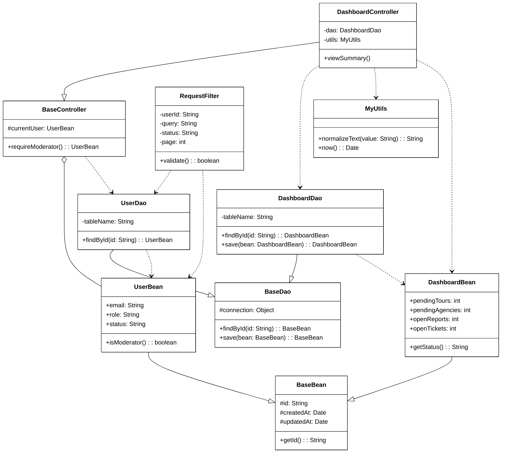
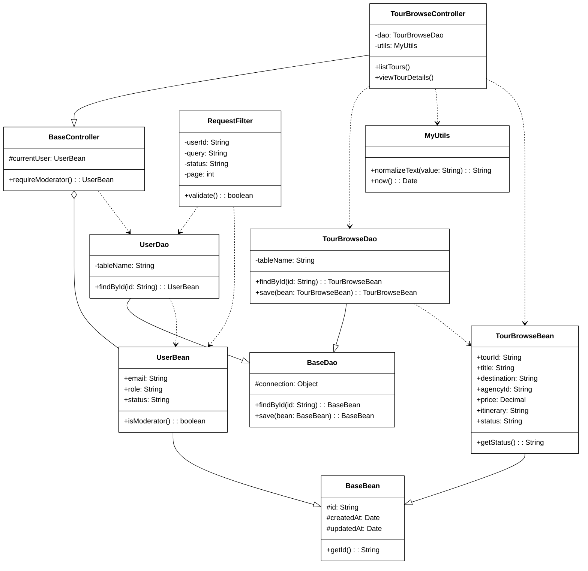
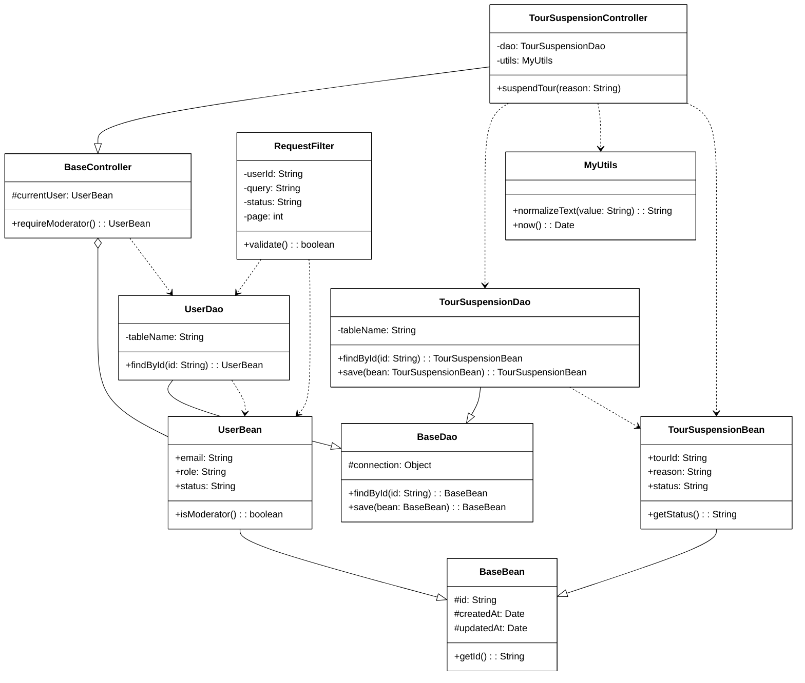
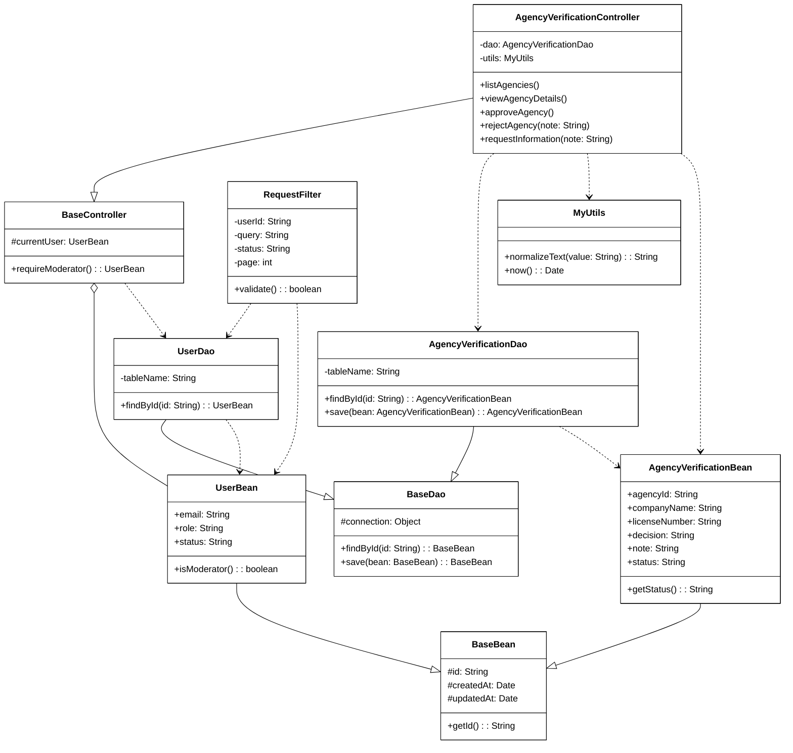
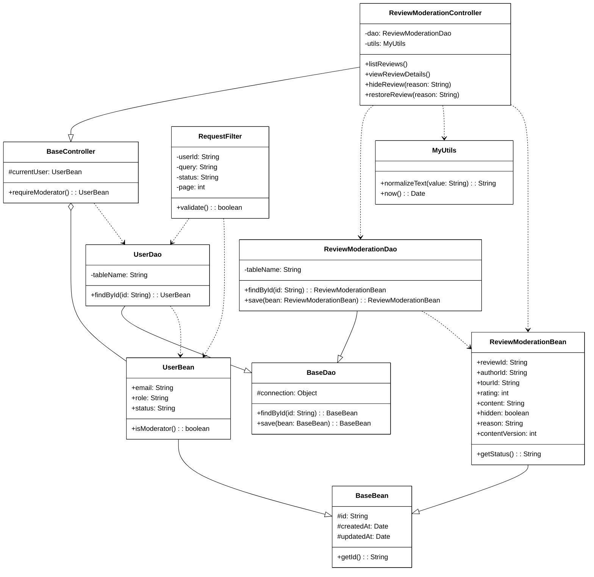
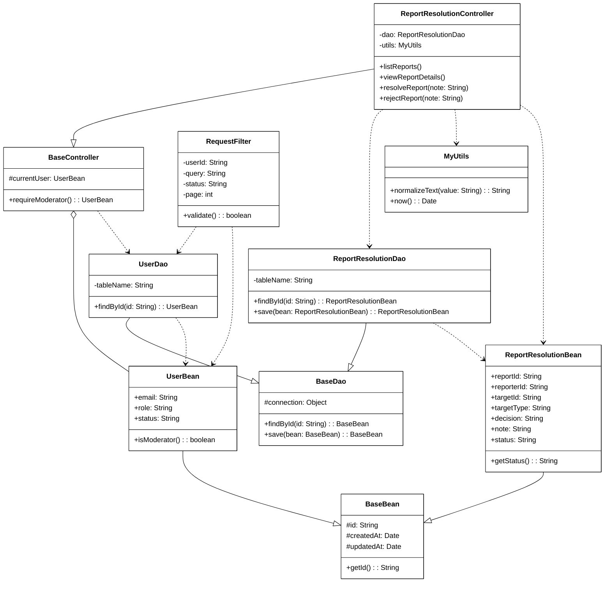
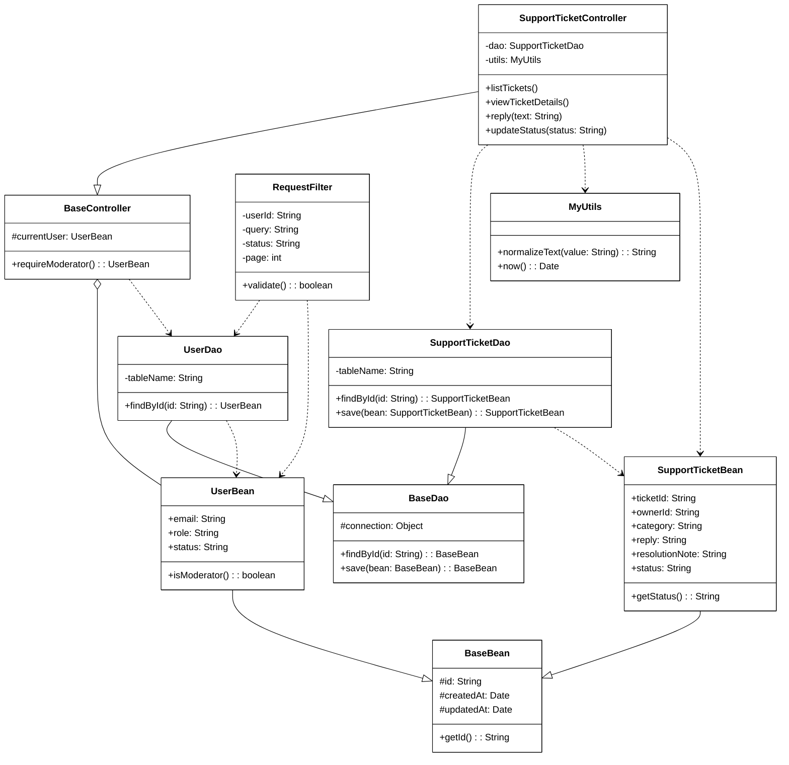

# Moderator — Mermaid UML Class Diagrams

Nguồn: `docs/backend/USE_CASE_MAP.md` và `docs/moderator-chapter-3.md`.
Các thao tác cùng luồng được gộp thành một sơ đồ độc lập (10 sơ đồ). Trong draw.io: **Insert → Advanced → Mermaid**, chỉ copy nội dung bên trong một khối mã mỗi lần. Tên lớp/phương thức là mô hình SDS theo mẫu yêu cầu, không phải tên class thực tế trong codebase.

## Moderator - View Moderation Dashboard

## Moderator - Browse Tours

## Moderator - Validate Tour

## Moderator - Suspend Tour

## Moderator - Verify Agency Profile

## Moderator - Moderate Reviews

## Moderator - Resolve Reports and Disputes

## Moderator - Adjudicate Tour Service Complaints

## Moderator - Handle Platform Support Tickets

## Moderator - Ban Violating Account

