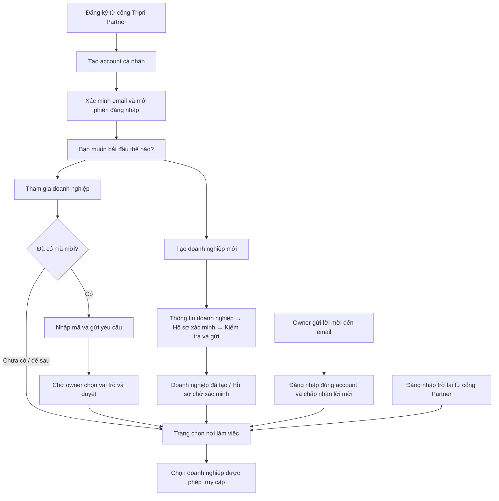

# Làm lại đăng nhập, đăng ký và onboarding Agency

Ngày: 2026-11-13. Trạng thái: đã triển khai code auth/onboarding và kiểm thử; chưa triển khai migration lên database dùng chung.

## Kết quả triển khai

### Cập nhật điều hướng — 2026-11-14

Bỏ màn Bắt đầu/hai lựa chọn: login và signup/OTP Partner mặc định vào thẳng
`/workplaces`. Nhập mã mời mở popup ngay trong danh sách, gửi xong sang tab yêu cầu
đã gửi, đóng/Hủy không rời trang. Tạo doanh nghiệp vẫn dùng onboarding riêng,
với nút quay lại trang chọn nơi làm việc. URL start/join cũ chỉ chuyển tiếp về
danh sách, giữ continuation an toàn. Mục này được ưu tiên hơn thiết kế ban đầu
hai lựa chọn trong các phần kế hoạch/lịch sử bên dưới.

- Entry `/agency/login`, `/agency/register` có UI Partner mới, dùng chung account APIs/hooks. Không yêu cầu membership để login; agency password/Google compatibility aliases và nhánh agency LOGIN_2FA/resend đã bỏ điều kiện membership. Contract agency REGISTER OTP legacy được giữ.
- Signup Partner → REGISTER OTP → `/workplaces`; returning login → `/workplaces`. Invitation continuation có ưu tiên, login target không được trỏ ngược vào auth. Normal traveler signup giữ `/home`.
- Danh sách nơi làm việc có tạo doanh nghiệp và popup nhập mã mời, tab request khi cần và empty state hướng dẫn nhận email sau.
- Wizard ba bước có idempotency key theo account/tab, lưu draft, tiếp tục hồ sơ và cảnh báo rời trang khi chưa lưu. Submit mới chuyển PENDING; lưu hồ sơ đã VERIFIED không tự gửi xác minh lại nếu thông tin pháp lý không thay đổi.
- Giữ lời mời email cần người nhận chấp nhận; có đường đổi account khi email không khớp. Không có nghiệp vụ tour mới trong thay đổi này.
- Taste được dùng cho hệ thống màu/căn lề/câu chữ/focus/responsive; vẫn giữ thương hiệu Tripri và các component hiện có.

### Bằng chứng kiểm tra

| Kiểm tra | Kết quả |
| --- | --- |
| Backend `tsc --noEmit` | Đạt. |
| Frontend `tsc --noEmit` | Đạt. |
| Backend unit toàn bộ | 60 file, 783 test đạt. |
| PostgreSQL integration workplaces | 16 test hiện có đạt; test HTTP bổ sung account chưa membership → tạo tenant → sinh/đọc mã cũng đạt (17 test khác nhau, chạy trong hai lượt). Database loopback tạm, không dùng Neon shared. |
| Frontend focused auth/workplaces/layout/continuation | 5 file, 30 test đạt sau các chỉnh sửa cuối. |
| Frontend suite toàn bộ | 743/746 đạt ở lượt kiểm tra rộng; còn hai assertion Team dùng selector UI cũ và một timeout tour editor. Test tour timeout vẫn tái hiện khi chạy riêng. Không thay nghiệp vụ Team/tour để làm xanh các test ngoài phạm vi. |
| Production preview build | Next.js build đã tạo đủ 88 trang. Dùng `.next-preview`, giữ output development riêng. |
| Visual QA | Đã xem ảnh login desktop 1440px và register mobile 390px. Browser tích hợp không khởi động vì cấu hình Codex; dùng Chrome headless/profile kiểm thử riêng của Taste để chụp public auth. Chưa chứng nhận browser end-to-end có session trên DB shared. |

Artifacts kiểm tra local được ignore tại `.taste-skill/`. Bộ test frontend đầy đủ chưa xanh; các số liệu focused nêu trên không được dùng để diễn giải thành full suite đã đạt.

### Database hiện tại còn chặn phát hành

Đã chạy `prisma migrate status` ở chế độ chỉ đọc, sau đó kiểm tra catalog qua runtime `DATABASE_URL` để tránh kiểm tra nhầm target:

- Runtime và URL migration trỏ cùng database sau khi chuẩn hóa hostname pooled/direct.
- Migration cuối chung là `20261113000100_agency_flexible_permissions`, đã hoàn tất.
- `20261113000200_agency_workplaces` chưa được áp dụng.
- Cả ba bảng `AgencyCreationKey`, `AgencyJoinCode`, `AgencyJoinRequest` đều chưa tồn tại ở runtime DB. Các endpoint tạo agency/code/request hiện không thể hoạt động trên DB này; lỗi không thể sửa chỉ ở popup.
- DB có hai migration chưa có file trong lịch sử local: `20261007000000_add_user_avatar_public_id` và `20261111000000_agency_calendar`.

Chưa sửa schema hoặc dữ liệu shared. Bước phát hành tiếp theo: khôi phục đúng artifact hai migration còn thiếu, đối chiếu checksum/lịch sử và checkpoint theo kế hoạch nền; sau đó mới áp dụng migration workplace đã được rehearsal trên DB cô lập, regenerate client và restart backend. Không reset DB, không tự đánh dấu migration đã chạy, không dùng `db push` để che drift. Đăng nhập account không cần ba bảng này, nhưng tạo doanh nghiệp và tham gia phải đợi schema sẵn sàng.

Các phần dưới là thiết kế/acceptance làm cơ sở triển khai; checklist rollout và browser/backend shared chưa được đánh dấu hoàn tất bằng kết quả mock hay unit test.

Đây là bản cập nhật về sản phẩm, UX và luồng auth cho [kế hoạch account chung và workplace](agency-workplaces-onboarding.md). Khi hai tài liệu khác nhau về màn hình hoặc điều hướng auth, dùng bản này. Quy tắc tenant, phân quyền, dữ liệu và tính nhất quán của kế hoạch nền vẫn áp dụng.

## 1. Kết quả cần đạt

Người dùng tạo một tài khoản cá nhân, xác minh email rồi được chọn **Tạo doanh nghiệp mới** hoặc **Tham gia doanh nghiệp**. Người chưa có mã mời vẫn đi tiếp đến trang chọn nơi làm việc, nhận lời mời qua email sau. Đăng nhập không phụ thuộc việc tài khoản đã có doanh nghiệp hay chưa.

Hai lựa chọn là hành động ở thời điểm hiện tại, không phải loại tài khoản cố định. U có thể là nhân viên của A và chủ doanh nghiệp B; tạo hoặc tham gia B không đổi quyền ở A hoặc global `User.role`.

Phạm vi đợt này: auth entry Agency, continuation qua xác minh, màn bắt đầu, tham gia bằng mã/để sau, danh sách nơi làm việc và onboarding chủ doanh nghiệp. Giữ trang Team/phân quyền hiện có, hàng chờ owner ở trang riêng và cách mời email hiện tại. Không thêm nghiệp vụ tour được giao, tài chính hoặc mô hình công ty mẹ–chi nhánh.

## 2. Baseline khi lập kế hoạch (trước thay đổi)

| Hiện trạng | Vấn đề cần xử lý |
| --- | --- |
| `frontend/app/agency/(auth)/login/page.tsx` hiện render `AgencyLoginPage`; component gọi `/auth/agency/login`. | Không chỉ sửa redirect frontend rồi xem như auth đã hợp nhất. |
| `AuthService.loginAgency()` kiểm tra `hasAgencyMembership()` trước khi mở session. | Tài khoản chưa có membership bị báo sai thông tin đăng nhập dù mật khẩu đúng; không vào được bước tạo/tham gia lần đầu. |
| `loginAgencyWithGoogle()`, nhánh agency OTP 2FA và resend cũng có kiểm tra membership. | Chỉ bỏ điều kiện ở email/password sẽ để lại những đường đăng nhập vẫn bị kẹt. |
| `AuthService.login()` chung hiện gọi `validateCredentials()` và `loginUser()`, không có điều kiện membership. | Không kết luận rằng mọi tài khoản legacy AGENCY đều bị chặn ở login chung. Phải kiểm tra từng endpoint và client hiện dùng. |
| `/agency/register` chuyển tới đăng ký account chung; account mới dùng role cá nhân TRAVELER. | Đường quay lại sau đăng ký phải giữ ngữ cảnh Agency, không yêu cầu có hồ sơ doanh nghiệp để xác thực account. |
| `AgencyLoginPage` còn đưa một số kết quả sang `/application-status`; đăng ký Agency/OTP cũ có contract riêng. | Thay điều hướng cho web mới; giữ contract legacy cho client chưa chuyển, không thay response OTP REGISTER cũ bằng session một cách âm thầm. |
| `WorkplacesPage` đã có list/create/join; trang tạo hiện chỉ hỏi tên rồi quay về danh sách. | Thiếu màn hai lựa chọn, đường "chưa có mã" rõ ràng và onboarding doanh nghiệp có thể tiếp tục. |
| Tạo agency độc lập, draft hồ sơ, mã 15 phút, join request và email invitation đã có API/model. | Tái sử dụng; không dựng auth framework hoặc membership model thứ hai. |
| Popup mã mời đang được người dùng báo HTTP 500. | Chưa có log để kết luận nguyên nhân. Kiểm tra response/log, Prisma client và migration/schema trên đúng DB trước QA; không ghi nhận "thiếu migration" như sự thật đã xác minh. |

Nguồn: `backend/src/modules/auth/auth.service.ts`, `backend/src/modules/agencies/{workplaces.service,workplaces.routes,agency.service}.ts`, `frontend/features/{auth,agency-auth,agency}` và `prisma/schema.prisma`.

## 3. Luồng sản phẩm

Đăng ký bằng mật khẩu chỉ hoàn tất sau REGISTER OTP; trước đó account còn pending. Google chỉ bỏ bước xác minh email riêng khi verifier xác nhận email hợp lệ theo policy hiện có. Không cấp membership hoặc đánh dấu doanh nghiệp đã xác minh từ kết quả Google.

Nếu người dùng bắt đầu từ link lời mời email, continuation đến màn chấp nhận lời mời được ưu tiên hơn màn hai lựa chọn. Người dùng được đọc thông tin và chủ động chấp nhận, không tự accept sau login.

## 4. Thiết kế từng màn hình

### A. Đăng nhập và tạo tài khoản Partner

- Giữ entry `/agency/login` và `/agency/register` để người dùng nhận ra đúng cổng Tripri Partner; dùng chung logic xác thực account với auth chung.
- Đăng nhập: email/tài khoản theo validation backend đang hỗ trợ, mật khẩu, ghi nhớ đăng nhập, quên mật khẩu, Google và liên kết tạo tài khoản. Không dùng việc đã có membership để quyết định mật khẩu có hợp lệ.
- Đăng ký: họ tên, email, số điện thoại, mật khẩu và xác nhận mật khẩu theo contract hiện có. Không hỏi tên/giấy phép doanh nghiệp hoặc chọn owner/staff ở đây.
- Sau xác minh đăng ký trong ngữ cảnh Partner: đến `/workplaces/start`. Người quay lại đăng nhập: đến `/workplaces`, kể cả danh sách rỗng.
- Khi chuyển Đăng nhập ↔ Đăng ký ↔ OTP ↔ 2FA phải giữ safe continuation. Đã đăng nhập thì đi tiếp vào đích phù hợp thay vì yêu cầu nhập mật khẩu lại.
- Chỉ đổi trải nghiệm web Partner trong đợt này; auth traveler, guide và platform giữ đích theo ngữ cảnh riêng.

### B. Màn bắt đầu với hai lựa chọn

Route mới đề xuất: `/workplaces/start`.

Tiêu đề: **Bắt đầu với Tripri Partner**. Mô tả: **Tạo doanh nghiệp của bạn hoặc tham gia đội ngũ đang làm việc.**

| Lựa chọn | Mô tả ngắn | Hành động |
| --- | --- | --- |
| Tạo doanh nghiệp mới | Thiết lập hồ sơ doanh nghiệp và quản lý đội ngũ của bạn. | Mở onboarding tại `/workplaces/new`. |
| Tham gia doanh nghiệp | Dùng mã mời từ người quản lý hoặc nhận lời mời qua email sau. | Mở `/workplaces/join`. |

Tham khảo bố cục hai ô cạnh nhau của OnePOS. Mỗi ô là một link/button đầy đủ, có tên và mô tả rõ ràng; bấm là đi tiếp, không cần chọn một ô rồi thêm nút "Tiếp tục" lặp lại. Có link phụ **Đến nơi làm việc của tôi** cho người đã có membership hoặc muốn để sau.

Không ghi "Bạn là chủ hay nhân viên?", không lưu một cột `accountType=OWNER/STAFF`. Màn này được mở lại khi cần, không ép hiện ở mọi lần đăng nhập và không cần thêm cờ onboarding toàn cục chỉ để điều hướng lần đầu.

### C. Nhân viên tham gia hoặc để sau

Route: `/workplaces/join`.

Tiêu đề: **Tham gia doanh nghiệp**. Một ô nhập **Mã mời**, hỗ trợ paste, chữ thường/chữ hoa và khoảng trắng/dấu phân tách theo normalizer server. CTA: **Gửi yêu cầu tham gia**.

Hướng dẫn: **Nhập mã do người quản lý chia sẻ. Sau khi gửi, yêu cầu cần được duyệt trước khi bạn truy cập doanh nghiệp.** Mã sai/hết hạn/thu hồi dùng thông báo thống nhất; giữ giá trị nhập để sửa, không trả thông tin doanh nghiệp khi mã không hợp lệ.

Bên dưới có hành động **Chưa có mã mời? Để sau** dẫn tới `/workplaces`. Bỏ qua chỉ là điều hướng: không tạo request PENDING, không tự tìm doanh nghiệp theo tên/email và không gán vai trò tạm.

Khi API xác nhận gửi thành công: hiển thị tên doanh nghiệp từ response, trạng thái **Đang chờ duyệt**, nút **Về nơi làm việc**. Owner chọn vai trò khi duyệt; nhân viên không có role picker. Mã hết hạn sau lúc nộp hợp lệ không hủy yêu cầu đang chờ.

### D. Trang chọn nơi làm việc

Route: `/workplaces`. Đây là trang ổn định sau login, sau bỏ qua mã, sau gửi request và sau nhận lời mời.

- Header **Chọn nơi làm việc**, mô tả **Mỗi doanh nghiệp có dữ liệu và quyền truy cập riêng.** Góc phải có **Nhập mã mời**, **Tạo doanh nghiệp** và menu tài khoản/đăng xuất, tương tự cấu trúc mẫu OnePOS.
- Có tìm kiếm tên doanh nghiệp; không dựng chỉ số chi nhánh vì hệ thống hiện chưa có quan hệ pháp nhân–chi nhánh.
- Danh sách theo dòng: biểu tượng/initial, tên doanh nghiệp, vai trò trong doanh nghiệp đó, trạng thái xác minh và hành động mở. Không lặp email cá nhân trên từng dòng, không dùng card lớn cho mỗi membership.
- Vai trò hiển thị từ server catalog, ví dụ **Chủ doanh nghiệp** hoặc tên role được tùy chỉnh; không suy ra từ global role.
- Khi chưa có doanh nghiệp: **Bạn chưa có nơi làm việc nào**. Gợi ý **Gửi email [email tài khoản hiện tại] cho người quản lý để nhận lời mời. Bạn cũng có thể nhập mã mời hoặc tạo doanh nghiệp mới.** Có thao tác sao chép email khi phù hợp.
- Chỉ hiện tab **Yêu cầu đã gửi (n)** khi có dữ liệu; hàng chờ của người gửi tách khỏi list doanh nghiệp. Request PENDING không có nút "Mở doanh nghiệp"; chỉ theo dõi/hủy yêu cầu theo policy.
- Không hiển thị một hộp lời mời email trống cố định bên cạnh list. MVP nhận lời mời qua link email hiện có; không bắt buộc thêm inbox/API lời mời người nhận chỉ để hoàn thành luồng này.
- Khi request được duyệt hoặc email invitation được chấp nhận: refetch membership khi focus/poll/reconnect, không bắt logout/login. Người dùng chủ động mở doanh nghiệp, không tự nhảy sang dashboard khi đang thao tác nơi khác.

Nhấn mở phải chọn tenant và vào route phù hợp quyền qua `workplaceHome()`. Owner của agency chưa xác minh được tiếp tục hồ sơ và quản lý thành viên theo policy. Staff thấy trạng thái phù hợp, không được sửa hồ sơ owner hoặc truy cập nghiệp vụ còn bị khóa.

### E. Owner tạo doanh nghiệp theo onboarding

Mở từ `/workplaces/new`; sau khi có agencyId thì tiếp tục draft qua `/agency/application/workplace`. Hai route dùng cùng wizard để quay lại/refresh không trở thành hai form khác nhau.

| Bước | Nội dung | Khi nhấn tiếp tục |
| --- | --- | --- |
| 1. Thông tin doanh nghiệp | Tên và địa chỉ doanh nghiệp; giới thiệu/website nếu cần. Không hỏi lại thông tin account. | Tạo draft agency độc lập và OWNER bằng API hiện có; refetch memberships, chủ động mở draft vừa tạo trên tab đang làm. |
| 2. Hồ sơ xác minh | Số giấy phép kinh doanh, mã số thuế nếu có, liên kết giấy phép theo khả năng MVP hiện hành. | Lưu draft, kiểm tra dữ liệu và chuyển sang xem lại. Có **Lưu và hoàn tất sau**. |
| 3. Kiểm tra và gửi | Tóm tắt thông tin, link sửa từng bước và giải thích việc xét duyệt. | **Gửi hồ sơ xác minh**; chỉ hiển thị thành công sau response server. |

Điều kiện gửi hiện tại ở backend: tên doanh nghiệp, địa chỉ và số giấy phép. Không tự nâng mã số thuế, file giấy phép hoặc website thành bắt buộc nếu policy chưa yêu cầu. Không đưa UI upload giả: MVP dùng liên kết giấy phép; nếu triển khai upload thì phải có API upload theo tenant và quyền owner trước, không tái sử dụng mù quáng đường upload đăng ký Agency legacy.

Sau gửi: **Đã gửi hồ sơ xác minh**, trạng thái **Chờ xác minh** và nút **Về nơi làm việc**. Không ghi "Đã kích hoạt" hoặc cho rằng submit đồng nghĩa VERIFIED. Draft chưa gửi là **Chưa hoàn tất hồ sơ**; PENDING khóa chỉnh sửa theo policy, REJECTED/INFORMATION_REQUESTED hiển thị lý do và cho sửa/gửi lại theo contract hiện có.

Back trong wizard giữ dữ liệu. Dữ liệu đã lưu nằm ở server; cảnh báo rời trang khi còn thay đổi chưa lưu. `requestId` tạo agency phải ổn định cho một lần tạo, kể cả retry khi mất response; sau khi có agencyId phải resume/update, không POST tạo lại mỗi lần Next. Có thể giữ khóa idempotency không nhạy cảm theo tab, không lưu mật khẩu, mã mời hoặc invitation token vào browser storage.

### F. Owner thêm email sau khi nhân viên đã tạo account

Giữ luồng **Thêm thành viên → email + vai trò → gửi lời mời** của trang Team. Việc gửi email không tự tạo membership và không đổi mật khẩu hay global role của người nhận.

Người nhận mở link email → đăng nhập/đăng ký đúng email → xác minh nếu cần → xem và chấp nhận → membership xuất hiện ở `/workplaces`. Vai trò đã được owner chọn khi gửi lời mời; không duyệt thêm lần hai như mã mời. Link hết hạn/thu hồi/email không khớp phải có hướng dẫn gửi lại hoặc đổi account, không tự accept bằng account đang login khác email.

## 5. Hướng giao diện từ mẫu OnePOS và Taste

Mode: **Operate**. Dùng các ảnh người dùng cung cấp làm tham chiếu về cấu trúc và mật độ, kết hợp design system Tripri hiện có tại `docs/frontend/DESIGN.md`.

- Giữ: hai lựa chọn rõ ràng, form một nhiệm vụ mỗi màn, stepper khi tạo doanh nghiệp, nút tiến/lùi ổn định và danh sách nơi làm việc nằm ngang.
- Điều chỉnh: tên lựa chọn là hành động, không đóng khung account thành owner/staff; stepper doanh nghiệp không có bước "Tài khoản" đã làm xong hoặc "Kích hoạt" gây hiểu nhầm xác minh.
- Màu mặc định: canvas sáng ấm, surface trắng, chữ ink, Ocean Teal cho CTA/focus/selected. Không sao chép nguyên dark/orange OnePOS sang toàn hệ thống hoặc thêm bộ theme mới trong đợt này.
- Font `Be Vietnam Pro`, tiêu đề gọn, label nhìn thấy rõ, khoảng cách đều; không tự đổi font của ứng dụng vì preset skill. Khung form khoảng 480–560px, màn hai lựa chọn 760–880px, danh sách tối đa khoảng 1120px; đây là định hướng layout, kiểm tra lại theo nội dung thực tế.
- Hai lựa chọn cạnh nhau trên desktop, xếp dọc trên mobile. List chuyển thông tin phụ xuống dòng trên mobile; tên dài/email dài không đẩy nút ra khỏi viewport. Nút không bị xuống dòng giữa các từ một cách vô ý.
- Một CTA chính mỗi form, button height tối thiểu 44px, trạng thái hover/press/focus rõ. Chuyển bước nhẹ, tôn trọng reduced motion; không dùng hiệu ứng hero/3D/ảnh trang trí làm chậm đăng nhập.
- Loading, lỗi tải, empty, chờ duyệt và thành công là các trạng thái riêng. Không hiện "chưa có dữ liệu" cùng lúc query lỗi, không hiển thị thành công trước server.
- Giao diện tránh thuật ngữ `global role`, `tenant`, `OWNER`, `RTK Query`; dùng **vai trò**, **chủ doanh nghiệp**, **nơi làm việc**, **chờ duyệt**. Tên role custom hợp lệ từ server vẫn được giữ.

Taste đã được cài toàn cục cho Codex với tên `design-taste-frontend`, nguồn [Leonxlnx/taste-skill](https://github.com/Leonxlnx/taste-skill), phiên bản trong SKILL.md là 2.5.1. Đã đọc hướng dẫn; áp dụng tính nhất quán, căn lề, câu chữ hành động, responsive và accessibility. Các quy tắc landing/marketing như hero toàn màn, hiệu ứng hoặc static export không thay thế brief app đang đăng nhập, dữ liệu doanh nghiệp thật hoặc kiến trúc Next.js hiện tại. Kết quả UI và giới hạn browser QA được ghi ở phần triển khai đầu tài liệu.

## 6. Auth, route và continuation

Nguyên tắc triển khai: một logic xác thực identity, các entry point có ngữ cảnh khác nhau. Membership/verification doanh nghiệp được kiểm tra khi truy cập workspace và API nghiệp vụ, không phải điều kiện tạo session cá nhân.

| Tình huống | Đích sau xác thực |
| --- | --- |
| Đăng ký từ Partner, không có đích riêng | `/workplaces/start` |
| Google lần đầu từ entry tạo account Partner | `/workplaces/start` qua cùng continuation; không dựa vào role OWNER/STAFF |
| Đăng nhập trở lại từ Partner, 0/1/n membership | `/workplaces`; vẫn cho chọn dù chỉ có một doanh nghiệp |
| Bỏ qua mã hoặc gửi request xong | `/workplaces` |
| Link lời mời email | Đích chấp nhận lời mời hiện có, giữ token qua continuation an toàn |
| Link sâu `/agency/...` có chủ đích | Đi tiếp khi có active agency và đủ quyền; nếu chưa chọn, đến workplace rồi tiếp tục sau khi người dùng chọn |
| Traveler/guide/platform không ở ngữ cảnh Partner | Giữ landing hoặc safe next nghiệp vụ hiện hành |

Ưu tiên: continuation cụ thể hợp lệ (lời mời/link sâu/booking) → đích theo entry Partner → `homeForRole` mặc định. Không lấy `next` bất kỳ làm quyền truy cập; target nội bộ vẫn phải qua auth/tenant guard. Tránh nhận `/agency/login`, `/agency/register` hoặc màn OTP như đích thành công gây vòng lặp.

Tận dụng `safeNextPath()` và thống nhất một helper continuation dùng cho login/register/Google/OTP; chỉ thêm ngữ cảnh Partner khi cần, không tạo các cờ điều hướng rải rác trong localStorage. Không đưa token vào log/analytics. Refresh trực tiếp màn bắt đầu/list không được đẩy người không membership trở lại login.

## 7. Thay đổi kỹ thuật dự kiến

### Backend

1. Rà contract login chung và agency alias; dùng chung core credential login, không yêu cầu `hasAgencyMembership()` để mở session. Response luôn phân biệt identity/session với danh sách `agencies`, danh sách rỗng hợp lệ.
2. Rà Google alias, pending account, LOGIN_2FA và resend có kiểm tra membership. Chuyển web mới dùng flow account chung thống nhất; giữ các adapter legacy cần thiết. Không giữ "đăng ký doanh nghiệp trước" làm điều kiện login của web mới.
3. Giữ password, email verification, ban/staff status, Google linking, chống pre-hijacking, OTP purpose, refresh rotation và rememberMe. Kiểm kê khác biệt Google/2FA/response trước khi gom method; không vô tình thay policy hay bỏ bước xác thực có sẵn khi refactor.
4. `POST /auth/agency/register` và agency OTP REGISTER cũ có response/lifecycle riêng: chưa xóa hoặc đổi contract cho client cũ. Entry web mới đăng ký account chung; không gọi API tạo business profile ở bước account.
5. Tái sử dụng `POST /agencies`, application save/submit, code/request và invitation. Không cần model account-owner/staff mới. Việc thêm route màn bắt đầu là thay đổi frontend, không tự đòi migration.
6. Cấp membership chỉ qua tạo agency/owner, owner duyệt request hoặc invitation được chấp nhận. Tenant guards vẫn chặn account không membership ở `/agency/...`; owner quyền và trạng thái phải được recheck trong transaction.
7. Tách 500 hiện tại thành task điều tra: xem log của `/agency/join-codes/current`, kiểm tra đúng DB/migration 001–002, generated Prisma và connection/transaction. Không nuốt lỗi hoặc giả trả `null` để UI trông như hoạt động. Migration target shared phải qua preflight/rehearsal trong kế hoạch nền.

### Frontend và phạm vi file

| Nhóm | Điểm thay đổi chính |
| --- | --- |
| Entry Partner | `frontend/app/agency/(auth)/{login,register,verify-otp}/page.tsx`; `features/agency-auth/AgencyLoginPage.tsx` và API adapter đang dùng. |
| Logic account chung | `features/auth/{components,hooks,api,utils}`; `authSlice`, `baseApi` chỉ sửa khi contract/continuation thực sự cần. |
| Màn bắt đầu | Route mới `frontend/app/workplaces/start/page.tsx` và component trong feature agency hiện có. |
| Chọn/tham gia/tạo | `features/agency/WorkplacesPage.tsx`, `WorkplaceApplicationPage.tsx`, các route `/workplaces`, hooks `workplacesApi.ts`. Tách component theo màn khi cần, không tạo module auth thứ hai. |
| Mở doanh nghiệp | `workplaceHome.ts`, `agencyContext`, `frontend/app/agency/layout.tsx`: không membership → workplace; chưa chọn → chọn; không đủ quyền → trạng thái phù hợp, không redirect vòng. |
| Lời mời | `AgencyInvitationAcceptPage.tsx`, safe continuation; tái sử dụng endpoint accept token hiện tại. |
| Tài liệu | Auth/agency READMEs, `AI_RULES.md`; đồng bộ `ENDPOINTS.md`, `USE_CASE_MAP.md` và route audits khi hành vi/contract thay đổi. |

Khi wizard vừa tạo agency: tải lại membership trước khi chọn; chọn tenant là hành động người dùng trên tab đang thao tác. Kiểm tra tương tác nhiều tab và response muộn theo `agencyEpoch`, không để wizard ghi vào agency cũ hoặc phản hồi của account trước cập nhật account mới.

## 8. Thứ tự phát triển và điều kiện hoàn thành

### R0 — Chốt baseline và môi trường chạy

- [ ] Kiểm kê route/component web thực sự đang serve; ghi request/response lỗi login và 500 mã mời từ log an toàn.
- [ ] Xác minh trạng thái migration/schema của đúng DB bằng thao tác chỉ đọc; QA integration dùng DB cô lập.
- [ ] Ghi lại contract/consumer agency auth legacy, role routing và design system hiện hành.

Hoàn thành khi phân biệt được lỗi code, môi trường và contract; không dùng phỏng đoán thiếu migration làm bằng chứng.

### R1 — Hoàn chỉnh account auth cho cổng Partner

- [ ] Account chưa có membership đăng nhập được; email/password, Google, pending verification, 2FA/resend đi hết luồng phù hợp.
- [ ] Tạo account không tạo doanh nghiệp; OTP sau đăng ký giữ context và tới màn bắt đầu.
- [ ] Người đăng nhập lại tới workplace; explicit invitation/booking/guide/platform continuation đúng; refresh/rememberMe không hồi sinh account cũ.
- [ ] Giữ tương thích API legacy; cập nhật test contract cũ nào đang khẳng định membership là điều kiện login của web mới.

Hoàn thành khi account 0 membership không còn bị kẹt giữa đăng nhập và tạo/tham gia.

### R2 — Màn bắt đầu, nhánh nhân viên và danh sách nơi làm việc

- [ ] Hai lựa chọn theo mẫu; labels theo hành động; bàn phím/focus và mobile hoạt động.
- [ ] Nhập mã → gửi request → chờ duyệt; bỏ qua mã → workplace rỗng không gọi API tạo request.
- [ ] List theo dòng, tìm kiếm, empty/loading/retry riêng, request tab khi có; không chèn khối email invitation rỗng.
- [ ] Owner mời email sau: người nhận đăng nhập, chấp nhận rồi thấy membership, không cần logout.

Hoàn thành khi một người tạo account xong có thể để sau và nhận lời mời email trong lần quay lại.

### R3 — Wizard owner và tiếp tục hồ sơ

- [ ] Ba bước dùng application API sẵn có; tạo draft/OWNER nguyên tử, stable idempotency key và không tạo trùng do double-click/retry.
- [ ] Back/refresh/resume/lưu sau hoạt động; owner chỉ sửa đúng tenant; không hỏi lại account.
- [ ] Submit thật → PENDING; rejected/requested information sửa/gửi lại đúng policy; verified mới mở nghiệp vụ.

Hoàn thành khi owner tạo được agency mới, rời giữa chừng rồi quay lại hoàn thiện cùng agency đó.

### R4 — QA, tương thích và phát hành

- [ ] Backend typecheck, unit/integration auth/workplaces; frontend typecheck, focused tests và production build theo scripts dự án.
- [ ] Browser có backend thật: các flow R1–R3, email invitation, chuyển account/doanh nghiệp, back/refresh và nhiều tab.
- [ ] Visual QA desktop 1440px, tablet 768/1024px, mobile 390px và kiểm tra overflow 320px; tên/email dài, bàn phím, 200% zoom, reduced motion.
- [ ] Kiểm tra 401/403/409/429/500 và network failure; không thông báo empty/thành công khi API lỗi; không lộ mã/token/OTP trong logs hoặc storage.
- [ ] Tài liệu, route audits, rollout compatibility được cập nhật; chỉ mở UI khi endpoint và schema target đã sẵn sàng. Rollback app vẫn hiểu các account và tenant đã tạo; không reset/xóa dữ liệu để quay về flow cũ.

Thứ tự: R0 → R1 → R2 → R3 → R4. UI có thể chuẩn bị theo lát nhỏ, nhưng hoàn thành phần auth là điều kiện để nghiệm thu onboarding.

## 9. Acceptance bắt buộc

1. Account vừa đăng ký, chưa thuộc agency, xác minh xong thấy hai lựa chọn; login lại được và vào workplace rỗng.
2. Người chọn tham gia nhưng chưa có mã bấm để sau, không phát sinh join request/membership giả; owner gửi email sau vẫn nhận được.
3. Nhập mã hợp lệ chỉ tạo request; owner chọn role và duyệt mới có quyền; đổi/hết hạn mã không xóa request hợp lệ đã gửi.
4. Email invitation giữ đúng email, role và continuation qua đăng ký/OTP/login/Google/2FA thích hợp; sai email/hết hạn/thu hồi không được nhận.
5. Owner tạo agency, lưu draft, refresh, quay lại và gửi xác minh không tạo agency thứ hai; submit không được đánh dấu VERIFIED.
6. U là staff A và owner B; danh sách thể hiện đúng hai role; quyền/dữ liệu giữa A/B không lẫn; account không bị đổi global role.
7. Account legacy AGENCY vẫn login/refresh được qua đường được hỗ trợ; client legacy chưa chuyển không bị đổi response ngoài kế hoạch.
8. Agency chưa xác minh: owner tiếp tục hồ sơ/team được theo policy, staff không được vận hành hoặc chỉnh hồ sơ thay owner.
9. Account bị ban hoặc member bị suspend/removed không có đường lách qua mã/email; nhiều lần gửi/accept/retry không tạo membership trùng.
10. User đang đặt tour hoặc đăng nhập guide/platform không bị kéo vào Partner onboarding chỉ vì dùng chung account.

## 10. Mặc định để triển khai

Các quyết định đủ để bắt đầu: UI giữ thương hiệu Tripri, mượn cấu trúc OnePOS; email account phải được xác minh trước tạo/tham gia; lựa chọn owner/staff là hành động chứ không phải account type; có đường để sau khi chưa có mã; invitation email cần consent; onboarding doanh nghiệp ba bước, submit cần xét duyệt. Không cần hỏi lại các điểm đã được người dùng mô tả này.

Phần còn phải lấy bằng chứng trong R0: nguyên nhân HTTP 500 mã mời và trạng thái database/migration đang chạy. Đó là việc xác minh kỹ thuật, không phải lý do đổi luồng sản phẩm.
